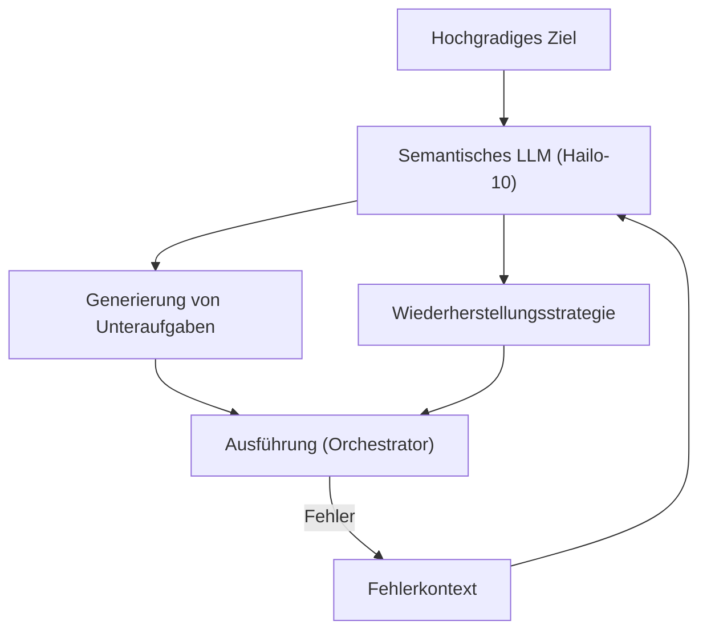

<!-- =============================================================================
HYDRA-UMC-SEMANTIC-PLANNER - Rule-based mission planner and semantic error recovery
Copyright (C) JuanenRac (Electro Hobby 3D) <electrohobby3d@gmail.com>
GPL-3.0-or-later - see LICENSE
============================================================================= -->

<p align="center">
  
</p>

# 🧭 HYDRA-UMC-SEMANTIC-PLANNER

<p align="center"><a href="README.md">🇺🇸 English</a> | <a href="README_spa.md">🇪🇸 Español</a> | <a href="README_fra.md">🇫🇷 Français</a> | <a href="README_ita.md">🇮🇹 Italiano</a> | 🇩🇪 <b>Deutsch</b> | <a href="README_zho.md">🇨🇳 简体中文</a> | <a href="README_jpn.md">🇯🇵 日本語</a> | <a href="README_por.md">🇵🇹 Português</a></p>

### 🧠 Regelbasierter Missionsplaner & Logik-Wiederherstellungssystem (LLM geplant)

<p align="center">
  
  
  
  
</p>

---

**Ehrlichkeitscheck - was heute wirklich läuft:** das geschlossene Primitiven-Vokabular (`primitives.py`), die regelbasierte Aufgabenzerlegung (`decompose.py`), die regelbasierte semantische Fehlerbehebung über eine feste MCU-Fehlercode-Tabelle (`recovery.py`), der Vorbedingungs-Validator, der einen fehlerhaft geformten Plan ablehnt statt ihn durchzulassen (`validation.py`), und die einfache JSON/HTTP-Oberfläche über `http.server` aus der Standardbibliothek über dieselbe Logik (`api.py`: `POST /decompose`, `POST /recover`, `GET /stats`) sind real und getestet (179 Tests, `pytest`), einschließlich eines Fuzz-Tests, der `decompose_goal()` gegen Hunderte zufällige/ungültige Ziele mit festem Seed laufen lässt und sicherstellt, dass es nie abstürzt oder einen fehlerhaft geformten Plan zurückgibt. Was NOCH NICHT real ist: Es gibt nirgendwo in diesem Code ein lokales LLM - `decompose.py` ist Muster-/Template-Abgleich per Regex über ein kleines, festes Zielvokabular (Zusammenbauen/Pick-and-Place/Inspizieren), kein Sprachverständnis, und es lief noch nie gegen ein echtes Hailo-10-Modul (diese Umgebung besitzt keines). Die Punkte "Agentic Workflow" und "Hailo-10 Optimized" weiter unten sind in diesem selben README ausdrücklich als `(planned)` markiert - sie beschreiben den eventuellen Ersatz für den heutigen regelbasierten Kern von `decompose_goal()`, nicht etwas, das heute existiert. Siehe `CHANGELOG.md` für genau das, was bisher ausgeliefert wurde, und die ROADMAP weiter unten für das, was noch offen ist.

**Bekannte Grenzen des regelbasierten Planers:** Ein verneintes oder abgebrochenes Ziel („nicht ...“, „nie ...“), das zu mehr als einer Vorlage passt, kein Objekt hat oder länger als 512 Zeichen ist, ergibt keinen Plan. Das Objekt wird aus den Wörtern nach dem Verb gelesen, nicht vom Satzende. Eine Zerlegung ist ein Vorschlag, kein Befehl: `POST /decompose` antwortet mit `executable: false`, einem Fingerabdruck, den geschätzten Kosten und einer verständlichen Erklärung; `POST /release` (oder `release_for_execution()`) berechnet Kosten und Erklärung aus dem Plan neu und prüft den Fingerabdruck der Freigabe, bevor etwas ausgeführt werden darf. Die Freigabe ist noch nicht signiert: Sie nennt eine Person, ist aber kein Berechtigungsnachweis. Mit `FailureContext.attempt` eskalieren die Wiederherstellungen für `TIMEOUT` und `GRIP_LOST_SEAL` nach 1 bzw. 3 automatischen Versuchen an einen Bediener.

---

> **Stand von Sicherheit (Safety) und Security:** Dieses Ökosystem ist kein zertifiziertes Sicherheitssystem. Es gibt noch keinen Hardware-E-STOP-Pfad, keine von der Firmware durchgesetzten Grenzen oder Verriegelungen und keinen verifizierten Bewegungsbefehl; Firmware-Images werden mit CRC-32 und einer Ed25519-Signatur geprüft, und ein Release-Build verweigert die veröffentlichten Entwicklungsschlüssel (die Werkzeugköpfe und Erweiterungsplatinen hinter dem Relais laufen noch mit URTC-Bootloadern, die statt einer Signatur ein HMAC-SHA256 mit gemeinsamem Schlüssel verwenden); TLS und gegenseitiges TLS sind optional und standardmäßig aus; noch keine eigene Platine wurde bestückt oder getestet. Lesen Sie die [Sicherheitsbasis](https://github.com/JuanenRac/HYDRA-UMC-DOCS/blob/main/docs/SECURITY_BASELINE.md) und das [Bedrohungsmodell](https://github.com/JuanenRac/HYDRA-UMC-DOCS/blob/main/docs/THREAT_MODEL.md), bevor Sie sich für die Sicherheit einer Person auf eine Aussage hier verlassen.

---

## 📋 Auf einen Blick

| | |
|---|---|
| Version | `0.1.5` |
| Reifegrad | Funktionsfähig |
| Tests | 179 (`python -m pytest -q tests`) |
| Technik | Python / local LLM (Llama-3 class) |
| Ziel | Der Raspberry Pi CM5 einer HYDRA-UMC-Zelle |
| Auf echter Hardware | Noch nicht: für diese Version ist kein Lauf auf echter Hardware vermerkt |

**Springe zu:** [Überblick](#-überblick) · [Architektur](#-architektur) · [Sicherheit und Schutz](#-sicherheit-und-schutz) · [Konfiguration](#-konfiguration) · [Schnellstart](#-schnellstart) · [Tests](#-tests) · [Struktur des Repositorys](#-struktur-des-repositorys) · [Verwandte Projekte](#-verwandte-projekte)

## 🚦 Projektstatus

Jede Zeile ist ein Teil dieses Repositorys, und die Ampel sagt, wie weit er heute ist. Sie beruht auf dem, was das Repository zeigen kann (Tests, Builds, Läufe), nicht auf dem, was geplant ist.

🟢 Fertig und überprüft · 🟡 Funktioniert, mit bekannten Grenzen · 🟠 Teilweise fertig oder noch nicht überprüft · 🔴 Nicht gemacht oder funktioniert nicht

| Bereich | Stand | Was das hier bedeutet |
|---|---|---|
| Software | 🟡 | Funktioniert für seinen Hauptzweck; die Ehrlichkeitsprüfung oben nennt, was noch fehlt |
| Tests | 🟢 | 179 automatische Tests, bei jeder Änderung ausgeführt |
| Echte Hardware | 🔴 | Noch nicht: für diese Version ist kein Lauf auf echter Hardware vermerkt |
| Dokumentation | 🟢 | README in acht Sprachen, bei jeder Änderung gegen das Manifest geprüft |

## 🎯 Überblick

**HYDRA-UMC-SEMANTIC-PLANNER** ist der "Logik-Orchestrator" des Cognitive AI Node. Er nutzt lokale LLMs (Large Language Models), um komplexe Ziele in ausführbare Roboter-Primitive zu zerlegen.

Er handhabt hochgradige Ambiguität und bietet eine semantische Fehlerbehebung: Wenn eine Aufgabe fehlschlägt (z. B. "Vakuumgreifer hat die Abdichtung verloren"), analysiert der Planer die Ursache und entscheidet, ob er den Druck erhöhen, es erneut versuchen oder gegen ein mechanisches Werkzeug austauschen soll.

### Hauptmerkmale:
* 🧩 **Aufgabenzerlegung (v0):** Echte, regelbasierte Zerlegung eines kleinen bekannten Zielvokabulars (z. B. "Leiterplatte montieren") in sequentielle Roboterbefehle. *(implementiert als echte Vorlagenregeln, noch kein LLM - siehe BUILD UND AUSFÜHRUNG unten)*
* 🛡️ **Semantische Wiederherstellung (v0):** Echtes, regelbasiertes Nachschlagen von strukturierten MCU-Fehlercodes zu einer Wiederherstellungsaktion. *(implementiert als echte, explizite Tabelle über ein bekanntes Codevokabular; unbekannte Codes eskalieren immer an einen Menschen)*
* ✅ **Präconditions-Validierung:** Jeder zerlegte Plan wird gegen das geprüft, was jede echte Primitive tatsächlich benötigt, bevor er weitergegeben wird - ein fehlgeschlagener Plan wird abgelehnt und niemals stillschweigend als ausführungsbereit durchgereicht. Ein optionaler, echter deklarierter Fähigkeitskatalog für das Ziel-Roboter/-Zelle (`capabilities` in `validate_plan()`/`POST /decompose`) erkennt auch einen wohlgeformten Schritt für eine Primitive, die dieser Roboter nie als unterstützt deklariert hat. *(implementiert)*
* ✅ **Greiferzustand entlang des Plans:** der Plan wird mit einem symbolischen Greifer durchlaufen (am Anfang leer): ein GRIP bei bereits gehaltenem Teil sowie ein RELEASE ohne gehaltenes Teil oder von etwas anderem als dem Gehaltenen sind Fehler des Plans an ihrem Schritt, gefunden bevor sich etwas bewegt. Ein Plan darf mit gehaltenem Ziel enden. Die Parameter eines Schritts sind schreibgeschützt und hashbar (`Params`), ein Plan lässt sich also nach dem Vorschlag nicht mehr ändern. *(implementiert)*
* 🌐 **JSON/HTTP-API (v0.0.8):** der Subbefehl `serve` stellt exakt dieselbe `decompose`/`recover`-Logik über einen stdlib-`http.server` bereit (`POST /decompose`, `POST /recover`, `GET /stats`) für Aufrufer, die nicht die CLI sind - standardmäßig nur Loopback, passend zur `systemd/hydra-umc-semantic-planner.service`-Unit. Siehe [`docs/CLI_REFERENCE.md`](docs/CLI_REFERENCE.md) für jeden echten Befehl, jedes Flag und jeden Exit-Code, und [`docs/RECOVERY_CONTRACT.md`](docs/RECOVERY_CONTRACT.md) für das vollständige öffentliche Fehlercode-Vokabular.
* 🎲 **Deterministisch und Property-getestet:** `decompose_goal()` ist nachweislich deterministisch (gleiches Ziel, gleicher Plan, immer) und wird per Fuzzing gegen Hunderte zufälliger/ungültiger Ziele getestet - stürzt nie ab, liefert nie einen fehlerhaft geformten Plan. *(implementiert)*
* 🤖 **Agentischer Workflow:** Agiert als lokaler Agent, der den Systemstatus und die Werkzeuge abfragen kann. *(geplant)*
* ⚡ **Hailo-10 optimiert:** Nutzt 40 TOPS für schnelles mehrstufiges Denken. *(geplant - benötigt das echte lokale LLM)*
* 👨‍👩‍👧 **Kind des Cognitive AI Node:** Läuft als einer von vier
  Schwesterdiensten unter [HYDRA-UMC-COGNITIVE-NODE](https://github.com/JuanenRac/HYDRA-UMC-COGNITIVE-NODE)
  (neben VLA-Engine, Voice-UI und Docs-QA) und teilt sich das
  HydraOS-Image und die Modellgewichte des Elternteils, statt eigene
  Kopien vorzuhalten.

## 🧩 Rolle in HYDRA-UMC

**HYDRA-UMC-SEMANTIC-PLANNER** macht aus einem übergeordneten Ziel einen Plan aus einem geschlossenen Vokabular von Roboter-Primitiven und schlägt eine Wiederherstellung vor, wenn ein Schritt scheitert. Heute arbeitet er regelbasiert, nicht mit einem Sprachmodell; ein Plan ist nur ein Vorschlag, bis eine benannte Person genau diesen Plan freigibt.

## 🏛️ Architektur

<p align="center">
  
</p>

<details>
<summary>Textversion des Diagramms (Mermaid)</summary>



</details>

### ARCHITEKTUR & DESIGNENTSCHEIDUNGEN

Dieses Repository ist ein **Kind** der Cognitive AI Node-Familie - sein
Elternteil, [HYDRA-UMC-COGNITIVE-NODE](https://github.com/JuanenRac/HYDRA-UMC-COGNITIVE-NODE),
besitzt das gemeinsam genutzte HydraOS-Image und die quantisierten
Modellgewichte und bindet diesen Dienst in seiner `docker-compose.yml`
neben seinen drei Geschwistern (VLA-Engine, Voice-UI, Docs-QA) ein:

* **Warum dieses Kind keine eigene Hardware/Firmware/`os/`/`models/`
  hat.** Es läuft vollständig auf dem CM5 + Hailo-10 M.2-Modul, das
  bereits dem Elternteil gehört - Modellgewichte und HydraOS-Image an
  einer zentralen Stelle zu halten vermeidet vier abweichende, mehrere
  Gigabyte große Kopien innerhalb der Familie.
* **Warum ein `src/`-Layout.** Trennt das installierbare Paket
  (`hydra_umc_semantic_planner`) vom Tooling im Repo-Root
  (`bump_version.py`) und entspricht dem Layout aller anderen
  Python-Projekte im Ökosystem.
* **Warum der Einstiegspunkt anfangs nur Identität/Version/Rolle
  ausgab.** Die Andamiaje- (Gerüst-) Phase bewies, dass sich das Paket
  auf der tatsächlichen Ziel-Python-Version sauber installieren,
  kompilieren und importieren lässt, bevor überhaupt echte LLM-basierte
  Planungs-/Wiederherstellungslogik hinzugefügt wurde, und hielt diese
  spätere Arbeit von Packaging-Fragen getrennt. `main.py` hat seitdem
  echte Unterbefehle `decompose`/`recover`/`serve` bekommen (siehe
  ERSTELLEN UND AUSFÜHREN weiter unten) - dass `run.sh` ohne Argumente
  weiterhin nur Identität/Version/Rolle ausgibt, ist beabsichtigt (ein
  schneller "wurde das Paket korrekt installiert"-Check), kein Zeichen
  dafür, dass die CLI selbst noch ein Gerüst wäre.
* **Wie sich das in den Rest des Ökosystems einfügt.** Dieser Planer ist
  der Entscheidungskern des Cognitive AI Node: Er verarbeitet die
  Absicht seines Geschwisters HYDRA-UMC-VOICE-UI und die Aktions-Token
  seines Geschwisters HYDRA-UMC-VLA-ENGINE und sendet die daraus
  resultierenden Missionsentscheidungen nachgelagert an
  HYDRA-UMC-ORCHESTRATOR zur physischen Ausführung.
* **Warum `decompose.py` echte Regex-Regeln sind, kein lokales LLM.**
  Ein kleines, echtes Zielvokabular (montieren/pick-and-place/
  inspizieren) wird heute vollständig und ehrlich durch Regeln abgedeckt
  - dieselbe Überlegung wie der echte TF-IDF-Index des Geschwisterprojekts
  HYDRA-UMC-DOCS-QA anstelle eines Embedding-Modells: ein echter,
  testbarer Kern jetzt, den ein künftiger LLM-basierter Planer hinter
  demselben `decompose_goal()`-Vertrag ersetzen kann.
* **Warum die Fehlercodes von `recovery.py` dem öffentlichen
  Wiederherstellungsvertrag entsprechen.**
  `INVALID_STATE`/`OUT_OF_RANGE`/`ESTOP_ACTIVE`/`TOOL_INCOMPATIBLE`/
  `TIMEOUT`/`UNSUPPORTED` sind die echten strukturierten Fehler, die
  dieser Adapter zurückgeben soll - eine schon heute gegen dieses echte
  Vokabular gebaute Wiederherstellungslogik bleibt gültig, sobald der
  Adapter selbst existiert, statt eine parallele Fehlertaxonomie zu
  erfinden, die später abgeglichen werden müsste.
* **Warum `ESTOP_ACTIVE`/`UNSUPPORTED`/unbekannte Codes immer an einen
  Menschen eskalieren.** Entspricht der ökosystemweiten Sicherheitsregel,
  dass KI-, UI- und Cloud-Schichten niemals eine physische
  Sicherheitsbedingung außer Kraft setzen - dieser Planer schlägt eine
  Wiederherstellungsaktion vor, er hebt niemals einen E-STOP auf und rät
  nicht bei einem Fehler, den er nicht erkennt.
* **Warum `validation.py` existiert, obwohl die echten Vorlagen von
  `decompose.py` nie tatsächlich einen ungültigen Plan erzeugen.**
  Eine feste Vorlage kann wohlgeformte Parameter allein durch ihre
  Konstruktion garantieren - ein künftiger LLM-basierter Planer kann
  das nicht. `validate_plan()` ist der echte, explizite Vertrag, den
  dieser Planer erfüllen müsste, hier und heute gegen den einzigen
  existierenden Planer geprüft, damit der Vertrag selbst als korrekt
  erwiesen ist, bevor etwas Schwierigeres ihn je erfüllen muss.
* **Warum `decompose_goal()` mit einem festen Zufalls-Seed statt mit
  `hypothesis` gefuzzt wird.** Dieses Projekt bleibt (wie der Rest des
  Ökosystems) ausschließlich bei der Standardbibliothek - eine
  reproduzierbare, mit Seed versehene `random.Random`-Schleife über
  Hunderte synthetischer Ziele liefert dieselbe echte Eigenschaft
  (stürzt nie ab, liefert nie einen fehlerhaft geformten Plan), ohne
  eine neue Abhängigkeit hinzuzufügen.

**Ein Plan als Operation.** `POST /decompose` antwortet zusätzlich mit `operation`: der Vorschlag als gemeinsame Operation des SDK (`kind` `execute_plan`, `status` `received`, `target` und `priority` der Anfrage, die Schritte, das Ziel und der Fingerabdruck in `params`; derselbe Plan ist dieselbe `operation_id`). Das ist die Form, die der Orchestrator und der Job-Dispatcher als Mission oder Job übernehmen. Sie gibt nichts frei: `executable` bleibt `false` bis `POST /release`.

## 🔒 Sicherheit und Schutz

Freigaben können signiert werden (standardmäßig aus): `serve --approval-key-file DATEI --robot-id ROBOT` lässt `POST /release` `robot_id`, `issued_at_ms`, `expires_at_ms` und eine HMAC-SHA256-`signature` über den Plan-Fingerabdruck, den Freigebenden, den Roboter und ein Zeitfenster von höchstens einer Stunde verlangen; eine unsignierte, veränderte, abgelaufene oder für einen anderen Roboter gedachte Freigabe gibt nichts frei; `sign-approval` erzeugt die Felder. Der Schlüssel (mindestens 16 Bytes) liegt in einer Datei der Installation, nie im Repository.

## ⚙️ Konfiguration

Plansimulation (standardmäßig aus): Ist in der Konfigurationsdatei `plan_simulation.enabled` auf `true` gesetzt, prüft `POST /plan/simulate` eine Schrittliste gegen deklarierte Randbedingungen (Arbeitsraumquader, Katalog der Orte, verfügbare Roboter, maximale Schritt- und Plandauer, Ressourcen, die nur ein Schritt zugleich halten darf, Reihenfolge der Abhängigkeiten, der Greifer jedes Roboters) und spielt sie auf einer simulierten Uhr durch. Die Antwort ist ein Urteil, das JEDE verletzte Regel mit Schritt, Wert und Grenze auflistet und, wo sich eines ergibt, einen deterministischen Korrekturvorschlag; sie führt nie etwas aus und gibt nie etwas frei, und eine nicht verständliche Eingabe ergibt 400, nie ein „akzeptiert“. Bei ausgeschaltetem Schalter antwortet die Route wie zuvor mit 404. Siehe `docs/PLAN_SIMULATION.md`.

## 🚀 Schnellstart

Benötigt Python 3.10 oder neuer.

```bash
./build.sh  # Linux, macOS (build.bat on Windows)
./run.sh decompose "assemble the pcb"
./run.sh recover --component gripper --error-code TIMEOUT
./run.sh serve --port 8110
```

## 🧪 Tests

179 automatische Tests laufen mit `python -m pytest -q tests`. Sie brauchen weder Hardware noch etwas außerhalb dieses Rechners.

Die CI führt `HYDRA_UMC_CI=1 python tools/ci_validate.py` aus; das prüft das Manifest, die Dokumente, die acht READMEs und die Bilder.

## 🏗️ Build und Veröffentlichung

Erfordert Python >= 3.10.

```bash
# Linux / macOS / Git Bash
./build.sh   # erstellt .venv, installiert das Paket (editable), prüft den Import
./run.sh     # führt den Einstiegspunkt aus

# Windows (cmd)
build.bat
run.bat
```

`build.sh`/`build.bat` ändern die Version nie (nur `python tools/hydra_project_tool.py bump` erhöht sie) und führen die echte Testsuite
aus (`pytest tests/`). Erwartete Ausgabe eines `run.sh` ohne Argumente:

```text
HYDRA-UMC-SEMANTIC-PLANNER v0.1.5
Semantic Planner (Hailo-10) - decomposes high-level goals into robotic primitives and recovers from execution failures.
```

Die echten Subcommands zerlegen ein Ziel oder schlagen eine
Wiederherstellung vor:

```bash
./run.sh decompose "assemble the pcb"
./run.sh recover --component gripper --error-code GRIP_LOST_SEAL --detail "vacuum gripper lost seal"

# Windows
run.bat decompose "assemble the pcb"
run.bat recover --component gripper --error-code GRIP_LOST_SEAL --detail "vacuum gripper lost seal"
```

Jeder echte zerlegte Plan wird vor der Ausgabe gegen die echten
Präconditions von `validation.py` geprüft. Die eigenen Vorlagen von
`decompose.py` bestehen immer; ein fehlgeschlagener Plan würde
stattdessen abgelehnt:

```text
Plan for: "broken" FAILED precondition validation:
  step 1 (GRIP): missing required param 'target'
```

Dieselbe `decompose`/`recover`-Logik ist auch über HTTP erreichbar, für Aufrufer, die nicht die CLI sind:

```bash
./run.sh serve --addr 127.0.0.1 --port 8109
# in einem anderen Terminal:
curl -s -X POST http://127.0.0.1:8109/decompose -d '{"goal": "assemble the pcb"}'
```

Siehe [`docs/CLI_REFERENCE.md`](docs/CLI_REFERENCE.md) für die vollständige Befehls-/Flag-/Exit-Code-Referenz, und [`docs/RECOVERY_CONTRACT.md`](docs/RECOVERY_CONTRACT.md) für das öffentliche Vokabular der Recovery-Fehlercodes.

### 🩺 Fehlerbehebung

* **`python: Befehl nicht gefunden` / der Build schlägt bei Schritt 1
  fehl.** Erfordert Python >= 3.10 im `PATH`. Unter Windows von
  [python.org](https://python.org) installieren und bei der Installation
  "Add to PATH" ankreuzen; unter Linux/macOS heißt es meist `python3`.
* **`build.sh` kann das venv nicht aktivieren.** `python3 -m venv .venv`
  legt das Aktivierungsskript je nach Plattform an anderer Stelle ab:
  `.venv/bin/activate` unter Linux/macOS, `.venv/Scripts/activate` unter
  Windows (auch bei einem Windows-Python-venv, das aus Git Bash heraus
  verwendet wird). `build.sh` prüft bereits beide Pfade - schlägt es
  weiterhin fehl, `.venv/` löschen und `./build.sh` erneut ausführen, um
  es von Grund auf neu zu erstellen.
* **`pip install -e .` schlägt fehl.** Meist wegen eines veralteten
  `.venv/`. Den Ordner `.venv/` löschen und `./build.sh`/`build.bat`
  erneut ausführen, um ihn neu zu erstellen.
* **`import OK` erscheint nie.** Bedeutet, dass `python -c "import
  hydra_umc_semantic_planner"` selbst fehlgeschlagen ist - mit aktivem
  venv erneut ausführen, um den echten Traceback zu sehen.

## 📂 Struktur des Repositorys

<p align="center">
  
</p>

<details>
<summary>Textversion des Baums</summary>

```text
HYDRA-UMC-SEMANTIC-PLANNER/
├── src/hydra_umc_semantic_planner/   Quellcode
│   ├── __init__.py                   Paketbeschreibung und Version
│   ├── primitives.py                 Echtes geschlossenes Vokabular von Roboter-Befehlsprimitiven
│   ├── decompose.py                  Echte regelbasierte Aufgabenzerlegung
│   ├── recovery.py                   Echte regelbasierte semantische Fehlerwiederherstellung
│   ├── validation.py                 Echte Präconditions-Validierung über einen zerlegten Plan
│   ├── api.py                        Einfache JSON/HTTP-Oberfläche (stdlib http.server) über decompose/recover
│   ├── main.py                       Einstiegspunkt + echte Subcommands `decompose`/`recover`
│   └── approval.py                   Was gelten muss, bevor ein Plan eine ausführende Schicht erreichen darf
├── tests/                            Echte Tests: Zerlegung, Wiederherstellung, Validierung, api, Property-Tests, End-to-End-CLI
├── docs/                             Dokumentation und Wissensdatenbank
├── images/                           Medien und Diagramme
├── configs/                          Konfiguration der Wiederherstellungsrichtlinie
├── systemd/                          Dienst-Unit
├── tools/                            Projektwerkzeuge und CI-Prüfungen
├── .github/                          CI-Workflow und Issue-Vorlagen
├── pyproject.toml                    Paketmetadaten
├── bump_version.py                   ausdrückliche Versionserhöhung
├── bump_manifest_version.py          Synchronisiert die Version von hydra-umc.project.json mit der nativen (--sync)
├── build.sh / build.bat              Erstellt das venv, installiert (mit Dev-Extras), führt Tests aus, prüft den Import
├── run.sh / run.bat                  Führt den Einstiegspunkt aus (leitet Argumente weiter, z. B. `decompose`)
├── CHANGELOG.md                      was sich in jeder Version geändert hat
├── Dockerfile                        Container-Image
├── build-test.sh                     Build-Prüfung ohne Änderungen
├── hydra-umc.project.json            Manifest: Version, Reifegrad, Familie
└── test.sh                           führt die Tests aus
```

</details>

## 🗺️ Roadmap und bekannte Grenzen

**Bekannte Grenzen heute**

* **Phase 1:** VLA-Engine-Bereitstellung und multimodale Eingabeverarbeitung auf Hailo-10.
* **Phase 2:** Integration des semantischen Planers mit Schwarmverhaltensmodellen und Langzeitgedächtnis.
* **Phase 3:** Lokale Ausführung der Voice-UI mit niedriger Latenz und industrielle Geräuschunterdrückung.
* **Phase 4:** Multi-Agenten-Koordination für die Zerlegung gemeinsamer Ziele und Optimierung der semantischen Wiederherstellung.

## 🌍 Sprachen

Diese README und die Dokumente des Repositorys gibt es in acht Sprachen: Englisch, Spanisch, Deutsch, Französisch, Italienisch, Japanisch, Chinesisch und Portugiesisch (Portugal). Sie entstehen gemeinsam, und die CI prüft, dass die acht Dateien dieselben Abschnitte und dieselben Links haben. Dieses Repository hat weder eine eigene Oberfläche noch einen eigenen Meldungskatalog, es gibt also keine Oberflächentexte zu übersetzen.

## 🔗 Verwandte Projekte

Dieses Projekt ist Teil des HYDRA-UMC-Robotik-Ökosystems desselben Autors (JuanenRac / Electro Hobby 3D). Gut zu wissen, da eine Anfrage eigentlich eines dieser Projekte betreffen könnte statt dieses Repositorys.

**Übergeordnetes Projekt**
- **[HYDRA-UMC-COGNITIVE-NODE](https://github.com/JuanenRac/HYDRA-UMC-COGNITIVE-NODE)** — Integrationsknoten für die Hailo-10-Cognitive-Pipeline (LLM-/VLA-/Sprach-Orchestrierung); das übergeordnete Projekt, dessen spezifische Stufe bzw. Verbraucher dieses Repository innerhalb seiner eigenen Cognitive-Pipeline ist.

**Geschwisterprojekte** — die übrigen Stufen/Verbraucher der eigenen Hailo-10-Cognitive-Pipeline von HYDRA-UMC-COGNITIVE-NODE
- **[HYDRA-UMC-VOICE-UI](https://github.com/JuanenRac/HYDRA-UMC-VOICE-UI)** — echtes Sprach-Frontend (VAD + Intent-Parser) mit einem begrenzten, bestätigungsgesicherten Watch-Relay.
- **[HYDRA-UMC-VLA-ENGINE](https://github.com/JuanenRac/HYDRA-UMC-VLA-ENGINE)** — echte Aktions-Token-Kodierung/-Dekodierung und Trajektoriengenerierung für ein Vision-Language-Action-Modell.
- **[HYDRA-UMC-DOCS-QA](https://github.com/JuanenRac/HYDRA-UMC-DOCS-QA)** — echte, nur auf der Standardbibliothek basierende TF-IDF-Dokumentensuche über die eigenen Markdown-Dokumente dieses Ökosystems.
- **[HYDRA-UMC-LOCAL-TECHNICIAN](https://github.com/JuanenRac/HYDRA-UMC-LOCAL-TECHNICIAN)** — lokaler, richtlinien-gesteuerter KI-Wartungstechniker für das Ökosystem selbst - beobachtet, diagnostiziert und schlägt Korrekturen vor; die zwei höchsten Risikostufen sind absichtlich noch nicht implementiert.

**Direkt verwandt**
- **[HYDRA-UMC-ORCHESTRATOR](https://github.com/JuanenRac/HYDRA-UMC-ORCHESTRATOR)** — Integrationsknoten mit einem echten gRPC/Protobuf-Health-Report-Vertrag und einer Missions-Zustandsmaschine; empfängt die eigenen Missionsentscheidungen dieses Planers.

**Ebenfalls Teil des Ökosystems**

*Kern-Hardware & Plattform*
- **[HYDRA-UMC](https://github.com/JuanenRac/HYDRA-UMC)** — der Entwurf des Motherboards des Roboterarms: CM5-Host + Dual-Core-STM32H745, gedacht zur Koordination von bis zu 8 Werkzeugarmen über CAN-OTA/SPI-OTA (Firmware in einer frühen Phase; noch keine bestückte Platine).
- **[HYDRA-UMC-OS](https://github.com/JuanenRac/HYDRA-UMC-OS)** — reproduzierbare Raspberry-Pi-OS-Produktschicht für den CM5: schreibgeschützter Agent, validierte Konfiguration/Profile, WiFi-Ersteinrichtung.
- **[HYDRA-UMC-SDK](https://github.com/JuanenRac/HYDRA-UMC-SDK)** — der gemeinsame JSON-Schema-Vertrag und die Software-Auftragsschranke, gegen die jede Bridge ihre Befehle validiert (keine zertifizierte Sicherheitsfunktion).
- **[HYDRA-UMC-CONNECTOR-HUB](https://github.com/JuanenRac/HYDRA-UMC-CONNECTOR-HUB)** — deklaratives Adapter-Manifest-Register und Validator für Konnektoren externer Maschinen; erweitert die eigene Vertragsidee des SDK auf externe Maschinen, ohne die Industrie-Gateway-Projekte zu ersetzen.

*Kern-Backend & Clients*
- **[HYDRA-UMC-SERVER](https://github.com/JuanenRac/HYDRA-UMC-SERVER)** — das reale Headless-Backend (REST/WebSocket), mit dem jeder Steuerungsclient tatsächlich spricht.
- **[HYDRA-UMC-STUDIO](https://github.com/JuanenRac/HYDRA-UMC-STUDIO)** — Web-Steuerungs-Dashboard mit Echtzeit-3D-Visualisierung mehrerer Roboter.
- **[HYDRA-UMC-SUITE](https://github.com/JuanenRac/HYDRA-UMC-SUITE)** — Desktop-Schwarmleitstand (PySide6) für mehrere Server gleichzeitig, verpackt als eigenständige ausführbare Datei.
- **[HYDRA-UMC-ANDROID-CONTROL](https://github.com/JuanenRac/HYDRA-UMC-ANDROID-CONTROL)** — native Android-Steuerungs-App mit biometrischem Login und einer gekoppelten Wear-OS-Begleit-App.
- **[HYDRA-UMC-IOS-CONTROL](https://github.com/JuanenRac/HYDRA-UMC-IOS-CONTROL)** — iOS/iPadOS-Steuerungs-App (Flutter) mit Echtzeit-WebSocket-Synchronisierung.
- **[HYDRA-UMC-DSI](https://github.com/JuanenRac/HYDRA-UMC-DSI)** — native Touch-UI für das eingebaute 7"-DSI-Touchscreen, direkt auf dem CM5 eingebettet.
- **[HYDRA-UMC-EDITOR-URDF](https://github.com/JuanenRac/HYDRA-UMC-EDITOR-URDF)** — grafischer Desktop-URDF-Ersteller/-Editor, der fertige Modelle in STUDIOs eigenen Katalog überträgt.
- **[HYDRA-UMC-EDITOR-STL](https://github.com/JuanenRac/HYDRA-UMC-EDITOR-STL)** — Desktop-STL-Modelleditor, der echte Teile im selben Modellkatalog transformiert/ersetzt/entfernt/hinzufügt, den auch HYDRA-UMC-EDITOR-URDF bearbeitet.
- **[HYDRA-UMC-BRIDGE-AMR](https://github.com/JuanenRac/HYDRA-UMC-BRIDGE-AMR)** — Koordinationsschranke für AGV-/AMR-Flotten über einen VDA-5050-MQTT-Publisher (nur gegen eine emulierte Flotte getestet).
- **[HYDRA-UMC-BRIDGE-CNC](https://github.com/JuanenRac/HYDRA-UMC-BRIDGE-CNC)** — High-Level-Koordinator für CNC-Zellen mit GRBL-Status-/Steuerbyte-Zugriff (nur gegen einen Emulator getestet).
- **[HYDRA-UMC-BRIDGE-DROIDS](https://github.com/JuanenRac/HYDRA-UMC-BRIDGE-DROIDS)** — Koordinationsschranke für laufende/humanoide Droiden, mit einem Boston-Dynamics-Spot-Befehlssender (nur gegen einen Emulator getestet).
- **[HYDRA-UMC-BRIDGE-LASER](https://github.com/JuanenRac/HYDRA-UMC-BRIDGE-LASER)** — Koordinator für Laserzellen, liest 3 Schlüssel-/Gehäuse-/Verriegelungs-GPIO-Signale (nur gegen einen simulierten Chip getestet; kann keinen Laser scharfschalten oder auslösen).
- **[HYDRA-UMC-BRIDGE-OPENPNP](https://github.com/JuanenRac/HYDRA-UMC-BRIDGE-OPENPNP)** — sicherer High-Level-Koordinator für den Leiterplattenfluss von OpenPnP Pick-and-Place.
- **[HYDRA-UMC-BRIDGE-PRINTER3D](https://github.com/JuanenRac/HYDRA-UMC-BRIDGE-PRINTER3D)** — sichere Koordinationsschranke für Moonraker/Klipper-3D-Drucker, mit echten gesicherten Job-Befehlen.
- **[HYDRA-UMC-BRIDGE-ROS2](https://github.com/JuanenRac/HYDRA-UMC-BRIDGE-ROS2)** — Koordinator mit einem träge importierten rclpy-ROS-2-Transport (noch nicht gegen eine ROS-2-Installation ausgeführt).
- **[HYDRA-UMC-BRIDGE-UAV](https://github.com/JuanenRac/HYDRA-UMC-BRIDGE-UAV)** — Koordinationsschranke für kameraausgestattete UAVs, mit einem MAVLink-Befehlssender (nur gegen einen Emulator getestet).

*URTC-Werkzeugplattform*
- **[URTC](https://github.com/JuanenRac/URTC)** — Firmware für die physische Universal-Robot-Tool-Controller-Platine, 25+ Werkzeugprofile über CAN-Bus.
- **[URTC-FLASHER](https://github.com/JuanenRac/URTC-FLASHER)** — Desktop-GUI-Flash-Tool für URTC-Platinen, CAN-OTA plus Full-Chip-SWD/JTAG.
- **[URTC-TESTER](https://github.com/JuanenRac/URTC-TESTER)** — Desktop-Live-CAN-Bus-Diagnosetool für URTC-Platinen, ein Panel pro Werkzeugprofil.
- **[URTC-WEB-STUDIO](https://github.com/JuanenRac/URTC-WEB-STUDIO)** — browserbasierte Alternative zu URTC-TESTER über die Web-Serial-API, ohne lokale Installation.
- **[URTC-GATEWAY](https://github.com/JuanenRac/URTC-GATEWAY)** — Gateway vor dem CAN-Bus von URTC: Liste erlaubter Kennungen, Ratenbegrenzung und Sitzungsschlüssel; Software auf dem Computer getestet, noch nicht an einem echten Bus.

*Vision-KI-Knoten (Hailo-8)*
- **[HYDRA-UMC-VISION-NODE](https://github.com/JuanenRac/HYDRA-UMC-VISION-NODE)** — Integrationsknoten für die Hailo-8-Vision-Pipeline, mit einer echten stufenweisen Hardware-Bereitschaftsprüfung.
- **[HYDRA-UMC-DETECTION-HEF](https://github.com/JuanenRac/HYDRA-UMC-DETECTION-HEF)** — echte Registry für kompilierte Modelle mit Hailo-Architektur-/Prüfsummen-Safe-Load-Verifizierung.
- **[HYDRA-UMC-VISION-STREAMER](https://github.com/JuanenRac/HYDRA-UMC-VISION-STREAMER)** — echter GStreamer-Pipeline- + MediaMTX-Konfigurationsgenerator mit einer echten HailoRT-Integrationsschranke.
- **[HYDRA-UMC-VISUAL-SERVOING-API](https://github.com/JuanenRac/HYDRA-UMC-VISUAL-SERVOING-API)** — Position-Based-Visual-Servoing-Korrekturgesetz mit Freigabe abhängig vom Zonenstatus; noch keine Posenschätzung per Kamera.
- **[HYDRA-UMC-SAFETY-ZONES](https://github.com/JuanenRac/HYDRA-UMC-SAFETY-ZONES)** — v0-Logik für Zonenverletzung, Kalibrierungsaktualität und E-STOP-Anforderung, die Objektpositionen aus einer Datei nimmt; kein Detektor speist sie, und noch kein physischer E-STOP ist angeschlossen.

*Orchestrierung & Schwarm*
- **[HYDRA-UMC-JOB-DISPATCHER](https://github.com/JuanenRac/HYDRA-UMC-JOB-DISPATCHER)** — echte prioritätsbasierte Job-Queue mit Deduplizierung, über eine echte HTTP-API.
- **[HYDRA-UMC-NODE-HEALING](https://github.com/JuanenRac/HYDRA-UMC-NODE-HEALING)** — echter gRPC-basierter Flotten-Health-Watchdog mit Retry/Backoff und Identitäts-Mismatch-Erkennung.
- **[HYDRA-UMC-PATH-PLANNER-3D](https://github.com/JuanenRac/HYDRA-UMC-PATH-PLANNER-3D)** — echter RRT-basierter 3D-Pfadplaner mit echter Hindernis-/Arbeitsraum-Kollisionsvalidierung.
- **[HYDRA-UMC-SWARM-SYNC](https://github.com/JuanenRac/HYDRA-UMC-SWARM-SYNC)** — echte CRDT-LWW-Element-Map-Zustandssynchronisation, eigenschaftsgetestet auf Multi-Zellen-Konvergenz.

*Digitaler Zwilling & Simulation*
- **[HYDRA-UMC-TWIN](https://github.com/JuanenRac/HYDRA-UMC-TWIN)** — Integrationsknoten für die Digital-Twin-Engine, mit einem echten Versionskompatibilitäts-Sync-Vertrag.
- **[HYDRA-UMC-HIL-BRIDGE](https://github.com/JuanenRac/HYDRA-UMC-HIL-BRIDGE)** — Hardware-in-the-Loop-Router mit einer Software-Kollisionsverriegelung zwischen Simulation und echter Hardware (ohne echte Hardware getestet).
- **[HYDRA-UMC-PHYSICS-REPLICA](https://github.com/JuanenRac/HYDRA-UMC-PHYSICS-REPLICA)** — echte Vorwärtskinematik und Gelenkgrenzenvalidierung über eine echte URDF-Teilmenge.
- **[HYDRA-UMC-SYNTHETIC-DATA-GEN](https://github.com/JuanenRac/HYDRA-UMC-SYNTHETIC-DATA-GEN)** — echter prozeduraler 2D-Szenengenerator mit YOLO/COCO-Annotationsexport.

*Daten & Analytik*
- **[HYDRA-UMC-DATALAKE](https://github.com/JuanenRac/HYDRA-UMC-DATALAKE)** — echter sqlite3-gestützter Zeitreihenspeicher mit einer echten Ingest-/Abfrage-HTTP-API.
- **[HYDRA-UMC-ANOMALY-DETECTOR](https://github.com/JuanenRac/HYDRA-UMC-ANOMALY-DETECTOR)** — echter FFT- + statistischer Basislinien-Anomaliedetektor mit Drift-Überwachung.
- **[HYDRA-UMC-PRODUCTION-REPORTS](https://github.com/JuanenRac/HYDRA-UMC-PRODUCTION-REPORTS)** — echte OEE-/Verfügbarkeitsberechnung über den DATALAKE-Verlauf, mit reproduzierbarem CSV-Export.
- **[HYDRA-UMC-TELEMETRY-COLLECTOR](https://github.com/JuanenRac/HYDRA-UMC-TELEMETRY-COLLECTOR)** — echte CAN/WebSocket-Ingestion-Pipeline in DATALAKE, mit Sequenz-Deduplizierung.

*Industrie-Gateway*
- **[HYDRA-UMC-GATEWAY-INDUSTRIAL](https://github.com/JuanenRac/HYDRA-UMC-GATEWAY-INDUSTRIAL)** — Integrationsknoten, der zu Industrieprotokollen weiterleitet, mit einer echten Befehls-Allowlist-/Backpressure-Schicht.
- **[HYDRA-UMC-OPCUA-SERVER](https://github.com/JuanenRac/HYDRA-UMC-OPCUA-SERVER)** — echter OPC-UA-Adressraum, verifiziert mit einer echten Binärprotokoll-Client-Session.
- **[HYDRA-UMC-MQTT-BROKER](https://github.com/JuanenRac/HYDRA-UMC-MQTT-BROKER)** — echter MQTT-Broker mit optionaler Pro-Client-Authentifizierung und Topic-ACLs.
- **[HYDRA-UMC-MTCONNECT-ADAPTER](https://github.com/JuanenRac/HYDRA-UMC-MTCONNECT-ADAPTER)** — echte MTConnect-`/probe`- und `/current`-XML-Endpunkte mit Degraded-Mode-Ausgabe.

*Ergänzende Tools & Ökosystembetrieb*
- **[HYDRA-UMC-DASHBOARD-AI](https://github.com/JuanenRac/HYDRA-UMC-DASHBOARD-AI)** — Smart-Summaries- und Anomaly-Highlighting-Panels über DATALAKE/ANOMALY-DETECTOR, mit einem ehrlichen statistischen Fallback.
- **[HYDRA-UMC-TOOL-CLI](https://github.com/JuanenRac/HYDRA-UMC-TOOL-CLI)** — Flotten-CLI mit einem echten, stabilen Exit-Code-Vertrag, ein echter Live-Client der eigenen API von HYDRA-UMC-SERVER.
- **[HYDRA-UMC-WATCH](https://github.com/JuanenRac/HYDRA-UMC-WATCH)** — WearOS-Begleit-App mit haptischen Alarmmustern und einem Sprach-Relay zum gekoppelten Telefon (noch nicht auf einer physischen Uhr ausgeführt).
- **[URTC-SMART-RACK](https://github.com/JuanenRac/URTC-SMART-RACK)** — Firmware für ein Platinenmontagegestell mit echter Werkzeug-ID-Dekodierung und Smart-Idle-Vorheizlogik.
- **[URTC-VISION-TOOL](https://github.com/JuanenRac/URTC-VISION-TOOL)** — Firmware plus ein echter Python-Vision-Begleiter für einen Thermal-/RGB-Inspektionswerkzeugkopf.
- **[HYDRA-UMC-UPDATER](https://github.com/JuanenRac/HYDRA-UMC-UPDATER)** — administratives Desktop-Tool, das jedes Repository in diesem Ökosystem entdeckt, klont und aktualisiert.
- **[HYDRA-UMC-OS-REBUILDER](https://github.com/JuanenRac/HYDRA-UMC-OS-REBUILDER)** — Windows/Linux-Desktop-Tool, das ein flashbereites CM5-Image baut, vorgeladen mit den aktuellsten Versionen des Ökosystems, mit Ersteinrichtungs-Konfiguration für WLAN/Benutzer/SSH im Stil von Raspberry Pi Imager.
- **[HYDRA-UMC-OPS-AGENT](https://github.com/JuanenRac/HYDRA-UMC-OPS-AGENT)** — Wartungsvorfall-Koordinator: eine Edge-Rolle mit niedrigem Privileg sammelt einen bereinigten Inventar-/Gesundheits-Snapshot, eine Control-Plane-Rolle rendert ihn schreibgeschützt und bittet einen KI-Anbieter um einen Diagnosevorschlag - wendet nie einen Patch an und stellt nie etwas bereit.
- **[HYDRA-UMC-DEV-SERVER](https://github.com/JuanenRac/HYDRA-UMC-DEV-SERVER)** — reproduzierbarer Entwicklungshost (Raspberry Pi 5 / CM5), der den Quellcode des Ökosystems vorhält und begrenzte Build-/Test-Aufgaben über eine dauerhafte Warteschlange ausführt; eine dedizierte Entwicklerrolle, ausdrücklich kein operativer CM5.

## 📚 Dokumentation

Hier steht mehr:

* [Sicherheitsgrundlage des Ökosystems](https://github.com/JuanenRac/HYDRA-UMC-DOCS/blob/main/docs/SECURITY_BASELINE.md)
* [Bedrohungsmodell des Ökosystems](https://github.com/JuanenRac/HYDRA-UMC-DOCS/blob/main/docs/THREAT_MODEL.md)
* [Änderungsprotokoll dieses Repositorys](CHANGELOG.md)
* [Lizenz dieses Repositorys](LICENSE.md)

## 🤝 Mitwirken und Community

* Führe vor einem Pull Request `HYDRA_UMC_CI=1 py -3 tools/ci_validate.py` (oder `HYDRA_UMC_CI=1 python3 tools/ci_validate.py`) aus: Es muss `CI_VALIDATION=PASS` ausgeben. Führe dafür nicht `build.sh` oder `build.bat` aus; Bauen ist keine Prüfung.
* Die acht READMEs entstehen aus einer einzigen Quelle in HYDRA-UMC-DOCS; bearbeite sie nicht von Hand. Ändere die Quelle und schreibe sie mit `tools/make_readmes.py` neu.
* Behaupte in einer README nichts, was nicht gelaufen ist: Schreibe „simuliert“ oder „nicht auf Hardware erprobt“, wo das stimmt.
* Siehe [CONTRIBUTING.md](CONTRIBUTING.md), den [Verhaltenskodex](CODE_OF_CONDUCT.md), [SECURITY.md](SECURITY.md) und [SUPPORT.md](SUPPORT.md).

## 👤 AUTOR

**JuanenRac (Electro Hobby 3D)** · electrohobby3d@gmail.com

## 📜 LIZENZ

GPL-3.0-or-later - [LICENSE](LICENSE).
