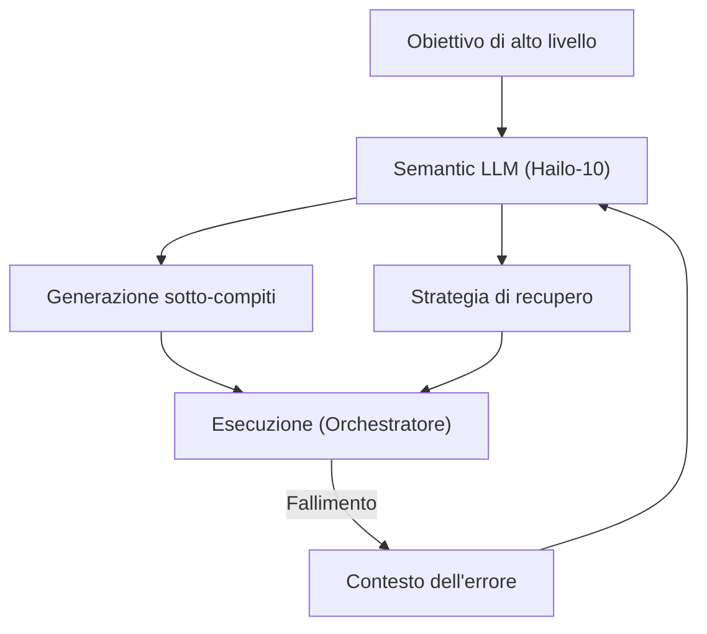

<!-- =============================================================================
HYDRA-UMC-SEMANTIC-PLANNER - Rule-based mission planner and semantic error recovery
Copyright (C) JuanenRac (Electro Hobby 3D) <electrohobby3d@gmail.com>
GPL-3.0-or-later - see LICENSE
============================================================================= -->

<p align="center">
  
</p>

# 🧭 HYDRA-UMC-SEMANTIC-PLANNER

<p align="center"><a href="README.md">🇺🇸 English</a> | <a href="README_spa.md">🇪🇸 Español</a> | <a href="README_fra.md">🇫🇷 Français</a> | 🇮🇹 <b>Italiano</b> | <a href="README_deu.md">🇩🇪 Deutsch</a> | <a href="README_zho.md">🇨🇳 简体中文</a> | <a href="README_jpn.md">🇯🇵 日本語</a> | <a href="README_por.md">🇵🇹 Português</a></p>

### 🧠 Pianificatore di missioni basato su regole e sistema di recupero logico (LLM previsto)

<p align="center">
  
  
  
  
</p>

---

**Verifica di onestà - cosa funziona davvero oggi:** il vocabolario chiuso di primitive (`primitives.py`), la scomposizione dei task basata su regole (`decompose.py`), il recupero semantico degli errori basato su regole su una tabella fissa di codici di errore MCU (`recovery.py`), il validatore delle precondizioni che rifiuta un piano mal formato invece di lasciarlo passare (`validation.py`), e la superficie JSON/HTTP con `http.server` della stdlib sulla stessa logica (`api.py`: `POST /decompose`, `POST /recover`, `GET /stats`) sono reali e testati (59 test, `pytest`), incluso un test di fuzzing che esegue `decompose_goal()` contro centinaia di obiettivi casuali/non validi con un seed fisso e verifica che non vada mai in crash né restituisca un piano mal formato. Ciò che NON è ancora reale: non esiste alcun LLM locale in nessuna parte di questo codice - `decompose.py` è corrispondenza di pattern/template regex su un piccolo vocabolario fisso di obiettivi (assemblare/pick-and-place/ispezionare), non comprensione del linguaggio, e non è mai stato eseguito contro un vero modulo Hailo-10 (questo ambiente non ne possiede uno). I punti "Agentic Workflow" e "Hailo-10 Optimized" più sotto sono esplicitamente contrassegnati come `(planned)` in questo stesso README - descrivono l'eventuale sostituzione dell'attuale nucleo basato su regole di `decompose_goal()`, non qualcosa che esiste oggi. Vedi `CHANGELOG.md` per ciò che è stato consegnato finora esattamente, e la TABELLA DI MARCIA più sotto per ciò che resta aperto.

**Limiti noti del pianificatore a regole:** un obiettivo negato o annullato («non ...», «mai ...»), che corrisponde a più di un modello, senza oggetto o più lungo di 512 caratteri non produce alcun piano. L'oggetto è letto dalle parole che seguono il verbo, non dalla fine della frase. Una scomposizione è una proposta, non un ordine: `POST /decompose` risponde `executable: false` con un'impronta, il costo stimato e una spiegazione leggibile, e `POST /release` (o `release_for_execution()`) ricalcola costo e spiegazione dal piano e verifica l'impronta dell'approvazione prima che qualcosa possa essere eseguito. L'approvazione non è ancora firmata: nomina una persona ma non è una credenziale. `FailureContext.attempt` fa sì che i recuperi di `TIMEOUT` e `GRIP_LOST_SEAL` passino a un operatore dopo 1 e 3 tentativi automatici.

---

> **Stato di sicurezza (safety e security):** questo ecosistema non è un sistema di sicurezza certificato. Non esiste ancora un percorso E-STOP hardware, né limiti o interblocchi imposti dal firmware, né un comando di movimento verificato; le immagini firmware sono controllate con CRC-32 e una firma Ed25519, e una compilazione di rilascio rifiuta le chiavi di sviluppo pubblicate (le teste utensile e le schede di espansione dietro il relè usano ancora i bootloader di URTC, che accettano un HMAC-SHA256 a chiave condivisa invece di una firma); TLS e TLS reciproco sono opzionali e disattivati per impostazione predefinita; nessuna scheda propria è stata ancora assemblata o provata. Leggi la [base di sicurezza](https://github.com/JuanenRac/HYDRA-UMC-DOCS/blob/main/docs/SECURITY_BASELINE.md) e il [modello delle minacce](https://github.com/JuanenRac/HYDRA-UMC-DOCS/blob/main/docs/THREAT_MODEL.md) prima di fidarti di qualsiasi affermazione qui per la sicurezza di una persona.

---

## 📋 In breve

| | |
|---|---|
| Versione | `0.1.5` |
| Maturità | Funzionale |
| Test | 179 (`python -m pytest -q tests`) |
| Tecnologia | Python / local LLM (Llama-3 class) |
| Destinazione | Il Raspberry Pi CM5 di una cella HYDRA-UMC |
| Su hardware reale | Non ancora: per questa versione non risulta alcuna esecuzione su hardware reale |

**Vai a:** [Panoramica](#-panoramica) · [Architettura](#-architettura) · [Sicurezza e protezione](#-sicurezza-e-protezione) · [Configurazione](#-configurazione) · [Avvio rapido](#-avvio-rapido) · [Test](#-test) · [Struttura del repository](#-struttura-del-repository) · [Progetti correlati](#-progetti-correlati)

## 🚦 Stato del progetto

Ogni riga è una parte di questo repository e il semaforo dice a che punto è oggi. È scritta in base a ciò che il repository può mostrare (test, compilazioni, esecuzioni), non a ciò che è previsto.

🟢 Fatto e verificato · 🟡 Funziona, con limiti noti · 🟠 Fatto a metà o non ancora verificato · 🔴 Non fatto o non funzionante

| Area | Stato | Cosa significa qui |
|---|---|---|
| Software | 🟡 | Funziona per il suo scopo principale; la verifica di onestà qui sopra elenca ciò che manca ancora |
| Test | 🟢 | 179 test automatici, eseguiti a ogni modifica |
| Hardware reale | 🔴 | Non ancora: per questa versione non risulta alcuna esecuzione su hardware reale |
| Documentazione | 🟢 | README in otto lingue, verificato rispetto al manifesto a ogni modifica |

## 🎯 Panoramica

**HYDRA-UMC-SEMANTIC-PLANNER** è l'«orchestratore logico» del Cognitive AI Node. Utilizza LLM (Large Language Models) locali per decomporre obiettivi complessi in primitive robotiche azionabili.

Gestisce l'ambiguità di alto livello e fornisce il recupero semantico degli errori: se un compito fallisce (ad esempio, «la pinza a vuoto ha perso la tenuta»), il pianificatore ragiona sulla causa e decide se aumentare la pressione, riprovare o passare a uno strumento meccanico.

### Caratteristiche principali:
* 🧩 **Decomposizione dei compiti (v0):** Scomposizione reale basata su regole di un piccolo vocabolario di obiettivi noti (es. «assemblare PCB») in comandi robotici sequenziali. *(implementato come vere regole a modello - non ancora un LLM; vedi BUILD ED ESECUZIONE sotto)*
* 🛡️ **Recupero semantico (v0):** Ricerca reale basata su regole da codici di errore MCU strutturati a un'azione di recupero. *(implementato come una vera tabella esplicita su un vocabolario di codici noto; i codici sconosciuti passano sempre a un umano)*
* ✅ **Validazione delle precondizioni:** Ogni piano decomposto viene verificato rispetto a ciò di cui ogni primitiva reale ha realmente bisogno prima di essere consegnato - un piano che fallisce viene rifiutato, mai passato silenziosamente come pronto per l'esecuzione. Un catalogo opzionale e reale di capacità dichiarate per il robot/cella target (`capabilities` in `validate_plan()`/`POST /decompose`) rileva anche uno step ben formato per una primitiva che quel robot non ha mai dichiarato di supportare. *(implementato)*
* ✅ **Stato della pinza lungo il piano:** il piano viene percorso con una pinza simbolica (vuota all'inizio): un GRIP mentre tiene già qualcosa, e un RELEASE senza nulla in mano o di qualcosa di diverso da ciò che si tiene, sono errori del piano al loro passo, trovati prima che qualcosa si muova. Un piano può finire tenendo il proprio bersaglio. I parametri di un passo sono di sola lettura e hashabili (`Params`): un piano non si può modificare dopo essere stato proposto. *(implementato)*
* 🌐 **API JSON/HTTP (v0.0.8):** il sottocomando `serve` espone la stessa identica logica di `decompose`/`recover` su un `http.server` della stdlib (`POST /decompose`, `POST /recover`, `GET /stats`) per chi non usa la CLI - solo loopback di default, come l'unità `systemd/hydra-umc-semantic-planner.service`. Vedi [`docs/CLI_REFERENCE.md`](docs/CLI_REFERENCE.md) per ogni comando, flag e codice di uscita reale, e [`docs/RECOVERY_CONTRACT.md`](docs/RECOVERY_CONTRACT.md) per il vocabolario pubblico completo dei codici di errore.
* 🎲 **Deterministico e testato per proprietà:** `decompose_goal()` è dimostrato deterministico (stesso obiettivo, stesso piano, sempre) ed è testato tramite fuzzing su centinaia di obiettivi casuali/non validi - non va mai in crash, non restituisce mai un piano malformato. *(implementato)*
* 🤖 **Workflow agenziale:** Opera come un agente locale in grado di interrogare lo stato del sistema e gli strumenti. *(pianificato)*
* ⚡ **Ottimizzato per Hailo-10:** Sfrutta 40 TOPS per un ragionamento rapido in più passaggi. *(pianificato - richiede il vero LLM locale)*
* 👨‍👩‍👧 **Figlio del Cognitive AI Node:** Gira come uno dei quattro
  servizi fratelli sotto [HYDRA-UMC-COGNITIVE-NODE](https://github.com/JuanenRac/HYDRA-UMC-COGNITIVE-NODE)
  (insieme a VLA-Engine, Voice-UI e Docs-QA), condividendo l'immagine
  HydraOS e i pesi dei modelli del padre invece di mantenere copie
  proprie.
* 📦 **Versionamento Contachilometri:** La versione di `pyproject.toml` viene alzata solo dal comando `bump` esplicito (`python tools/hydra_project_tool.py bump`, che esegue `bump_version.py`) - compilare non la cambia mai.

## 🧩 Ruolo in HYDRA-UMC

**HYDRA-UMC-SEMANTIC-PLANNER** trasforma un obiettivo di alto livello in un piano fatto di un vocabolario chiuso di primitive del robot e propone un ripristino quando un passo fallisce. Oggi è basato su regole, non su un modello linguistico; un piano è solo una proposta finché una persona con nome non approva quel piano esatto.

## 🏛️ Architettura

<p align="center">
  
</p>

<details>
<summary>Versione testuale del diagramma (Mermaid)</summary>



</details>

### ARCHITETTURA E DECISIONI DI PROGETTAZIONE

Questo repository è un **figlio** della famiglia Cognitive AI Node - il
suo padre, [HYDRA-UMC-COGNITIVE-NODE](https://github.com/JuanenRac/HYDRA-UMC-COGNITIVE-NODE),
possiede l'immagine HydraOS condivisa e i pesi dei modelli quantizzati, e
collega questo servizio nel suo `docker-compose.yml` insieme ai suoi tre
fratelli (VLA-Engine, Voice-UI, Docs-QA):

* **Perché questo figlio non ha hardware/firmware/`os/`/`models/`
  propri.** Gira interamente sul modulo CM5 + Hailo-10 M.2 già posseduto
  dal padre - centralizzare i pesi dei modelli e l'immagine HydraOS in un
  unico posto evita quattro copie divergenti di più gigabyte all'interno
  della famiglia.
* **Perché una struttura `src/`.** Mantiene il pacchetto installabile
  (`hydra_umc_semantic_planner`) separato dal tooling nella radice del
  repo (`bump_version.py`), coerentemente con il resto dei progetti
  Python dell'ecosistema.
* **Perché il punto di ingresso inizialmente si limitava a stampare
  identità/versione/ruolo.** La fase di andamiaje (impalcatura) ha
  dimostrato che il pacchetto si installa, compila e importa
  correttamente - sulla versione Python reale di destinazione - prima di
  aggiungere qualsiasi vera logica di pianificazione/recupero basata su
  LLM, mantenendo quel lavoro successivo isolato dalle questioni di
  packaging. Da allora `main.py` si è arricchito di veri sottocomandi
  `decompose`/`recover`/`serve` (vedi COMPILAZIONE ED ESECUZIONE più
  sotto) - che `run.sh` senza argomenti continui a stampare solo
  identità/versione/ruolo è intenzionale (un rapido controllo "il
  pacchetto si è installato correttamente"), non un segno che la CLI
  stessa sia ancora uno scheletro.
* **Come si inserisce nel resto dell'ecosistema.** Questo pianificatore
  è il nucleo decisionale del Cognitive AI Node: consuma l'intento dal
  suo fratello HYDRA-UMC-VOICE-UI e i token di azione dal suo fratello
  HYDRA-UMC-VLA-ENGINE, e invia le decisioni di missione risultanti a
  valle verso HYDRA-UMC-ORCHESTRATOR per l'esecuzione fisica.
* **Perché `decompose.py` sono vere regole regex, non un LLM locale.**
  Un piccolo vocabolario reale di obiettivi (assemblare/pick-and-place/
  ispezionare) è coperto interamente e onestamente da regole oggi - lo
  stesso ragionamento del vero indice TF-IDF del fratello
  HYDRA-UMC-DOCS-QA invece di un modello di embedding: un nucleo reale e
  testabile ora, che un futuro pianificatore basato su LLM potrà
  sostituire dietro lo stesso contratto `decompose_goal()`.
* **Perché i codici di errore di `recovery.py` corrispondono al contratto
  pubblico di recupero.** `INVALID_STATE`/`OUT_OF_RANGE`/`ESTOP_ACTIVE`/
  `TOOL_INCOMPATIBLE`/`TIMEOUT`/`UNSUPPORTED` sono i veri errori
  strutturati che quell'adattatore è progettato per restituire - una
  logica di recupero costruita oggi contro questo vero vocabolario resta
  valida quando l'adattatore stesso esisterà, invece di inventare una
  tassonomia di errori parallela da riconciliare in seguito.
* **Perché `ESTOP_ACTIVE`/`UNSUPPORTED`/i codici sconosciuti passano
  sempre a un umano.** Coerente con la regola di sicurezza di tutto
  l'ecosistema secondo cui i livelli IA, UI e cloud non annullano mai
  una condizione di sicurezza fisica - questo pianificatore propone
  un'azione di recupero, non annulla mai un E-STOP né indovina di
  fronte a un errore che non riconosce.
* **Perché `validation.py` esiste anche se i veri modelli di
  `decompose.py` non producono mai realmente un piano non valido.**
  Un modello fisso può garantire parametri ben formati per
  costruzione - un futuro pianificatore basato su LLM non può farlo.
  `validate_plan()` è il contratto reale ed esplicito che quel
  pianificatore dovrebbe soddisfare, verificato qui e ora contro
  l'unico pianificatore che esiste oggi, così che il contratto stesso
  sia dimostrato corretto prima che qualcosa di più difficile debba
  soddisfarlo.
* **Perché `decompose_goal()` viene testato tramite fuzzing con un
  seed casuale fisso invece che con `hypothesis`.** Questo progetto
  (come il resto dell'ecosistema) rimane basato esclusivamente sulla
  libreria standard - un ciclo riproducibile e con seed di
  `random.Random` su centinaia di obiettivi sintetici ottiene la
  stessa proprietà reale (non va mai in crash, non restituisce mai un
  piano malformato) senza aggiungere una nuova dipendenza.

**Un piano come Operation.** `POST /decompose` risponde anche con `operation`: la proposta espressa come Operation comune dell'SDK (`kind` `execute_plan`, `status` `received`, il `target` e la `priority` della richiesta, i passi, l'obiettivo e l'impronta in `params`; lo stesso piano è lo stesso `operation_id`). È la forma che l'orchestratore e il dispatcher dei lavori accettano come missione o come lavoro. Non rilascia nulla: `executable` resta `false` fino a `POST /release`.

## 🔒 Sicurezza e protezione

Le approvazioni possono essere firmate (spento per impostazione predefinita): `serve --approval-key-file FILE --robot-id ROBOT` fa sì che `POST /release` richieda `robot_id`, `issued_at_ms`, `expires_at_ms` e una `signature` HMAC-SHA256 sull'impronta del piano, l'approvatore, il robot e una finestra di tempo di al massimo un'ora; un'approvazione non firmata, alterata, scaduta o di un altro robot non rilascia nulla; `sign-approval` produce i campi. La chiave (almeno 16 byte) sta in un file dell'installazione, mai nel repository.

## ⚙️ Configurazione

Simulazione dei piani (spenta per impostazione predefinita): con `plan_simulation.enabled` impostato su `true` nel file di configurazione, `POST /plan/simulate` verifica un elenco di passi rispetto a vincoli dichiarati (riquadro dello spazio di lavoro, catalogo delle posizioni, robot disponibili, tempo massimo per passo e per piano, risorse che un solo passo può tenere alla volta, ordine delle dipendenze, la pinza di ogni robot) e lo percorre con un orologio simulato. Risponde con un verdetto che elenca OGNI regola violata con il suo passo, valore e limite e, quando ne discende una, un suggerimento deterministico; non esegue né rilascia mai nulla, e un input che non capisce dà un 400, mai un «accettato». Con l'interruttore spento la route risponde 404 come prima. Vedi `docs/PLAN_SIMULATION.md`.

## 🚀 Avvio rapido

Richiede Python 3.10 o successivo.

```bash
./build.sh  # Linux, macOS (build.bat on Windows)
./run.sh decompose "assemble the pcb"
./run.sh recover --component gripper --error-code TIMEOUT
./run.sh serve --port 8110
```

## 🧪 Test

179 test automatici si eseguono con `python -m pytest -q tests`. Non richiedono hardware né nulla al di fuori di questa macchina.

La CI esegue `HYDRA_UMC_CI=1 python tools/ci_validate.py`, che controlla il manifesto, i documenti, gli otto README e le immagini.

## 🏗️ Compilazione e rilascio

Richiede Python >= 3.10.

```bash
# Linux / macOS / Git Bash
./build.sh   # crea .venv, installa il pacchetto (editable), verifica l'import
./run.sh     # esegue il punto di ingresso

# Windows (cmd)
build.bat
run.bat
```

`build.sh`/`build.bat` non cambiano mai la versione (solo `python tools/hydra_project_tool.py bump` la alza), ed eseguono la vera
suite di test (`pytest tests/`). Output atteso di un `run.sh` senza
argomenti:

```text
HYDRA-UMC-SEMANTIC-PLANNER v0.1.5
Semantic Planner (Hailo-10) - decomposes high-level goals into robotic primitives and recovers from execution failures.
```

I sottocomandi reali scompongono un obiettivo o propongono un recupero:

```bash
./run.sh decompose "assemble the pcb"
./run.sh recover --component gripper --error-code GRIP_LOST_SEAL --detail "vacuum gripper lost seal"

# Windows
run.bat decompose "assemble the pcb"
run.bat recover --component gripper --error-code GRIP_LOST_SEAL --detail "vacuum gripper lost seal"
```

Ogni piano reale decomposto viene verificato rispetto alle vere
precondizioni di `validation.py` prima di essere stampato. I modelli
propri di `decompose.py` passano sempre; un piano che fallisse
verrebbe invece rifiutato:

```text
Plan for: "broken" FAILED precondition validation:
  step 1 (GRIP): missing required param 'target'
```

La stessa logica di `decompose`/`recover` è raggiungibile anche via HTTP, per chi non usa la CLI:

```bash
./run.sh serve --addr 127.0.0.1 --port 8109
# in un altro terminale:
curl -s -X POST http://127.0.0.1:8109/decompose -d '{"goal": "assemble the pcb"}'
```

Vedi [`docs/CLI_REFERENCE.md`](docs/CLI_REFERENCE.md) per il riferimento completo di comandi, flag e codici di uscita, e [`docs/RECOVERY_CONTRACT.md`](docs/RECOVERY_CONTRACT.md) per il vocabolario pubblico dei codici di errore di recupero.

### 🩺 Risoluzione dei problemi

* **`python: comando non trovato` / il build fallisce al passo 1.**
  Richiede Python >= 3.10 nel `PATH`. Su Windows, installalo da
  [python.org](https://python.org) e spunta "Add to PATH" durante
  l'installazione; su Linux/macOS di solito si chiama `python3`.
* **`build.sh` non riesce ad attivare il venv.** `python3 -m venv .venv`
  posiziona lo script di attivazione in un percorso diverso a seconda
  della piattaforma: `.venv/bin/activate` su Linux/macOS,
  `.venv/Scripts/activate` su Windows (anche per un venv Python Windows
  usato da Git Bash). `build.sh` verifica già entrambi i percorsi - se
  continua a fallire, elimina `.venv/` e riesegui `./build.sh` per
  ricrearlo da zero.
* **`pip install -e .` fallisce.** Di solito per un `.venv/` obsoleto.
  Elimina la cartella `.venv/` e riesegui `./build.sh`/`build.bat` per
  ricrearla.
* **`import OK` non viene mai stampato.** Significa che `python -c
  "import hydra_umc_semantic_planner"` è fallito - riesegui con il venv
  attivo per vedere il traceback reale.

## 📂 Struttura del repository

<p align="center">
  
</p>

<details>
<summary>Versione testuale dell'albero</summary>

```text
HYDRA-UMC-SEMANTIC-PLANNER/
├── src/hydra_umc_semantic_planner/   codice sorgente
│   ├── __init__.py                   Descrizione e versione del pacchetto
│   ├── primitives.py                 Vero vocabolario chiuso di primitive di comando del robot
│   ├── decompose.py                  Decomposizione reale dei compiti basata su regole
│   ├── recovery.py                   Recupero semantico reale degli errori basato su regole
│   ├── validation.py                 Validazione reale delle precondizioni su un Plan decomposto
│   ├── api.py                        Superficie JSON/HTTP semplice (http.server di stdlib) su decompose/recover
│   ├── main.py                       Punto di ingresso + sottocomandi reali `decompose`/`recover`
│   └── approval.py                   Ciò che deve valere prima che un piano possa raggiungere uno strato che esegue
├── tests/                            Test reali: decomposizione, recupero, validazione, api, test di proprietà, CLI end-to-end
├── docs/                             Documentazione e base di conoscenza
├── images/                           Media e diagrammi
├── configs/                          configurazione della politica di recupero
├── systemd/                          unità di servizio
├── tools/                            strumenti del progetto e controlli della CI
├── .github/                          workflow di CI e modelli di segnalazione
├── pyproject.toml                    Metadati del pacchetto (versione a incremento contachilometri)
├── bump_version.py                   Incremento di versione a contachilometri (eseguito solo dal comando `bump` esplicito)
├── bump_manifest_version.py          Sincronizza la versione di hydra-umc.project.json con quella nativa (--sync)
├── build.sh / build.bat              Crea il venv, installa (con extra dev), esegue i test, verifica l'import
├── run.sh / run.bat                  Esegue il punto di ingresso (inoltra gli argomenti, es. `decompose`)
├── CHANGELOG.md                      cosa è cambiato in ogni versione
├── Dockerfile                        immagine del container
├── build-test.sh                     controllo di build senza modifiche
├── hydra-umc.project.json            manifesto: versione, maturità, famiglia
└── test.sh                           esegue i test
```

</details>

## 🗺️ Roadmap e limiti noti

**Limiti noti oggi**

* **Fase 1:** Distribuzione del motore VLA e elaborazione dell'input multi-modale su Hailo-10.
* **Fase 2:** Integrazione del pianificatore semantico con modelli comportamentali di sciame e memoria a lungo termine.
* **Fase 3:** Esecuzione locale a bassa latenza dell'interfaccia vocale e cancellazione del rumore industriale.
* **Fase 4:** Coordinamento multi-agente per la decomposizione di obiettivi condivisi e ottimizzazione del recupero semantico.

## 🌍 Lingue

Questo README e i documenti del repository esistono in otto lingue: inglese, spagnolo, tedesco, francese, italiano, giapponese, cinese e portoghese (Portogallo). Sono scritti insieme e la CI verifica che gli otto file abbiano le stesse sezioni e gli stessi link. Questo repository non ha uno schermo né un catalogo di messaggi propri, quindi non ci sono stringhe di interfaccia da tradurre.

## 🔗 Progetti correlati

Questo progetto fa parte dell'ecosistema robotico HYDRA-UMC dello stesso autore (JuanenRac / Electro Hobby 3D). Vale la pena conoscerlo, poiché una richiesta potrebbe in realtà riguardare uno di questi invece di questo repository.

**Progetto Padre**
- **[HYDRA-UMC-COGNITIVE-NODE](https://github.com/JuanenRac/HYDRA-UMC-COGNITIVE-NODE)** — hub di integrazione per la pipeline cognitiva Hailo-10 (orchestrazione LLM/VLA/voce); il genitore di cui questo repository è una fase o un consumatore specifico, all'interno della propria pipeline cognitiva.

**Progetti Fratelli** — le altre fasi/consumatori della pipeline cognitiva Hailo-10 propria di HYDRA-UMC-COGNITIVE-NODE
- **[HYDRA-UMC-VOICE-UI](https://github.com/JuanenRac/HYDRA-UMC-VOICE-UI)** — vero front-end vocale (VAD + parser di intenti) con un relay verso Watch limitato e soggetto a conferma.
- **[HYDRA-UMC-VLA-ENGINE](https://github.com/JuanenRac/HYDRA-UMC-VLA-ENGINE)** — vera codifica/decodifica di token d'azione e generazione di traiettoria per un modello Vision-Language-Action.
- **[HYDRA-UMC-DOCS-QA](https://github.com/JuanenRac/HYDRA-UMC-DOCS-QA)** — vera ricerca documentale TF-IDF (solo libreria standard) sui documenti Markdown di questo ecosistema.
- **[HYDRA-UMC-LOCAL-TECHNICIAN](https://github.com/JuanenRac/HYDRA-UMC-LOCAL-TECHNICIAN)** — tecnico di manutenzione IA locale e con cancelli di policy per l'ecosistema stesso - osserva, diagnostica e propone correzioni; i due livelli di rischio più alti non sono deliberatamente ancora implementati.

**Direttamente Correlati**
- **[HYDRA-UMC-ORCHESTRATOR](https://github.com/JuanenRac/HYDRA-UMC-ORCHESTRATOR)** — hub di integrazione con un vero contratto di health-report gRPC/Protobuf e una macchina a stati di missione; riceve le proprie decisioni di missione di questo pianificatore.

**Fa Anche Parte dell'Ecosistema**

*Hardware e Piattaforma di Base*
- **[HYDRA-UMC](https://github.com/JuanenRac/HYDRA-UMC)** — il progetto della scheda madre del braccio robotico: host CM5 + coprocessore STM32H745 dual-core, pensato per coordinare fino a 8 bracci utensile via CAN-OTA/SPI-OTA (firmware in fase iniziale; nessuna scheda assemblata per ora).
- **[HYDRA-UMC-OS](https://github.com/JuanenRac/HYDRA-UMC-OS)** — livello prodotto riproducibile su Raspberry Pi OS per il CM5: agente in sola lettura, config/profili validati, provisioning WiFi al primo contatto.
- **[HYDRA-UMC-SDK](https://github.com/JuanenRac/HYDRA-UMC-SDK)** — il contratto JSON-Schema condiviso e la barriera software di controllo dei job contro cui ogni bridge valida i propri comandi (non è una funzione di sicurezza certificata).
- **[HYDRA-UMC-CONNECTOR-HUB](https://github.com/JuanenRac/HYDRA-UMC-CONNECTOR-HUB)** — registro dichiarativo e validatore di manifesti adattatore per connettori di macchine esterne; estende la propria idea di contratto dell'SDK alle macchine esterne senza sostituire i progetti di gateway industriale.

*Backend Centrale e Client*
- **[HYDRA-UMC-SERVER](https://github.com/JuanenRac/HYDRA-UMC-SERVER)** — il vero backend headless (REST/WebSocket) con cui parla davvero ogni client di controllo.
- **[HYDRA-UMC-STUDIO](https://github.com/JuanenRac/HYDRA-UMC-STUDIO)** — dashboard di controllo web con visualizzazione 3D multi-robot in tempo reale.
- **[HYDRA-UMC-SUITE](https://github.com/JuanenRac/HYDRA-UMC-SUITE)** — centro di comando sciame desktop (PySide6) per più server contemporaneamente, pacchettizzato come eseguibile standalone.
- **[HYDRA-UMC-ANDROID-CONTROL](https://github.com/JuanenRac/HYDRA-UMC-ANDROID-CONTROL)** — app di controllo nativa per Android con login biometrico e un companion Wear OS abbinato.
- **[HYDRA-UMC-IOS-CONTROL](https://github.com/JuanenRac/HYDRA-UMC-IOS-CONTROL)** — app di controllo per iOS/iPadOS (Flutter) con sincronizzazione WebSocket in tempo reale.
- **[HYDRA-UMC-DSI](https://github.com/JuanenRac/HYDRA-UMC-DSI)** — interfaccia touch nativa per il touchscreen DSI da 7" a bordo, incorporata direttamente nel CM5.
- **[HYDRA-UMC-EDITOR-URDF](https://github.com/JuanenRac/HYDRA-UMC-EDITOR-URDF)** — creatore/editor grafico desktop di URDF che invia i modelli finiti al catalogo di STUDIO.
- **[HYDRA-UMC-EDITOR-STL](https://github.com/JuanenRac/HYDRA-UMC-EDITOR-STL)** — editor desktop di modelli STL, che trasforma/sostituisce/rimuove/aggiunge veri pezzi nello stesso catalogo di modelli modificato anche da HYDRA-UMC-EDITOR-URDF.
- **[HYDRA-UMC-BRIDGE-AMR](https://github.com/JuanenRac/HYDRA-UMC-BRIDGE-AMR)** — barriera di coordinamento per flotte AGV/AMR tramite un publisher MQTT VDA 5050 (testato solo contro una flotta emulata).
- **[HYDRA-UMC-BRIDGE-CNC](https://github.com/JuanenRac/HYDRA-UMC-BRIDGE-CNC)** — coordinatore ad alto livello per celle CNC con accesso a stato/byte di controllo GRBL (testato solo contro un emulatore).
- **[HYDRA-UMC-BRIDGE-DROIDS](https://github.com/JuanenRac/HYDRA-UMC-BRIDGE-DROIDS)** — barriera di coordinamento per droidi con zampe/umanoidi, con un mittente di comandi per Boston Dynamics Spot (testato solo contro un emulatore).
- **[HYDRA-UMC-BRIDGE-LASER](https://github.com/JuanenRac/HYDRA-UMC-BRIDGE-LASER)** — coordinatore per celle laser che legge 3 segnali GPIO di chiave/involucro/interblocco (testato solo contro un chip simulato; non può armare né far partire un laser).
- **[HYDRA-UMC-BRIDGE-OPENPNP](https://github.com/JuanenRac/HYDRA-UMC-BRIDGE-OPENPNP)** — coordinatore ad alto livello sicuro per il flusso schede del pick-and-place OpenPnP.
- **[HYDRA-UMC-BRIDGE-PRINTER3D](https://github.com/JuanenRac/HYDRA-UMC-BRIDGE-PRINTER3D)** — barriera di coordinamento sicura per stampanti 3D Moonraker/Klipper, con comandi di lavoro reali e controllati.
- **[HYDRA-UMC-BRIDGE-ROS2](https://github.com/JuanenRac/HYDRA-UMC-BRIDGE-ROS2)** — coordinatore con un trasporto ROS 2 rclpy importato in modo lazy (non ancora eseguito contro un'installazione ROS 2).
- **[HYDRA-UMC-BRIDGE-UAV](https://github.com/JuanenRac/HYDRA-UMC-BRIDGE-UAV)** — barriera di coordinamento per UAV dotati di fotocamera, con un mittente di comandi MAVLink (testato solo contro un emulatore).

*Piattaforma Strumenti URTC*
- **[URTC](https://github.com/JuanenRac/URTC)** — firmware per la scheda fisica dell'Universal Robot Tool Controller, oltre 25 profili utensile su bus CAN.
- **[URTC-FLASHER](https://github.com/JuanenRac/URTC-FLASHER)** — strumento desktop con GUI per il flashing delle schede URTC, CAN-OTA più SWD/JTAG a chip intero.
- **[URTC-TESTER](https://github.com/JuanenRac/URTC-TESTER)** — strumento desktop di diagnostica CAN-bus dal vivo per schede URTC, un pannello per profilo utensile.
- **[URTC-WEB-STUDIO](https://github.com/JuanenRac/URTC-WEB-STUDIO)** — alternativa basata su browser a URTC-TESTER tramite la Web Serial API, senza installazione locale.
- **[URTC-GATEWAY](https://github.com/JuanenRac/URTC-GATEWAY)** — gateway davanti al bus CAN di URTC: elenco di identificatori consentiti, limite di frequenza e chiave di sessione; software provato su computer, non ancora su un bus reale.

*Nodo IA Visione (Hailo-8)*
- **[HYDRA-UMC-VISION-NODE](https://github.com/JuanenRac/HYDRA-UMC-VISION-NODE)** — hub di integrazione per la pipeline di visione Hailo-8, con un vero controllo di prontezza hardware per fase.
- **[HYDRA-UMC-DETECTION-HEF](https://github.com/JuanenRac/HYDRA-UMC-DETECTION-HEF)** — registro reale di modelli compilati con verifica di caricamento sicuro per architettura Hailo/checksum.
- **[HYDRA-UMC-VISION-STREAMER](https://github.com/JuanenRac/HYDRA-UMC-VISION-STREAMER)** — generatore reale di pipeline GStreamer + config MediaMTX, con una vera barriera di integrazione HailoRT.
- **[HYDRA-UMC-VISUAL-SERVOING-API](https://github.com/JuanenRac/HYDRA-UMC-VISUAL-SERVOING-API)** — legge di correzione Position-Based Visual Servoing con autorizzazione condizionata allo stato di zona; ancora nessuna stima di posa da telecamera.
- **[HYDRA-UMC-SAFETY-ZONES](https://github.com/JuanenRac/HYDRA-UMC-SAFETY-ZONES)** — logica v0 di violazione zona, freschezza di calibrazione e richiesta E-STOP che legge le posizioni degli oggetti da un file; nessun rilevatore la alimenta e nessun E-STOP fisico è ancora collegato.

*Orchestrazione e Sciame*
- **[HYDRA-UMC-JOB-DISPATCHER](https://github.com/JuanenRac/HYDRA-UMC-JOB-DISPATCHER)** — vera coda di lavori basata su priorità con deduplicazione, su una vera API HTTP.
- **[HYDRA-UMC-NODE-HEALING](https://github.com/JuanenRac/HYDRA-UMC-NODE-HEALING)** — vero watchdog di salute della flotta basato su gRPC, con retry/backoff e rilevamento di discrepanza d'identità.
- **[HYDRA-UMC-PATH-PLANNER-3D](https://github.com/JuanenRac/HYDRA-UMC-PATH-PLANNER-3D)** — vero pianificatore di percorsi 3D basato su RRT, con vera validazione delle collisioni ostacolo/spazio di lavoro.
- **[HYDRA-UMC-SWARM-SYNC](https://github.com/JuanenRac/HYDRA-UMC-SWARM-SYNC)** — vera sincronizzazione di stato CRDT LWW-Element-Map, con property test per la convergenza multi-cella.

*Gemello Digitale e Simulazione*
- **[HYDRA-UMC-TWIN](https://github.com/JuanenRac/HYDRA-UMC-TWIN)** — hub di integrazione per il motore di gemello digitale, con un vero contratto di sincronizzazione per compatibilità di versione.
- **[HYDRA-UMC-HIL-BRIDGE](https://github.com/JuanenRac/HYDRA-UMC-HIL-BRIDGE)** — router hardware-in-the-loop con un interblocco software di collisione tra simulazione e hardware reale (testato senza hardware reale).
- **[HYDRA-UMC-PHYSICS-REPLICA](https://github.com/JuanenRac/HYDRA-UMC-PHYSICS-REPLICA)** — vera cinematica diretta e validazione dei limiti articolari su un vero sottoinsieme URDF.
- **[HYDRA-UMC-SYNTHETIC-DATA-GEN](https://github.com/JuanenRac/HYDRA-UMC-SYNTHETIC-DATA-GEN)** — vero generatore procedurale di scene 2D con esportazione di annotazioni YOLO/COCO.

*Dati e Analisi*
- **[HYDRA-UMC-DATALAKE](https://github.com/JuanenRac/HYDRA-UMC-DATALAKE)** — vero archivio di serie temporali basato su sqlite3, con una vera API HTTP di ingestione/query.
- **[HYDRA-UMC-ANOMALY-DETECTOR](https://github.com/JuanenRac/HYDRA-UMC-ANOMALY-DETECTOR)** — vero rilevatore di anomalie FFT + baseline statistica, con monitoraggio della deriva.
- **[HYDRA-UMC-PRODUCTION-REPORTS](https://github.com/JuanenRac/HYDRA-UMC-PRODUCTION-REPORTS)** — vero calcolo OEE/disponibilità sullo storico di DATALAKE, con esportazione CSV riproducibile.
- **[HYDRA-UMC-TELEMETRY-COLLECTOR](https://github.com/JuanenRac/HYDRA-UMC-TELEMETRY-COLLECTOR)** — vera pipeline di ingestione CAN/WebSocket verso DATALAKE, con deduplicazione per sequenza.

*Gateway Industriale*
- **[HYDRA-UMC-GATEWAY-INDUSTRIAL](https://github.com/JuanenRac/HYDRA-UMC-GATEWAY-INDUSTRIAL)** — hub di integrazione che inoltra ai protocolli industriali, con un vero livello di allowlist dei comandi/backpressure.
- **[HYDRA-UMC-OPCUA-SERVER](https://github.com/JuanenRac/HYDRA-UMC-OPCUA-SERVER)** — vero spazio di indirizzi OPC-UA, verificato con una vera sessione client del protocollo binario.
- **[HYDRA-UMC-MQTT-BROKER](https://github.com/JuanenRac/HYDRA-UMC-MQTT-BROKER)** — vero broker MQTT con autenticazione opzionale per client e ACL sui topic.
- **[HYDRA-UMC-MTCONNECT-ADAPTER](https://github.com/JuanenRac/HYDRA-UMC-MTCONNECT-ADAPTER)** — veri endpoint XML `/probe` e `/current` di MTConnect, con output in modalità degradata.

*Strumenti Complementari e Operazioni dell'Ecosistema*
- **[HYDRA-UMC-DASHBOARD-AI](https://github.com/JuanenRac/HYDRA-UMC-DASHBOARD-AI)** — pannelli Smart Summaries e Anomaly Highlighting su DATALAKE/ANOMALY-DETECTOR, con un fallback statistico onesto.
- **[HYDRA-UMC-TOOL-CLI](https://github.com/JuanenRac/HYDRA-UMC-TOOL-CLI)** — CLI di flotta con un vero e stabile contratto di exit-code, un client live reale della stessa API di HYDRA-UMC-SERVER.
- **[HYDRA-UMC-WATCH](https://github.com/JuanenRac/HYDRA-UMC-WATCH)** — app companion WearOS con schemi di avviso aptico e un relay vocale verso il telefono abbinato (non ancora eseguita su un orologio fisico).
- **[URTC-SMART-RACK](https://github.com/JuanenRac/URTC-SMART-RACK)** — firmware per un rack di montaggio schede con decodifica reale dell'ID utensile e logica di preriscaldamento Smart Idle.
- **[URTC-VISION-TOOL](https://github.com/JuanenRac/URTC-VISION-TOOL)** — firmware più un vero companion di visione Python per una testa utensile di ispezione termica/RGB.
- **[HYDRA-UMC-UPDATER](https://github.com/JuanenRac/HYDRA-UMC-UPDATER)** — strumento amministrativo desktop che scopre, clona e aggiorna ogni repository di questo ecosistema.
- **[HYDRA-UMC-OS-REBUILDER](https://github.com/JuanenRac/HYDRA-UMC-OS-REBUILDER)** — strumento desktop Windows/Linux che costruisce un'immagine della CM5 pronta da scrivere, precaricata con le versioni più aggiornate dell'ecosistema, con configurazione di primo avvio Wi-Fi/utente/SSH in stile Raspberry Pi Imager.
- **[HYDRA-UMC-OPS-AGENT](https://github.com/JuanenRac/HYDRA-UMC-OPS-AGENT)** — coordinatore di incidenti di manutenzione: un ruolo edge a basso privilegio raccoglie uno snapshot di inventario/salute sanificato, un ruolo control-plane lo rende in sola lettura e chiede a un provider di IA di suggerire una diagnosi - non applica mai una patch né distribuisce nulla.
- **[HYDRA-UMC-DEV-SERVER](https://github.com/JuanenRac/HYDRA-UMC-DEV-SERVER)** — host di sviluppo riproducibile (Raspberry Pi 5 / CM5) che conserva il codice sorgente dell'ecosistema ed esegue attività delimitate di build/test tramite una coda durevole; un ruolo di sviluppo dedicato, esplicitamente distinto da un CM5 operativo.

## 📚 Documentazione

Dove leggere di più:

* [Base di sicurezza dell'ecosistema](https://github.com/JuanenRac/HYDRA-UMC-DOCS/blob/main/docs/SECURITY_BASELINE.md)
* [Modello delle minacce dell'ecosistema](https://github.com/JuanenRac/HYDRA-UMC-DOCS/blob/main/docs/THREAT_MODEL.md)
* [Registro delle modifiche di questo repository](CHANGELOG.md)
* [Licenza di questo repository](LICENSE.md)

## 🤝 Contribuire e comunità

* Prima di una pull request esegui `HYDRA_UMC_CI=1 py -3 tools/ci_validate.py` (oppure `HYDRA_UMC_CI=1 python3 tools/ci_validate.py`): deve stampare `CI_VALIDATION=PASS`. Non eseguire `build.sh` né `build.bat` per questa verifica; compilare non è verificare.
* I otto README sono scritti da un'unica fonte in HYDRA-UMC-DOCS; non modificarli a mano. Cambia la fonte e riscrivili con `tools/make_readmes.py`.
* Non affermare in un README ciò che non è stato eseguito: scrivi «simulato» o «non provato su hardware» quando è la verità.
* Vedi [CONTRIBUTING.md](CONTRIBUTING.md), il [codice di condotta](CODE_OF_CONDUCT.md), [SECURITY.md](SECURITY.md) e [SUPPORT.md](SUPPORT.md).

## 👤 AUTORE

**JuanenRac (Electro Hobby 3D)** · electrohobby3d@gmail.com

## 📜 LICENZA

GPL-3.0-or-later - [LICENSE](LICENSE).
