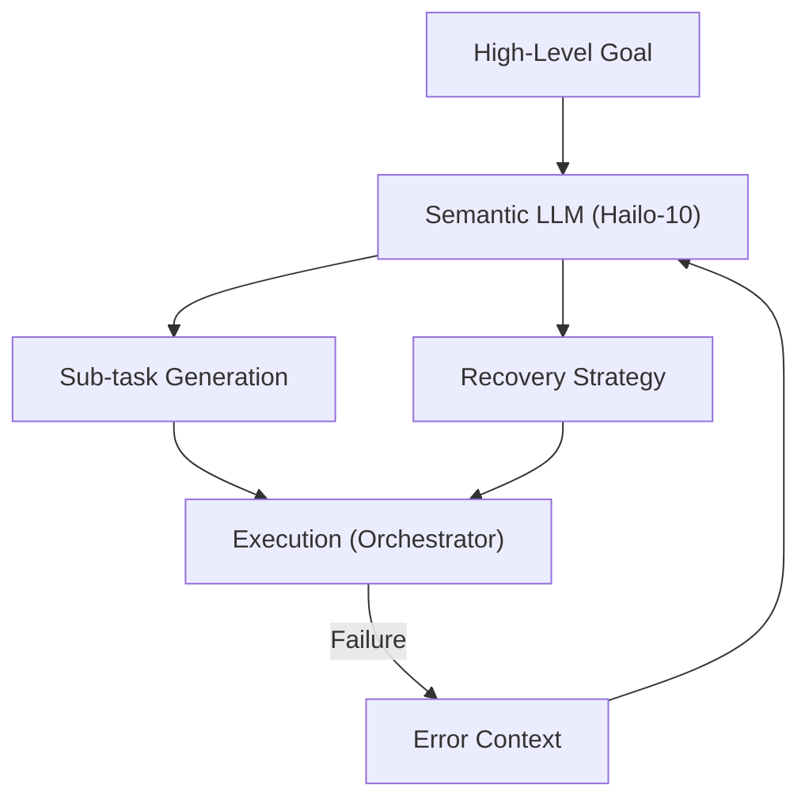

<!-- =============================================================================
HYDRA-UMC-SEMANTIC-PLANNER - Rule-based mission planner and semantic error recovery
Copyright (C) JuanenRac (Electro Hobby 3D) <electrohobby3d@gmail.com>
GPL-3.0-or-later - see LICENSE
============================================================================= -->

<p align="center">
  
</p>

# 🧭 HYDRA-UMC-SEMANTIC-PLANNER

<p align="center"><a href="README.md">🇺🇸 English</a> | <a href="README_spa.md">🇪🇸 Español</a> | <a href="README_fra.md">🇫🇷 Français</a> | <a href="README_ita.md">🇮🇹 Italiano</a> | <a href="README_deu.md">🇩🇪 Deutsch</a> | <a href="README_zho.md">🇨🇳 简体中文</a> | 🇯🇵 <b>日本語</b> | <a href="README_por.md">🇵🇹 Português</a></p>

### 🧠 ルールベースのミッションプランナー & ロジック復旧システム（LLM は計画中）

<p align="center">
  
  
  
  
</p>

---

**正直な現状確認 - 実際に今動くもの:** 閉じたプリミティブ語彙（`primitives.py`）、ルールベースのタスク分解（`decompose.py`）、固定されたMCUエラーコード表に基づくルールベースの意味的エラー回復（`recovery.py`）、不正な形式の計画を通過させるのではなく拒否する事前条件バリデータ（`validation.py`)、そして同じロジックを公開する標準ライブラリの `http.server` によるシンプルなJSON/HTTPインターフェース（`api.py`: `POST /decompose`、`POST /recover`、`GET /stats`）は本物であり、テスト済みです（59件のテスト、`pytest`）。これには、固定シードで数百のランダム/無効な目標に対して `decompose_goal()` を実行し、決してクラッシュせず不正な形式の計画を返さないことを確認するファズテストも含まれます。まだ本物ではないもの: このコードのどこにもローカルLLMは存在しません - `decompose.py` は、小さく固定された目標語彙（組み立て/ピックアンドプレース/検査）に対する正規表現/テンプレートのパターンマッチングであり、言語理解ではありません。また、実際のHailo-10モジュールに対して実行されたことは一度もありません（この環境にはそのモジュールがありません）。下記の「Agentic Workflow」と「Hailo-10 Optimized」の項目は、この同じREADME内で明示的に `(planned)` とマークされています - これらは `decompose_goal()` の現在のルールベースのコアが将来的に置き換えられる先を説明しているのであり、今日すでに存在するものではありません。これまでに実際に出荷されたものの詳細は `CHANGELOG.md` を、残っている未完了事項は下記のROADMAPを参照してください。

**ルールベースプランナーの既知の制限：** 否定・取り消しされた目標（「しない」「決して〜ない」）、複数のテンプレートに該当する目標、対象のない目標、512 文字を超える目標にはプランが作られません。対象は文末ではなく動詞の後ろの語から読み取ります。分解結果は命令ではなく提案です。`POST /decompose` は `executable: false` とフィンガープリント、推定コスト、読みやすい説明を返し、`POST /release`（または `release_for_execution()`）がプランからコストと説明を再計算し、承認のフィンガープリントを確認するまで何も実行できません。承認にはまだ署名がなく、担当者名を示すだけで資格情報ではありません。`FailureContext.attempt` により、`TIMEOUT` と `GRIP_LOST_SEAL` の復旧はそれぞれ自動 1 回・3 回の試行後にオペレーターへエスカレーションされます。

---

> **安全性とセキュリティの現状:** このエコシステムは認証された安全システムではありません。ハードウェアの E-STOP 経路、ファームウェアが強制する制限やインターロック、検証済みの動作コマンドはまだありません。ファームウェアイメージは CRC32 と共有鍵の HMAC-SHA256 で検査しており、非対称署名ではありません。TLS と相互 TLS は任意で、既定では無効です。独自基板はまだ実装も試験もされていません。ここに書かれた内容を人の安全のために頼る前に、[セキュリティベースライン](https://github.com/JuanenRac/HYDRA-UMC-DOCS/blob/main/docs/SECURITY_BASELINE.md)と[脅威モデル](https://github.com/JuanenRac/HYDRA-UMC-DOCS/blob/main/docs/THREAT_MODEL.md)をお読みください。

---

## 📋 ひと目で

| | |
|---|---|
| バージョン | `0.1.4` |
| 成熟度 | 機能する |
| テスト | 88 (`python -m pytest -q tests`) |
| 技術 | Python / local LLM (Llama-3 class) |
| 対象 | HYDRA-UMC セルの Raspberry Pi CM5 |
| 実機での確認 | まだです：このバージョンについて実機での動作記録はありません |

**移動：** [概要](#-概要) · [アーキテクチャ](#-アーキテクチャ) · [クイックスタート](#-クイックスタート) · [テスト](#-テスト) · [リポジトリの構成](#-リポジトリの構成) · [関連プロジェクト](#-関連プロジェクト)

## 🚦 プロジェクトの状況

各行はこのリポジトリの一部分で、信号は今日どこまで進んでいるかを示します。計画ではなく、リポジトリが示せるもの（テスト、ビルド、実行）に基づいて書かれています。

🟢 完了・検証済み · 🟡 動作する（既知の制限あり） · 🟠 一部のみ、または未検証 · 🔴 未実装または動作しない

| 領域 | 状態 | ここでの意味 |
|---|---|---|
| ソフトウェア | 🟡 | 主な目的では動作します。足りない点は上の正直さの確認に書かれています |
| テスト | 🟢 | 自動テスト 88 件。変更のたびに実行されます |
| 実機 | 🔴 | まだです：このバージョンについて実機での動作記録はありません |
| ドキュメント | 🟢 | 8 言語の README。変更のたびにマニフェストと照合されます |

## 🎯 概要

**HYDRA-UMC-SEMANTIC-PLANNER** は、Cognitive AI Node の「ロジック
オーケストレーター」です。ローカル LLM（大規模言語モデル）を使用して、
複雑な目標を実行可能なロボットプリミティブへと分解します。

高レベルの曖昧さを処理し、意味的なエラー復旧を提供します：あるタスクが
失敗した場合（例：「バキュームグリッパーの密封が失われた」）、プランナー
はその原因を推論し、圧力を上げるか、再試行するか、機械式ツールに切り
替えるかを判断します。

### 主な機能：
* 🧩 **タスク分解（v0）：** 既知の小さな目標語彙に対する実際のルールベース分解（例：「PCB を組み立てる」）により、順序立ったロボットコマンドを生成します。*（実際のテンプレートルールとして実装済み——まだ LLM ではありません。下記の「ビルドとリリース」を参照）*
* 🛡️ **意味的復旧（v0）：** 構造化された MCU エラーコードから復旧アクションへの、実際のルールベースの参照。*（既知のコード語彙に対する実際の明示的なテーブルとして実装済み。未知のコードは常に人間にエスカレーションされます）*
* ✅ **前提条件の検証：** 分解された各プランは、渡される前に、各実際のプリミティブが本当に必要とするものに照らしてチェックされます —— 失敗したプランは拒否され、実行可能として黙って次に渡されることはありません。対象のロボット/セルの実際の宣言済み能力カタログ(`validate_plan()`/`POST /decompose` の `capabilities`、任意指定)により、そのロボットが対応を宣言したことのないプリミティブに対する形式的には正しいステップも検出できます。*(実装済み)*
* ✅ **プランに沿ったグリッパーの状態：** プランは記号的なグリッパー（開始時は空）で辿られます。すでに何かを持っているときの GRIP、何も持っていない、または持っているものと別のものの RELEASE は、そのステップのプラン上の誤りとして、何かが動く前に見つかります。プランは対象を持ったまま終わってもかまいません。ステップのパラメータは読み取り専用でハッシュ可能（`Params`）なので、提案後にプランを変更することはできません。*（実装済み）*
* 🌐 **JSON/HTTP API(v0.0.8):** `serve` サブコマンドは `decompose`/`recover` とまったく同じロジックを、stdlib の `http.server`(`POST /decompose`、`POST /recover`、`GET /stats`)経由でCLI以外の呼び出し元にも公開します。デフォルトはループバックのみで、`systemd/hydra-umc-semantic-planner.service` ユニットと同じです。すべての実コマンド・フラグ・終了コードは [`docs/CLI_REFERENCE.md`](docs/CLI_REFERENCE.md) を、公開エラーコード語彙の全体は [`docs/RECOVERY_CONTRACT.md`](docs/RECOVERY_CONTRACT.md) を参照してください。
* 🎲 **決定論的でプロパティテスト済み：** `decompose_goal()` は決定論的であること（同じ目標には常に同じプラン）が証明されており、数百のランダム/無効な目標に対してファジングテストされています —— クラッシュすることはなく、形式不正なプランを返すこともありません。*（実装済み）*
* 🤖 **エージェント型ワークフロー：** システム状態やツールを照会できるローカルエージェントとして動作します。*（計画中）*
* ⚡ **Hailo-10 最適化：** 40 TOPS を活用した高速な多段階推論。*（計画中——実際のローカル LLM が必要です）*
* 👨‍👩‍👧 **認知 AI ノードの子プロジェクト：**
  [HYDRA-UMC-COGNITIVE-NODE](https://github.com/JuanenRac/HYDRA-UMC-COGNITIVE-NODE) の下で 4 つの兄弟サービスの 1 つとして動作します（VLA-Engine、Voice-UI、Docs-QA と並んで）。独自のコピーを保持するのではなく、親プロジェクトの HydraOS イメージとモデルの重みを共有します。

## 🧩 HYDRA-UMC での役割

**HYDRA-UMC-SEMANTIC-PLANNER** は高レベルの目標を、閉じたロボットプリミティブの語彙で作られた計画に変換し、ステップが失敗したときの回復案を提案します。現在はルールベースで言語モデルではなく、計画は名前のある担当者がその計画そのものを承認するまで提案にすぎません。

## 🏛️ アーキテクチャ

<p align="center">
  
</p>

<details>
<summary>図のテキスト版（Mermaid）</summary>



</details>

### アーキテクチャと設計上の決定

本リポジトリは Cognitive AI Node ファミリーの**子プロジェクト**です——
親プロジェクトである [HYDRA-UMC-COGNITIVE-NODE](https://github.com/JuanenRac/HYDRA-UMC-COGNITIVE-NODE) が共有の HydraOS イメージと量子化モデルの重みを保持し、本サービスを他の 3 つの兄弟プロジェクト（VLA-Engine、Voice-UI、Docs-QA）とともに `docker-compose.yml` に接続します：

* **本子プロジェクトに独自のハードウェア/ファームウェア/`os/`/`models/` がない理由。** 親プロジェクトが既に保有する CM5 + Hailo-10 M.2 モジュール上で完全に動作します——モデルの重みと HydraOS イメージを 1 か所に集約することで、ファミリー全体で数 GB にも及ぶモデルの重みが 4 つの食い違ったコピーとして存在することを避けられます。
* **`src/` レイアウトを採用した理由。** インストール可能なパッケージ（`hydra_umc_semantic_planner`）をリポジトリルートのツール（`bump_version.py`）から分離し、エコシステム内の他のすべての Python プロジェクトで使用されているレイアウトと一致させるためです。
* **エントリポイントが当初は身元/バージョン/役割のみを表示していた理由。** 足場（スキャフォールディング）段階では、実際の LLM ベースのプランニング/復旧ロジックを追加する前に、実際のターゲット Python バージョン上で本パッケージが正しくインストール・コンパイルされ、問題なくインポートできることを証明し、その後の作業をパッケージングの懸念から切り離していました。それ以来 `main.py` には本物の `decompose`/`recover`/`serve` サブコマンドが追加されています（下記の BUILD & RUN GUIDE を参照）- 引数なしの `run.sh` が今も身元/バージョン/役割のみを表示するのは意図的なものです（「パッケージが正しくインストールされたか」を確認するための簡単なチェックであり、CLI自体がまだスタブのままであることを示すものではありません）。
* **エコシステムの他の部分との関係。** 本プランナーは、Cognitive AI Node の意思決定の中核です：兄弟プロジェクトである HYDRA-UMC-VOICE-UI から意図を消費し、兄弟プロジェクトである HYDRA-UMC-VLA-ENGINE から動作トークンを消費し、その結果生じたミッションの決定を、物理的な実行のために下流の HYDRA-UMC-ORCHESTRATOR へ送信します。
* **`decompose.py` が実際の正規表現ルールであり、ローカル LLM ではない理由。** 小さな実際の目標語彙（組み立て/ピックアンドプレース/検査）は、今日すでにルールによって完全かつ正直にカバーされています——これは兄弟プロジェクトである HYDRA-UMC-DOCS-QA が埋め込みモデルではなく実際の TF-IDF インデックスを使う理由と同じです：将来 LLM ベースのプランナーが同じ `decompose_goal()` 契約の背後で置き換えられる、実際に機能するテスト可能なカーネルを今持っているということです。
* **`recovery.py` のエラーコードが公開リカバリー契約と一致する理由。** `INVALID_STATE`/`OUT_OF_RANGE`/`ESTOP_ACTIVE`/`TOOL_INCOMPATIBLE`/`TIMEOUT`/`UNSUPPORTED` は、そのアダプターが返すよう設計されている実際の構造化エラーです——今日この実際の語彙に対して構築された復旧ロジックは、アダプター自体が実際に存在するようになった後もそのまま有効であり、後で調整が必要になる並行したエラー分類体系を発明せずに済みます。
* **`ESTOP_ACTIVE`/`UNSUPPORTED`/未知のコードが常に人間にエスカレーションされる理由。** IA、UI、クラウド層が物理的な安全条件を決して上書きしないという、エコシステム全体の安全規則に一致しています——本プランナーは復旧アクションを提案するだけであり、E-STOP を自ら解除することも、認識できないエラーに対して推測することも決してありません。
* **`decompose.py` の実際のテンプレートが実際には無効なプランを一度も生成しないにもかかわらず、`validation.py` が存在する理由。** 固定のテンプレートは、その構造自体によって整形されたパラメータを保証できますが —— 将来の LLM ベースのプランナーはそうはいきません。`validate_plan()` は、そのプランナーが満たす必要のある実際の、明示的な契約であり、今存在する唯一のプランナーに対して今ここで検証することで、より難しいものがそれを満たす必要ができる前に、契約そのものが正しいことを証明します。
* **`decompose_goal()` が `hypothesis` ではなく、固定のランダムシードでファジングテストされている理由。** 本プロジェクトは（エコシステムの他の部分と同様に）標準ライブラリのみに依存しています —— 新たな依存関係を追加せずに、数百の合成目標に対する再現可能でシード付きの `random.Random` ループが、同じ実際の特性（クラッシュしない、形式不正なプランを返さない）を得られます。

## 🚀 クイックスタート

Python 3.10 以上が必要です。

```bash
./build.sh  # Linux, macOS (build.bat on Windows)
./run.sh decompose "assemble the pcb"
./run.sh recover --component gripper --error-code TIMEOUT
./run.sh serve --port 8110
```

## 🧪 テスト

`python -m pytest -q tests` で自動テスト 88 件を実行します。 ハードウェアも、このマシンの外にあるものも必要ありません。

CI は `HYDRA_UMC_CI=1 python tools/ci_validate.py` を実行し、マニフェスト、文書、8 つの README、図を検査します。

## 🏗️ ビルドとリリース

Python >= 3.10 が必要です。

```bash
# Linux / macOS / Git Bash
./build.sh   # .venv を作成し、パッケージを（editable モードで）インストールし、インポートを検証します
./run.sh     # エントリポイントを実行します

# Windows (cmd)
build.bat
run.bat
```

`build.sh`/`build.bat` はバージョンを変更せず（上げるのは `python tools/hydra_project_tool.py bump` だけです）、実際のテストスイートを
実行します（`pytest tests/`）。引数なしの `run.sh` の予期される出力：

```text
HYDRA-UMC-SEMANTIC-PLANNER v0.1.4
Semantic Planner (Hailo-10) - decomposes high-level goals into robotic primitives and recovers from execution failures.
```

実際のサブコマンドは、目標を分解するか、復旧策を提案します：

```bash
./run.sh decompose "assemble the pcb"
./run.sh recover --component gripper --error-code GRIP_LOST_SEAL --detail "vacuum gripper lost seal"

# Windows
run.bat decompose "assemble the pcb"
run.bat recover --component gripper --error-code GRIP_LOST_SEAL --detail "vacuum gripper lost seal"
```

実際の分解された各プランは、表示される前に `validation.py` の実際の前提条件に照らしてチェックされます。`decompose.py` 自身のテンプレートは常に合格しますが、失敗したプランは代わりに拒否されます：

```text
Plan for: "broken" FAILED precondition validation:
  step 1 (GRIP): missing required param 'target'
```

同じ `decompose`/`recover` ロジックは、CLI以外の呼び出し元向けにHTTP経由でも利用できます:

```bash
./run.sh serve --addr 127.0.0.1 --port 8109
# 別のターミナルで:
curl -s -X POST http://127.0.0.1:8109/decompose -d '{"goal": "assemble the pcb"}'
```

実際のコマンド・フラグ・終了コードの完全なリファレンスは [`docs/CLI_REFERENCE.md`](docs/CLI_REFERENCE.md) を、公開リカバリーエラーコード語彙は [`docs/RECOVERY_CONTRACT.md`](docs/RECOVERY_CONTRACT.md) を参照してください。

### 🩺 トラブルシューティング

* **`python: command not found` / ビルドがステップ 1 で失敗する。** `PATH` 上に Python >= 3.10 が必要です。Windows では [python.org](https://python.org) からインストールし、セットアップ中に「Add to PATH」がチェックされていることを確認してください。Linux/macOS では通常 `python3` という名前が使われます。
* **`build.sh` が venv をアクティブ化できない。** `python3 -m venv .venv` は、プラットフォームごとに異なる場所にアクティベートスクリプトを配置します：Linux/macOS では `.venv/bin/activate`、Windows（Git Bash から使用される Windows Python venv でも同様）では `.venv/Scripts/activate`。`build.sh` は既に両方のパスをチェックしています——それでも失敗する場合は、`.venv/` を削除して `./build.sh` を再実行し、ゼロから再構築してください。
* **`pip install -e .` が失敗する。** 通常は `.venv/` が古くなっていることが原因です。`.venv/` フォルダを削除して `./build.sh`/`build.bat` を再実行し、再作成してください。
* **`import OK` が一度も表示されない。** `python -c "import hydra_umc_semantic_planner"` 自体が失敗したことを意味します——venv がアクティブな状態で再実行し、実際のトレースバックを確認してください。

## 📂 リポジトリの構成

<p align="center">
  
</p>

<details>
<summary>ツリーのテキスト版</summary>

```text
HYDRA-UMC-SEMANTIC-PLANNER/
├── src/hydra_umc_semantic_planner/   ソースコード
│   ├── __init__.py                   パッケージの説明とバージョン
│   ├── primitives.py                 実際の、閉じたロボットコマンドプリミティブの語彙
│   ├── decompose.py                  実際の、ルールベースのタスク分解
│   ├── recovery.py                   実際の、ルールベースの意味的エラー復旧
│   ├── validation.py                 分解された Plan に対する実際の前提条件検証
│   ├── api.py                        シンプルなJSON/HTTPサーフェス(stdlibのhttp.server)。decompose/recoverを橋渡し
│   ├── main.py                       エントリポイント + 実際の `decompose`/`recover` サブコマンド
│   └── approval.py                   プランが実行層に到達する前に満たすべき条件
├── tests/                            実際のテスト：分解、復旧、検証、api、プロパティテスト、エンドツーエンド CLI
├── docs/                             ドキュメントとナレッジベース
├── images/                           メディアと図表
├── systemd/                          サービスユニット
├── tools/                            プロジェクトのツールと CI の検査
├── .github/                          CI ワークフローと Issue テンプレート
├── pyproject.toml                    パッケージのメタデータ
├── bump_version.py                   明示的なバージョン更新
├── bump_manifest_version.py          hydra-umc.project.json のバージョンをネイティブ版と同期(--sync)
├── build.sh / build.bat              venv 作成、インストール（dev エクストラ付き）、テスト実行、インポート検証
├── run.sh / run.bat                  エントリポイントを実行（引数を転送、例：`decompose`）
├── CHANGELOG.md                      各バージョンの変更点
├── Dockerfile                        コンテナイメージ
├── build-test.sh                     変更を伴わないビルド確認
├── hydra-umc.project.json            マニフェスト：バージョン、成熟度、ファミリー
└── test.sh                           テストを実行
```

</details>

## 🗺️ ロードマップと既知の制限

**現時点の既知の制限**

* **フェーズ 1：** Hailo-10 上での VLA エンジンのデプロイとマルチモーダル入力処理。
* **フェーズ 2：** 意味プランナーと群行動モデルおよび長期記憶の統合。
* **フェーズ 3：** 音声 UI の低遅延ローカル実行と産業用ノイズキャンセリング。
* **フェーズ 4：** 共有目標分解のためのマルチエージェント協調と意味的復旧の最適化。

## 🌍 言語

この README とリポジトリの文書は、英語・スペイン語・ドイツ語・フランス語・イタリア語・日本語・中国語・ポルトガル語（ポルトガル）の 8 言語で提供されています。8 つのファイルは同時に書かれ、同じ節と同じリンクを持つことを CI が確認します。 このリポジトリには独自の画面もメッセージカタログもないため、翻訳すべきインターフェース文字列はありません。

## 🔗 関連プロジェクト

本プロジェクトは、同じ作者(JuanenRac / Electro Hobby 3D)による HYDRA-UMC ロボティクスエコシステムの一部です。リクエストが実はこの中のどれかについてのものである可能性があるため、知っておく価値があります。

**親プロジェクト**
- **[HYDRA-UMC-COGNITIVE-NODE](https://github.com/JuanenRac/HYDRA-UMC-COGNITIVE-NODE)** — Hailo-10 コグニティブパイプライン(LLM/VLA/音声オーケストレーション)の統合ハブ。本リポジトリは、その自身のコグニティブパイプライン内における特定の段階・消費者として、この親の一部を成す。

**兄弟プロジェクト** —— HYDRA-UMC-COGNITIVE-NODE 自身の Hailo-10 コグニティブパイプラインにおける他の段階・消費者
- **[HYDRA-UMC-VOICE-UI](https://github.com/JuanenRac/HYDRA-UMC-VOICE-UI)** — 確認ゲート付きの限定的な Watch リレーを備えた、実際の音声フロントエンド(VAD + 意図解析)。
- **[HYDRA-UMC-VLA-ENGINE](https://github.com/JuanenRac/HYDRA-UMC-VLA-ENGINE)** — Vision-Language-Action モデル向けの、実際のアクショントークンのエンコード/デコードと軌道生成。
- **[HYDRA-UMC-DOCS-QA](https://github.com/JuanenRac/HYDRA-UMC-DOCS-QA)** — このエコシステム自身の Markdown ドキュメントに対する、標準ライブラリのみの実際の TF-IDF 文書検索。
- **[HYDRA-UMC-LOCAL-TECHNICIAN](https://github.com/JuanenRac/HYDRA-UMC-LOCAL-TECHNICIAN)** — エコシステム自身のための、ローカルでポリシーゲート付きのAIメンテナンス技術者 — 観察、診断し、修正を提案する;最上位の2つのリスクレベルは意図的にまだ実装されていない。

**直接関連**
- **[HYDRA-UMC-ORCHESTRATOR](https://github.com/JuanenRac/HYDRA-UMC-ORCHESTRATOR)** — 実際の gRPC/Protobuf ヘルスレポート契約とミッションステートマシンを持つ統合ハブ。このプランナー自身のミッション判断を受け取る。

**エコシステムの他のプロジェクト**

*コアハードウェア&プラットフォーム*
- **[HYDRA-UMC](https://github.com/JuanenRac/HYDRA-UMC)** — ロボットアームのマザーボードの設計——CM5 ホスト + デュアルコア STM32H745、CAN-OTA/SPI-OTA 経由で最大 8 本のツールアームを統括することを目指す(ファームウェアは初期段階で、実装済みの基板はまだない)。
- **[HYDRA-UMC-OS](https://github.com/JuanenRac/HYDRA-UMC-OS)** — CM5 向けの再現可能な Raspberry Pi OS プロダクト層——読み取り専用エージェント、検証済み設定/プロファイル、WiFi 初回接続プロビジョニング。
- **[HYDRA-UMC-SDK](https://github.com/JuanenRac/HYDRA-UMC-SDK)** — すべてのブリッジが自身のコマンドを検証する共有 JSON-Schema 契約とソフトウェアのジョブゲート境界(認証済みの安全機能ではない)。
- **[HYDRA-UMC-CONNECTOR-HUB](https://github.com/JuanenRac/HYDRA-UMC-CONNECTOR-HUB)** — 外部マシン用コネクタのための宣言的アダプターマニフェストのレジストリとバリデーター。SDK 自身の契約という発想を外部マシンにまで拡張し、産業用ゲートウェイ系のプロジェクトを置き換えることはありません。

*コアバックエンド&クライアント*
- **[HYDRA-UMC-SERVER](https://github.com/JuanenRac/HYDRA-UMC-SERVER)** — すべての制御クライアントが実際に通信する、本物のヘッドレスバックエンド(REST/WebSocket)。
- **[HYDRA-UMC-STUDIO](https://github.com/JuanenRac/HYDRA-UMC-STUDIO)** — リアルタイムのマルチロボット 3D 可視化を備えたウェブ制御ダッシュボード。
- **[HYDRA-UMC-SUITE](https://github.com/JuanenRac/HYDRA-UMC-SUITE)** — 複数のサーバーを同時に扱えるデスクトップ(PySide6)スウォームコマンドセンター、スタンドアロン実行ファイルとしてパッケージ化。
- **[HYDRA-UMC-ANDROID-CONTROL](https://github.com/JuanenRac/HYDRA-UMC-ANDROID-CONTROL)** — 生体認証ログインとペアリングされた Wear OS コンパニオンを備えたネイティブ Android 制御アプリ。
- **[HYDRA-UMC-IOS-CONTROL](https://github.com/JuanenRac/HYDRA-UMC-IOS-CONTROL)** — リアルタイム WebSocket 同期を備えた iOS/iPadOS 制御アプリ(Flutter)。
- **[HYDRA-UMC-DSI](https://github.com/JuanenRac/HYDRA-UMC-DSI)** — 本体搭載の 7 インチ DSI タッチスクリーン向けネイティブタッチ UI、CM5 自体に組み込み。
- **[HYDRA-UMC-EDITOR-URDF](https://github.com/JuanenRac/HYDRA-UMC-EDITOR-URDF)** — 完成したモデルを STUDIO 自身のカタログへ送信するデスクトップ用グラフィカル URDF 作成/編集ツール。
- **[HYDRA-UMC-EDITOR-STL](https://github.com/JuanenRac/HYDRA-UMC-EDITOR-STL)** — HYDRA-UMC-EDITOR-URDF も編集する同じモデルカタログ内で、実在するパーツを変換/置換/削除/追加するデスクトップ STL モデルエディタ。
- **[HYDRA-UMC-BRIDGE-AMR](https://github.com/JuanenRac/HYDRA-UMC-BRIDGE-AMR)** — VDA 5050 MQTT パブリッシャーによる AGV/AMR フリートの調整境界(エミュレートしたフリートに対してのみテスト済み)。
- **[HYDRA-UMC-BRIDGE-CNC](https://github.com/JuanenRac/HYDRA-UMC-BRIDGE-CNC)** — GRBL ステータス/制御バイトへのアクセスを持つ、CNC セルの高レベルコーディネーター(エミュレーターに対してのみテスト済み)。
- **[HYDRA-UMC-BRIDGE-DROIDS](https://github.com/JuanenRac/HYDRA-UMC-BRIDGE-DROIDS)** — Boston Dynamics Spot コマンド送信機能を持つ、脚型/ヒューマノイドドロイドの調整境界(エミュレーターに対してのみテスト済み)。
- **[HYDRA-UMC-BRIDGE-LASER](https://github.com/JuanenRac/HYDRA-UMC-BRIDGE-LASER)** — キー/筐体/インターロックの GPIO 信号 3 系統を読み取るレーザーセルのコーディネーター(模擬チップに対してのみテスト済み。レーザーの武装や発射はできない)。
- **[HYDRA-UMC-BRIDGE-OPENPNP](https://github.com/JuanenRac/HYDRA-UMC-BRIDGE-OPENPNP)** — OpenPnP ピックアンドプレースの基板フローを安全に統括する高レベルコーディネーター。
- **[HYDRA-UMC-BRIDGE-PRINTER3D](https://github.com/JuanenRac/HYDRA-UMC-BRIDGE-PRINTER3D)** — 実際にゲート制御されたジョブコマンドを持つ、Moonraker/Klipper 3D プリンター向けの安全な調整境界。
- **[HYDRA-UMC-BRIDGE-ROS2](https://github.com/JuanenRac/HYDRA-UMC-BRIDGE-ROS2)** — 遅延インポートの rclpy ROS 2 トランスポートを持つコーディネーター(ROS 2 環境ではまだ実行していない)。
- **[HYDRA-UMC-BRIDGE-UAV](https://github.com/JuanenRac/HYDRA-UMC-BRIDGE-UAV)** — MAVLink コマンド送信機能を持つ、カメラ搭載 UAV の調整境界(エミュレーターに対してのみテスト済み)。

*URTC ツールプラットフォーム*
- **[URTC](https://github.com/JuanenRac/URTC)** — 物理的な Universal Robot Tool Controller 基板向けファームウェア、CAN バス経由の 25 以上のツールプロファイル。
- **[URTC-FLASHER](https://github.com/JuanenRac/URTC-FLASHER)** — URTC 基板用のデスクトップ GUI 書き込みツール、CAN-OTA およびフルチップ SWD/JTAG。
- **[URTC-TESTER](https://github.com/JuanenRac/URTC-TESTER)** — URTC 基板向けのデスクトップ CAN バスライブ診断ツール、ツールプロファイルごとに 1 パネル。
- **[URTC-WEB-STUDIO](https://github.com/JuanenRac/URTC-WEB-STUDIO)** — Web Serial API を使ったブラウザベースの URTC-TESTER の代替、ローカルインストール不要。
- **[URTC-GATEWAY](https://github.com/JuanenRac/URTC-GATEWAY)** — URTC の CAN バスの前に置くゲートウェイ：許可する識別子のリスト、レート制限、セッション鍵。コンピューター上でテスト済みで、実際のバスではまだ試していません。

*ビジョン AI ノード(Hailo-8)*
- **[HYDRA-UMC-VISION-NODE](https://github.com/JuanenRac/HYDRA-UMC-VISION-NODE)** — Hailo-8 ビジョンパイプラインの統合ハブ、段階ごとの実際のハードウェア準備状況チェック付き。
- **[HYDRA-UMC-DETECTION-HEF](https://github.com/JuanenRac/HYDRA-UMC-DETECTION-HEF)** — Hailo アーキテクチャ/チェックサムによる安全読み込み検証を備えた、実際のコンパイル済みモデルレジストリ。
- **[HYDRA-UMC-VISION-STREAMER](https://github.com/JuanenRac/HYDRA-UMC-VISION-STREAMER)** — 実際の HailoRT 統合境界を持つ、実際の GStreamer パイプライン + MediaMTX 設定生成器。
- **[HYDRA-UMC-VISUAL-SERVOING-API](https://github.com/JuanenRac/HYDRA-UMC-VISUAL-SERVOING-API)** — ゾーン状態を条件に承認する Position-Based Visual Servoing 補正則。カメラによる姿勢推定はまだない。
- **[HYDRA-UMC-SAFETY-ZONES](https://github.com/JuanenRac/HYDRA-UMC-SAFETY-ZONES)** — ファイルから物体位置を受け取る、ゾーン侵入・キャリブレーション鮮度・E-STOP 要求の v0 ロジック。検出器は接続されておらず、物理 E-STOP もまだ配線されていない。

*オーケストレーション&スウォーム*
- **[HYDRA-UMC-JOB-DISPATCHER](https://github.com/JuanenRac/HYDRA-UMC-JOB-DISPATCHER)** — 実際の HTTP API 上に構築された、優先度ベースの実際のジョブキュー(重複排除付き)。
- **[HYDRA-UMC-NODE-HEALING](https://github.com/JuanenRac/HYDRA-UMC-NODE-HEALING)** — リトライ/バックオフとアイデンティティ不一致検出を備えた、実際の gRPC ベースのフリートヘルスウォッチドッグ。
- **[HYDRA-UMC-PATH-PLANNER-3D](https://github.com/JuanenRac/HYDRA-UMC-PATH-PLANNER-3D)** — 実際の障害物/ワークスペース衝突検証を備えた、実際の RRT ベースの 3D 経路プランナー。
- **[HYDRA-UMC-SWARM-SYNC](https://github.com/JuanenRac/HYDRA-UMC-SWARM-SYNC)** — 複数セルの収束についてプロパティテストされた、実際の CRDT LWW-Element-Map 状態同期。

*デジタルツイン&シミュレーション*
- **[HYDRA-UMC-TWIN](https://github.com/JuanenRac/HYDRA-UMC-TWIN)** — 実際のバージョン互換性同期契約を持つ、デジタルツインエンジンの統合ハブ。
- **[HYDRA-UMC-HIL-BRIDGE](https://github.com/JuanenRac/HYDRA-UMC-HIL-BRIDGE)** — シミュレーションと実機の間にソフトウェアの衝突インターロックを備えたハードウェア・イン・ザ・ループのルーター(実機なしでテスト済み)。
- **[HYDRA-UMC-PHYSICS-REPLICA](https://github.com/JuanenRac/HYDRA-UMC-PHYSICS-REPLICA)** — 実際の URDF サブセットに対する、実際の順運動学と関節限界検証。
- **[HYDRA-UMC-SYNTHETIC-DATA-GEN](https://github.com/JuanenRac/HYDRA-UMC-SYNTHETIC-DATA-GEN)** — YOLO/COCO アノテーションのエクスポート機能を持つ、実際のプロシージャル 2D シーンジェネレーター。

*データ&分析*
- **[HYDRA-UMC-DATALAKE](https://github.com/JuanenRac/HYDRA-UMC-DATALAKE)** — 実際の取り込み/クエリ HTTP API を備えた、実際の sqlite3 ベースの時系列ストア。
- **[HYDRA-UMC-ANOMALY-DETECTOR](https://github.com/JuanenRac/HYDRA-UMC-ANOMALY-DETECTOR)** — ドリフト監視を備えた、実際の FFT + 統計ベースラインによる異常検知器。
- **[HYDRA-UMC-PRODUCTION-REPORTS](https://github.com/JuanenRac/HYDRA-UMC-PRODUCTION-REPORTS)** — DATALAKE の履歴に対する実際の OEE/稼働率計算、再現可能な CSV エクスポート付き。
- **[HYDRA-UMC-TELEMETRY-COLLECTOR](https://github.com/JuanenRac/HYDRA-UMC-TELEMETRY-COLLECTOR)** — シーケンス重複排除機能を備えた、DATALAKE への実際の CAN/WebSocket 取り込みパイプライン。

*産業用ゲートウェイ*
- **[HYDRA-UMC-GATEWAY-INDUSTRIAL](https://github.com/JuanenRac/HYDRA-UMC-GATEWAY-INDUSTRIAL)** — 実際のコマンド許可リスト/バックプレッシャー層を持つ、産業用プロトコルへ中継する統合ハブ。
- **[HYDRA-UMC-OPCUA-SERVER](https://github.com/JuanenRac/HYDRA-UMC-OPCUA-SERVER)** — 実際のバイナリプロトコルクライアントセッションで検証された、実際の OPC-UA アドレス空間。
- **[HYDRA-UMC-MQTT-BROKER](https://github.com/JuanenRac/HYDRA-UMC-MQTT-BROKER)** — クライアント単位のオプション認証とトピック ACL を備えた、実際の MQTT ブローカー。
- **[HYDRA-UMC-MTCONNECT-ADAPTER](https://github.com/JuanenRac/HYDRA-UMC-MTCONNECT-ADAPTER)** — 縮退モード出力を備えた、実際の MTConnect `/probe` および `/current` XML エンドポイント。

*補完ツール&エコシステム運用*
- **[HYDRA-UMC-DASHBOARD-AI](https://github.com/JuanenRac/HYDRA-UMC-DASHBOARD-AI)** — 誠実な統計フォールバックを備えた、DATALAKE/ANOMALY-DETECTOR 上のスマートサマリーと異常ハイライトパネル。
- **[HYDRA-UMC-TOOL-CLI](https://github.com/JuanenRac/HYDRA-UMC-TOOL-CLI)** — 実際の安定した終了コード契約を持つフリート CLI、HYDRA-UMC-SERVER 自身の API の本物のライブクライアント。
- **[HYDRA-UMC-WATCH](https://github.com/JuanenRac/HYDRA-UMC-WATCH)** — 触覚アラートのパターンとペアリング済みスマートフォンへの音声リレーを備えた WearOS コンパニオンアプリ(物理的なウォッチではまだ実行していない)。
- **[URTC-SMART-RACK](https://github.com/JuanenRac/URTC-SMART-RACK)** — 実際の工具 ID デコードと Smart Idle 予熱ロジックを備えた、基板搭載ラック用ファームウェア。
- **[URTC-VISION-TOOL](https://github.com/JuanenRac/URTC-VISION-TOOL)** — サーマル/RGB 検査ツールヘッド向けの、ファームウェアと実際の Python ビジョンコンパニオン。
- **[HYDRA-UMC-UPDATER](https://github.com/JuanenRac/HYDRA-UMC-UPDATER)** — このエコシステム内のすべてのリポジトリを検出・クローン・更新する、管理用デスクトップツール。
- **[HYDRA-UMC-OS-REBUILDER](https://github.com/JuanenRac/HYDRA-UMC-OS-REBUILDER)** — エコシステムの最新バージョンをプリロードした、書き込み可能なCM5イメージを構築するWindows/Linuxデスクトップツール。Raspberry Pi Imager方式の初回起動Wi-Fi/ユーザー/SSH設定を備える。
- **[HYDRA-UMC-OPS-AGENT](https://github.com/JuanenRac/HYDRA-UMC-OPS-AGENT)** — 保守インシデントコーディネーター: 低権限のエッジ役割がサニタイズされたインベントリ/ヘルスのスナップショットを収集し、コントロールプレーン役割がそれを読み取り専用でレンダリングして AI プロバイダーに診断の提案を依頼します - パッチを適用することも、何かをデプロイすることも決してありません。
- **[HYDRA-UMC-DEV-SERVER](https://github.com/JuanenRac/HYDRA-UMC-DEV-SERVER)** — 再現可能な開発ホスト（Raspberry Pi 5 / CM5）。エコシステムのソースコードを保管し、永続キューのもとで境界の明確なビルド/テストタスクを実行する。運用中の CM5 とは明確に異なる、開発専用の役割。

## 📚 ドキュメント

さらに読むには：

* [エコシステムのセキュリティ基準](https://github.com/JuanenRac/HYDRA-UMC-DOCS/blob/main/docs/SECURITY_BASELINE.md)
* [エコシステムの脅威モデル](https://github.com/JuanenRac/HYDRA-UMC-DOCS/blob/main/docs/THREAT_MODEL.md)
* [このリポジトリの変更履歴](CHANGELOG.md)
* [このリポジトリのライセンス](LICENSE.md)

## 🤝 コントリビュートとコミュニティ

* プルリクエストの前に `HYDRA_UMC_CI=1 py -3 tools/ci_validate.py`（または `HYDRA_UMC_CI=1 python3 tools/ci_validate.py`）を実行してください。`CI_VALIDATION=PASS` と表示される必要があります。この確認に `build.sh` や `build.bat` は使わないでください。ビルドは検査ではありません。
* 8 つの README は HYDRA-UMC-DOCS の 1 つのソースから書かれます。手で編集しないでください。ソースを変更し、`tools/make_readmes.py` で書き直します。
* 実行していないことを README に書かないでください。事実であれば「シミュレーションのみ」「実機では未確認」と書きます。
* [CONTRIBUTING.md](CONTRIBUTING.md)、[行動規範](CODE_OF_CONDUCT.md)、[SECURITY.md](SECURITY.md)、[SUPPORT.md](SUPPORT.md) を参照してください。

## 👤 作者

**JuanenRac (Electro Hobby 3D)** · electrohobby3d@gmail.com

## 📜 ライセンス

GPL-3.0-or-later - [LICENSE](LICENSE).
