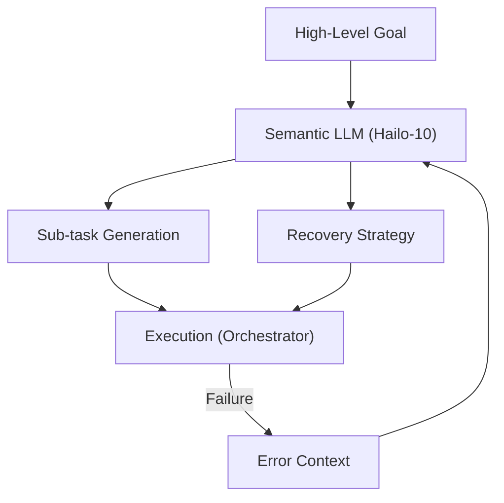

<p align="center">
  
</p>

# 🧩 HYDRA-UMC-SEMANTIC-PLANNER

<p align="center"><a href="README.md">🇺🇸 English</a> | <a href="README_spa.md">🇪🇸 Español</a> | <a href="README_fra.md">🇫🇷 Français</a> | <a href="README_ita.md">🇮🇹 Italiano</a> | <a href="README_deu.md">🇩🇪 Deutsch</a> | <a href="README_zho.md">🇨🇳 简体中文</a> | <a href="README_jpn.md">🇯🇵 日本語</a> | 🇵🇹 <b>Português</b></p>

### 🧠 Planeador de missões baseado em LLM e sistema de recuperação lógica

<p align="center">
  
  
  
</p>

---

**Verificação de honestidade - o que realmente funciona hoje:** o vocabulário fechado de primitivas (`primitives.py`), a decomposição de tarefas baseada em regras (`decompose.py`), a recuperação semântica de erros baseada em regras sobre uma tabela fixa de códigos de erro do MCU (`recovery.py`), o validador de pré-condições que recusa um plano malformado em vez de o passar adiante (`validation.py`) e a superfície JSON/HTTP simples do `http.server` da biblioteca padrão sobre a mesma lógica (`api.py`: `POST /decompose`, `POST /recover`, `GET /stats`) são reais e testados (59 testes, `pytest`), incluindo um teste de fuzzing que executa o `decompose_goal()` contra centenas de objetivos aleatórios/inválidos com uma semente fixa e afirma que nunca falha nem devolve um plano malformado. O que ainda NÃO é real: não há nenhum LLM local em todo este código - o `decompose.py` é correspondência de expressões regulares/modelos sobre um vocabulário pequeno e fixo de objetivos (montar/pick-and-place/inspecionar), não compreensão de linguagem, e nunca foi executado contra um módulo Hailo-10 real (este ambiente não tem nenhum). As funcionalidades "Fluxo de trabalho com agentes" e "Otimizado para Hailo-10" abaixo estão explicitamente marcadas `(planeado)` neste mesmo README - descrevem o substituto eventual do núcleo atual baseado em regras do `decompose_goal()`, não algo que exista hoje. Veja o `CHANGELOG.md` para saber exatamente o que foi entregue até agora e o ROTEIRO abaixo para o que continua em aberto.

---

## 1. 🛠️ VISÃO TÉCNICA GERAL

O **HYDRA-UMC-SEMANTIC-PLANNER** é o "Orquestrador Lógico" do Nó de IA Cognitiva. Usa LLMs (grandes modelos de linguagem) locais para decompor objetivos complexos em primitivas robóticas executáveis.

Trata a ambiguidade de alto nível e fornece recuperação semântica de erros: se uma tarefa falha (por exemplo, "a pinça de vácuo perdeu a vedação"), o planeador raciocina sobre a causa e decide se aumenta a pressão, tenta de novo ou troca por uma ferramenta mecânica.

### Funcionalidades principais:
* 🧩 **Decomposição de tarefas (v0):** decomposição real, baseada em regras, de um vocabulário pequeno e conhecido de objetivos (por exemplo, "montar PCB") em comandos sequenciais para o robô. *(implementado como regras de modelo reais, ainda não um LLM - veja COMPILAR E EXECUTAR abaixo)*
* 🛡️ **Recuperação semântica (v0):** consulta real, baseada em regras, dos códigos de erro estruturados do MCU para uma ação de recuperação. *(implementada como uma tabela real e explícita sobre um vocabulário conhecido de códigos; os códigos desconhecidos escalam sempre para uma pessoa)*
* ✅ **Validação de pré-condições:** cada plano decomposto é verificado contra o que cada primitiva real realmente precisa antes de ser entregue - um plano que falhe é recusado, nunca passado em silêncio como pronto a executar. Um catálogo opcional e real de capacidades declaradas para o robô/célula de destino (`capabilities` em `validate_plan()`/`POST /decompose`) apanha também um passo bem formado para uma primitiva que esse robô nunca declarou suportar. *(implementado)*
* 🌐 **API JSON/HTTP (v0.0.8):** o subcomando `serve` expõe exatamente a mesma lógica de `decompose`/`recover` num `http.server` simples da biblioteca padrão (`POST /decompose`, `POST /recover`, `GET /stats`) para chamadores que não sejam a própria CLI - só em loopback por omissão, de acordo com a unidade `systemd/hydra-umc-semantic-planner.service`. Veja [`docs/CLI_REFERENCE.md`](docs/CLI_REFERENCE.md) para cada comando, opção e código de saída reais, e [`docs/RECOVERY_CONTRACT.md`](docs/RECOVERY_CONTRACT.md) para o vocabulário público completo de códigos de erro.
* 🎲 **Determinístico + testado por propriedades:** o `decompose_goal()` está provado como determinístico (mesmo objetivo, mesmo plano, sempre) e testado por fuzzing contra centenas de objetivos aleatórios/inválidos - nunca falha, nunca devolve um plano malformado. *(implementado)*
* 🤖 **Fluxo de trabalho com agentes:** funciona como um agente local capaz de consultar o estado do sistema e as ferramentas. *(planeado)*
* ⚡ **Otimizado para Hailo-10:** aproveita 40 TOPS para raciocínio rápido em vários passos. *(planeado - precisa do LLM local real)*
* 👨‍👩‍👧 **Filho do Nó de IA Cognitiva:** funciona como um de quatro serviços irmãos
  sob o [HYDRA-UMC-COGNITIVE-NODE](https://github.com/JuanenRac/HYDRA-UMC-COGNITIVE-NODE)
  (a par do VLA-Engine, Voice-UI e Docs-QA), partilhando a imagem HydraOS e os pesos
  de modelos do pai em vez de manter cópias próprias.
* 📦 **Versionamento ao estilo conta-quilómetros:** cada compilação real sobe automaticamente a versão do
  `pyproject.toml` (`bump_version.py`) - sem edições manuais de versão.

---

## 2. 🔄 CICLO DE PLANEAMENTO



---

## 3. 🧱 ARQUITETURA E DECISÕES DE DESENHO

Este repositório é um **filho** da família do Nó de IA Cognitiva - o seu pai,
o [HYDRA-UMC-COGNITIVE-NODE](https://github.com/JuanenRac/HYDRA-UMC-COGNITIVE-NODE),
detém a imagem HydraOS partilhada e os pesos de modelos quantizados, e liga este
serviço no `docker-compose.yml` a par dos seus três irmãos
(VLA-Engine, Voice-UI, Docs-QA):

* **Porque este filho não tem hardware/firmware/`os/`/`models/` próprios.**
  Corre inteiramente no CM5 + módulo M.2 Hailo-10 já pertencentes ao pai -
  manter os pesos dos modelos e a imagem HydraOS centralizados num só sítio evita quatro
  cópias divergentes, de vários gigabytes, em toda a família.
* **Porque uma estrutura `src/`.** Mantém o pacote instalável
  (`hydra_umc_semantic_planner`) separado das ferramentas da raiz do repositório
  (`bump_version.py`), de acordo com a estrutura usada por todos os outros projetos
  Python do ecossistema.
* **Porque o ponto de entrada começou por só imprimir a identidade/versão/papel.**
  A fase de andaimes (scaffolding) provou que o pacote instala, compila
  e importa limpo - na versão de Python de destino - antes de se acrescentar qualquer
  lógica real de planeamento/recuperação baseada em LLM, mantendo esse trabalho posterior
  isolado das questões de empacotamento. Entretanto o `main.py` ganhou
  subcomandos reais `decompose`/`recover`/`serve` (veja COMPILAR E EXECUTAR abaixo) - o
  `run.sh` simples, sem argumentos, continua a imprimir apenas a identidade/versão/papel,
  o que é intencional (uma verificação rápida de "o pacote instalou-se bem"), e não um sinal de que a
  própria CLI continue a ser um esboço.
* **Como isto se encaixa no resto do ecossistema.** Este planeador é o
  núcleo de decisão do Nó de IA Cognitiva: consome a intenção do seu irmão HYDRA-UMC-VOICE-UI
  e os tokens de ação do seu irmão HYDRA-UMC-VLA-ENGINE, e envia as decisões de
  missão resultantes a jusante para o HYDRA-UMC-ORCHESTRATOR para execução física.
* **Porque o `decompose.py` são modelos reais de expressões regulares e não um LLM local.** Um
  vocabulário pequeno e real de objetivos (montar/pick-and-place/inspecionar) é coberto por completo
  e com honestidade por regras hoje - o mesmo raciocínio do irmão HYDRA-UMC-DOCS-QA
  com o seu índice TF-IDF real em vez de um modelo de embeddings:
  um núcleo real e testável agora que um futuro planeador baseado em LLM pode
  substituir por detrás do mesmo contrato `decompose_goal()`.
* **Porque os códigos de erro do `recovery.py` correspondem ao contrato público de recuperação.**
  `INVALID_STATE`/
  `OUT_OF_RANGE`/`ESTOP_ACTIVE`/`TOOL_INCOMPATIBLE`/`TIMEOUT`/
  `UNSUPPORTED` são os erros estruturados reais que esse adaptador foi desenhado para
  devolver - a lógica de recuperação construída hoje contra esse vocabulário real
  continua válida quando o próprio adaptador existir, em vez de inventar uma
  taxonomia de erros paralela que teria de ser reconciliada mais tarde.
* **Porque `ESTOP_ACTIVE`/`UNSUPPORTED`/códigos desconhecidos escalam sempre para uma
  pessoa.** Respeita a regra de segurança de todo o ecossistema de que as camadas de IA, interface e
  nuvem nunca anulam uma condição de segurança física - este planeador
  propõe uma ação de recuperação, nunca limpa um E-STOP nem adivinha um
  erro que não reconhece.
* **Porque o `validation.py` existe mesmo que os modelos reais do `decompose.py` nunca produzam
  na prática um plano inválido.** Um modelo fixo pode garantir parâmetros bem
  formados por construção - um futuro planeador baseado em LLM não pode. O `validate_plan()`
  é o contrato real e explícito que esse planeador teria de satisfazer, verificado aqui
  e agora contra o único planeador que existe hoje, para que o próprio contrato
  fique provado correto antes de algo mais difícil ter de o cumprir. O seu argumento opcional `capabilities`
  é deliberadamente a metade limitada de "este plano é realmente
  executável" que se pode responder *antes* da execução - a verificação real de
  PÓS-condições (a `GRIP` acabou mesmo a segurar o seu alvo) precisa de
  retorno em direto de um executor real (HYDRA-UMC-ORCHESTRATOR) que este
  projeto ainda não tem, pelo que não é tentada aqui.
* **Porque o `decompose_goal()` é testado por fuzzing com uma semente aleatória fixa
  em vez do `hypothesis`.** Este projeto (como o resto do
  ecossistema) fica só com a biblioteca padrão - um ciclo reproduzível, com semente, de `random.Random`
  sobre centenas de objetivos sintéticos obtém a mesma propriedade real
  (nunca falha, nunca devolve um plano malformado) sem uma nova
  dependência.

---

## 📂 ESTRUTURA DE DIRETÓRIOS

```text
HYDRA-UMC-SEMANTIC-PLANNER/
├── src/hydra_umc_semantic_planner/
│   ├── primitives.py                  # Vocabulário fechado e real de primitivas de comandos do robô
│   ├── decompose.py                    # Decomposição real de tarefas baseada em regras
│   ├── recovery.py                      # Recuperação semântica real de erros baseada em regras
│   ├── validation.py                    # Validação real de pré-condições sobre um Plan decomposto
│   ├── api.py                             # Superfície JSON/HTTP simples (http.server da biblioteca padrão) sobre decompose/recover
│   └── main.py                            # Ponto de entrada + subcomandos reais `decompose`/`recover`
├── tests/                            # Testes reais: decomposição, recuperação, validação, api, testes de propriedades, CLI de ponta a ponta
├── docs/                             # Documentação e base de conhecimento
│   ├── CLI_REFERENCE.md               # Contrato público da linha de comandos
│   └── RECOVERY_CONTRACT.md           # Vocabulário público de erros/recuperação
├── images/                           # Multimédia e diagramas
├── systemd/
│   └── hydra-umc-semantic-planner.service # Unidade systemd da API local decompose/recover do CM5
├── tools/
│   ├── build_test.py                 # Verificação de compilação sem subir a versão
│   └── ci_validate.py                # Validação de manifesto/CHANGELOG/documentação usada pelo CI
├── build/                            # Saída da compilação local (ignorada pelo git)
├── pyproject.toml                    # Metadados do pacote (versão subida ao estilo conta-quilómetros em cada compilação real)
├── bump_version.py                   # Subida de versão nativa ao estilo conta-quilómetros (usada pelo build.sh/.bat)
├── bump_manifest_version.py          # Sincroniza a versão do hydra-umc.project.json com a nativa (--sync)
├── build.sh / build.bat              # Cria o venv, instala (com extras de desenvolvimento), executa os testes, verifica a importação
└── run.sh / run.bat                  # Executa o ponto de entrada (reencaminha argumentos, por exemplo `decompose`)
```

> **Nota:** `hardware/` e `firmware/` foram retirados - este nó corre num
> CM5 + módulo M.2 Hailo-10 existentes, sem desenho de hardware/firmware próprio.
> O `os/` e o `models/` foram também retirados - a imagem HydraOS e
> os pesos partilhados de modelos do Hailo-10 vivem no pai
> `HYDRA-UMC-COGNITIVE-NODE`, a que este projeto se liga como
> serviço (veja o seu `docker-compose.yml`).

---

## ⚙️ GUIA DE COMPILAÇÃO E EXECUÇÃO

Requer o Python >= 3.10.

```bash
# Linux / macOS / Git Bash
./build.sh   # cria o .venv, instala o pacote (editável), verifica a importação
./run.sh     # executa o ponto de entrada

# Windows (cmd)
build.bat
run.bat
```

O `build.sh`/`build.bat` sobe a versão (ao estilo conta-quilómetros, veja
`bump_version.py`) antes de cada compilação real e executa a suite de testes real
(`pytest tests/`). Saída esperada de um `run.sh` simples:

```text
HYDRA-UMC-SEMANTIC-PLANNER v0.1.1
Semantic Planner (Hailo-10) - decomposes high-level goals into robotic primitives and recovers from execution failures.
```

Os subcomandos reais decompõem um objetivo ou propõem uma recuperação:

```bash
./run.sh decompose "assemble the pcb"
./run.sh recover --component gripper --error-code GRIP_LOST_SEAL --detail "vacuum gripper lost seal"

# Windows
run.bat decompose "assemble the pcb"
run.bat recover --component gripper --error-code GRIP_LOST_SEAL --detail "vacuum gripper lost seal"
```

Cada plano real decomposto é verificado contra as pré-condições reais do
`validation.py` antes de ser impresso. Os modelos do `decompose.py` passam
sempre; um plano que falhasse seria antes recusado:

```text
Plan for: "broken" FAILED precondition validation:
  step 1 (GRIP): missing required param 'target'
```

A mesma lógica de `decompose`/`recover` está também acessível por HTTP, para
chamadores que não sejam a própria CLI:

```bash
./run.sh serve --addr 127.0.0.1 --port 8109
# noutro terminal:
curl -s -X POST http://127.0.0.1:8109/decompose -d '{"goal": "assemble the pcb"}'
```

Veja o [`docs/CLI_REFERENCE.md`](docs/CLI_REFERENCE.md) para a referência completa de comandos/opções/códigos de saída e o [`docs/RECOVERY_CONTRACT.md`](docs/RECOVERY_CONTRACT.md) para o vocabulário público de códigos de erro de recuperação.

### 🩺 Resolução de problemas

* **`python: command not found` / a compilação falha no passo 1.** Requer o
  Python >= 3.10 no `PATH`. No Windows, instale a partir de
  [python.org](https://python.org) e confirme que "Add to PATH" ficou
  marcado durante a instalação; `python3` é o nome habitual no Linux/macOS.
* **O `build.sh` falha ao ativar o venv.** O `python3 -m venv .venv`
  dispõe o script de ativação de forma diferente por plataforma:
  `.venv/bin/activate` no Linux/macOS, `.venv/Scripts/activate` no
  Windows (também verdade para um venv de Python do Windows usado a partir do Git Bash).
  O `build.sh` já verifica ambos os caminhos - se ainda assim falhar, apague o
  `.venv/` e volte a executar `./build.sh` para o reconstruir de raiz.
* **O `pip install -e .` falha.** Normalmente um `.venv/` obsoleto. Apague a
  pasta `.venv/` e volte a executar `./build.sh`/`build.bat` para a recriar.
* **O `import OK` nunca aparece.** Significa que o próprio `python -c "import
  hydra_umc_semantic_planner"` falhou - volte a executar com o venv
  ativo para ver o traceback real.

---

## 🚀 ROTEIRO
* **Fase 1:** implementação do motor VLA e processamento de entrada multimodal no Hailo-10.
* **Fase 2:** integração do planeador semântico com modelos comportamentais do enxame e memória de longo prazo.
* **Fase 3:** execução local de baixa latência da Voice UI e cancelamento de ruído industrial.
* **Fase 4:** coordenação multiagente para a decomposição partilhada de objetivos e a otimização da recuperação semântica.

---

## 🔗 Projetos relacionados

Este projeto faz parte do ecossistema de robótica HYDRA-UMC do mesmo autor (JuanenRac / Electro Hobby 3D). Vale a pena conhecê-los, porque um pedido pode ser, na verdade, sobre um destes e não sobre este repositório.

**Projeto-mãe**
- **[HYDRA-UMC-COGNITIVE-NODE](https://github.com/JuanenRac/HYDRA-UMC-COGNITIVE-NODE)** — centro de integração do pipeline cognitivo do Hailo-10 (orquestração de LLM/VLA/voz); o pai de que este repositório é uma etapa ou consumidor específico, dentro do seu próprio pipeline cognitivo.

**Projetos irmãos** — as outras etapas/consumidores do próprio pipeline cognitivo Hailo-10 do HYDRA-UMC-COGNITIVE-NODE
- **[HYDRA-UMC-VOICE-UI](https://github.com/JuanenRac/HYDRA-UMC-VOICE-UI)** — front-end de voz real (VAD + analisador de intenções) com um relé para o relógio limitado e protegido por confirmação.
- **[HYDRA-UMC-VLA-ENGINE](https://github.com/JuanenRac/HYDRA-UMC-VLA-ENGINE)** — codificação/descodificação real de tokens de ação e geração de trajetórias para um modelo Visão-Linguagem-Ação.
- **[HYDRA-UMC-DOCS-QA](https://github.com/JuanenRac/HYDRA-UMC-DOCS-QA)** — pesquisa real de documentos TF-IDF só com a biblioteca padrão sobre a documentação Markdown deste ecossistema.
- **[HYDRA-UMC-LOCAL-TECHNICIAN](https://github.com/JuanenRac/HYDRA-UMC-LOCAL-TECHNICIAN)** — técnico de manutenção de IA local, protegido por políticas, para o próprio ecossistema: observa, diagnostica e propõe correções; os dois níveis de maior risco não estão implementados de propósito.

**Diretamente relacionados**
- **[HYDRA-UMC-ORCHESTRATOR](https://github.com/JuanenRac/HYDRA-UMC-ORCHESTRATOR)** — centro de integração com um contrato real de relatório de saúde gRPC/Protobuf e uma máquina de estados de missões; recebe as decisões de missão deste planeador.

**Também fazem parte do ecossistema**

*Hardware e plataforma centrais*
- **[HYDRA-UMC](https://github.com/JuanenRac/HYDRA-UMC)** — a placa-mãe física do braço robótico: anfitrião CM5 + STM32H745 de dois núcleos, que orquestra até 8 braços de ferramenta por CAN-OTA/SPI-OTA.
- **[HYDRA-UMC-OS](https://github.com/JuanenRac/HYDRA-UMC-OS)** — camada de produto reproduzível do Raspberry Pi OS para o CM5: agente só de leitura, configuração/perfis validados, aprovisionamento Wi-Fi de primeiro contacto.
- **[HYDRA-UMC-SDK](https://github.com/JuanenRac/HYDRA-UMC-SDK)** — o contrato JSON-Schema partilhado e a fronteira de portas de segurança contra a qual cada bridge valida os seus comandos.
- **[HYDRA-UMC-CONNECTOR-HUB](https://github.com/JuanenRac/HYDRA-UMC-CONNECTOR-HUB)** — registo declarativo de manifestos de adaptador e validador para conectores de máquinas externas; estende a ideia de contrato do SDK a máquinas externas sem substituir os projetos de gateway industrial.

*Backend central e clientes*
- **[HYDRA-UMC-SERVER](https://github.com/JuanenRac/HYDRA-UMC-SERVER)** — o back-end headless real (REST/WebSocket) com que todos os clientes de controlo realmente comunicam.
- **[HYDRA-UMC-STUDIO](https://github.com/JuanenRac/HYDRA-UMC-STUDIO)** — painel web de controlo com visualização 3D em tempo real de vários robôs.
- **[HYDRA-UMC-SUITE](https://github.com/JuanenRac/HYDRA-UMC-SUITE)** — centro de comando de enxame para desktop (PySide6) para vários servidores ao mesmo tempo, empacotado como executável independente.
- **[HYDRA-UMC-ANDROID-CONTROL](https://github.com/JuanenRac/HYDRA-UMC-ANDROID-CONTROL)** — aplicação Android nativa de controlo, com início de sessão biométrico e um companheiro Wear OS emparelhado.
- **[HYDRA-UMC-IOS-CONTROL](https://github.com/JuanenRac/HYDRA-UMC-IOS-CONTROL)** — aplicação de controlo para iOS/iPadOS (Flutter) com sincronização WebSocket em tempo real.
- **[HYDRA-UMC-DSI](https://github.com/JuanenRac/HYDRA-UMC-DSI)** — interface tátil nativa para o ecrã tátil DSI de 7" integrado, executada no próprio CM5.
- **[HYDRA-UMC-EDITOR-URDF](https://github.com/JuanenRac/HYDRA-UMC-EDITOR-URDF)** — criador/editor gráfico de URDF para desktop que envia os modelos concluídos para o catálogo do STUDIO.
- **[HYDRA-UMC-EDITOR-STL](https://github.com/JuanenRac/HYDRA-UMC-EDITOR-STL)** — editor de modelos STL para desktop que transforma/substitui/remove/adiciona peças reais no mesmo catálogo de modelos que o HYDRA-UMC-EDITOR-URDF também edita.
- **[HYDRA-UMC-BRIDGE-AMR](https://github.com/JuanenRac/HYDRA-UMC-BRIDGE-AMR)** — fronteira de coordenação para frotas AGV/AMR através de um publicador MQTT VDA 5050 real.
- **[HYDRA-UMC-BRIDGE-CNC](https://github.com/JuanenRac/HYDRA-UMC-BRIDGE-CNC)** — coordenador de células CNC de alto nível com acesso real ao estado GRBL e aos bytes de controlo.
- **[HYDRA-UMC-BRIDGE-DROIDS](https://github.com/JuanenRac/HYDRA-UMC-BRIDGE-DROIDS)** — fronteira de coordenação para droides com patas/humanoides, com um emissor real de comandos para o Boston Dynamics Spot.
- **[HYDRA-UMC-BRIDGE-LASER](https://github.com/JuanenRac/HYDRA-UMC-BRIDGE-LASER)** — coordenador de segurança de células laser que lê 3 proteções reais por GPIO (chave, caixa e interlock).
- **[HYDRA-UMC-BRIDGE-OPENPNP](https://github.com/JuanenRac/HYDRA-UMC-BRIDGE-OPENPNP)** — coordenador seguro de fluxo de placa de alto nível para pick-and-place com OpenPnP.
- **[HYDRA-UMC-BRIDGE-PRINTER3D](https://github.com/JuanenRac/HYDRA-UMC-BRIDGE-PRINTER3D)** — fronteira de coordenação segura para impressoras 3D Moonraker/Klipper, com comandos de trabalho reais protegidos por portas.
- **[HYDRA-UMC-BRIDGE-ROS2](https://github.com/JuanenRac/HYDRA-UMC-BRIDGE-ROS2)** — coordenador de segurança com um transporte ROS 2 real baseado em rclpy importado sob demanda.
- **[HYDRA-UMC-BRIDGE-UAV](https://github.com/JuanenRac/HYDRA-UMC-BRIDGE-UAV)** — fronteira de coordenação para UAV com câmara, com um emissor real de comandos MAVLink.

*Plataforma de ferramentas URTC*
- **[URTC](https://github.com/JuanenRac/URTC)** — firmware da placa física Universal Robot Tool Controller, mais de 25 perfis de ferramenta por barramento CAN.
- **[URTC-FLASHER](https://github.com/JuanenRac/URTC-FLASHER)** — ferramenta gráfica de gravação para desktop das placas URTC, por CAN-OTA e também SWD/JTAG de chip completo.
- **[URTC-TESTER](https://github.com/JuanenRac/URTC-TESTER)** — ferramenta de diagnóstico CAN em tempo real para desktop das placas URTC, com um painel por perfil de ferramenta.
- **[URTC-WEB-STUDIO](https://github.com/JuanenRac/URTC-WEB-STUDIO)** — alternativa no navegador ao URTC-TESTER através da Web Serial API, sem instalação local.

*Nó de IA de visão (Hailo-8)*
- **[HYDRA-UMC-VISION-NODE](https://github.com/JuanenRac/HYDRA-UMC-VISION-NODE)** — centro de integração do pipeline de visão Hailo-8, com uma verificação real de prontidão de hardware por fase.
- **[HYDRA-UMC-DETECTION-HEF](https://github.com/JuanenRac/HYDRA-UMC-DETECTION-HEF)** — registo real de modelos compilados com verificação segura de carga por arquitetura Hailo e soma de verificação.
- **[HYDRA-UMC-VISION-STREAMER](https://github.com/JuanenRac/HYDRA-UMC-VISION-STREAMER)** — pipeline GStreamer real e gerador de configuração MediaMTX com uma fronteira de integração HailoRT real.
- **[HYDRA-UMC-VISUAL-SERVOING-API](https://github.com/JuanenRac/HYDRA-UMC-VISUAL-SERVOING-API)** — lei de correção real de servovisão baseada em posição, protegida pelo estado da zona a montante.
- **[HYDRA-UMC-SAFETY-ZONES](https://github.com/JuanenRac/HYDRA-UMC-SAFETY-ZONES)** — verificação real de violação de zonas e pedido de E-STOP, com exigência de calibração recente.

*Orquestração e enxame*
- **[HYDRA-UMC-JOB-DISPATCHER](https://github.com/JuanenRac/HYDRA-UMC-JOB-DISPATCHER)** — fila real de trabalhos por prioridade com deduplicação, sobre uma API HTTP real.
- **[HYDRA-UMC-NODE-HEALING](https://github.com/JuanenRac/HYDRA-UMC-NODE-HEALING)** — vigilante real de saúde da frota por gRPC com repetição/recuo e deteção de identidade incoerente.
- **[HYDRA-UMC-PATH-PLANNER-3D](https://github.com/JuanenRac/HYDRA-UMC-PATH-PLANNER-3D)** — planeador real de trajetórias 3D baseado em RRT com validação real de colisões com obstáculos e espaço de trabalho.
- **[HYDRA-UMC-SWARM-SYNC](https://github.com/JuanenRac/HYDRA-UMC-SWARM-SYNC)** — sincronização real de estado CRDT LWW-Element-Map, testada por propriedades para a convergência de várias células.

*Gémeo digital e simulação*
- **[HYDRA-UMC-TWIN](https://github.com/JuanenRac/HYDRA-UMC-TWIN)** — centro de integração do motor de gémeo digital, com um contrato real de sincronização de compatibilidade de versões.
- **[HYDRA-UMC-HIL-BRIDGE](https://github.com/JuanenRac/HYDRA-UMC-HIL-BRIDGE)** — interlock de segurança real de hardware-in-the-loop que encaminha comandos entre a simulação e o hardware real.
- **[HYDRA-UMC-PHYSICS-REPLICA](https://github.com/JuanenRac/HYDRA-UMC-PHYSICS-REPLICA)** — cinemática direta real e validação de limites de juntas sobre um subconjunto real de URDF.
- **[HYDRA-UMC-SYNTHETIC-DATA-GEN](https://github.com/JuanenRac/HYDRA-UMC-SYNTHETIC-DATA-GEN)** — gerador procedural real de cenas 2D com exportação de anotações YOLO/COCO.

*Dados e análise*
- **[HYDRA-UMC-DATALAKE](https://github.com/JuanenRac/HYDRA-UMC-DATALAKE)** — armazém real de séries temporais sobre sqlite3 com uma API HTTP real de ingestão/consulta.
- **[HYDRA-UMC-ANOMALY-DETECTOR](https://github.com/JuanenRac/HYDRA-UMC-ANOMALY-DETECTOR)** — detetor real de anomalias por FFT e linha de base estatística, com monitorização de deriva.
- **[HYDRA-UMC-PRODUCTION-REPORTS](https://github.com/JuanenRac/HYDRA-UMC-PRODUCTION-REPORTS)** — cálculo real de OEE/disponibilidade sobre o histórico do DATALAKE, com exportação CSV reprodutível.
- **[HYDRA-UMC-TELEMETRY-COLLECTOR](https://github.com/JuanenRac/HYDRA-UMC-TELEMETRY-COLLECTOR)** — pipeline real de ingestão CAN/WebSocket para o DATALAKE, com deduplicação por sequência.

*Gateway industrial*
- **[HYDRA-UMC-GATEWAY-INDUSTRIAL](https://github.com/JuanenRac/HYDRA-UMC-GATEWAY-INDUSTRIAL)** — centro de integração que retransmite para protocolos industriais, com uma camada real de lista de comandos permitidos e contrapressão.
- **[HYDRA-UMC-OPCUA-SERVER](https://github.com/JuanenRac/HYDRA-UMC-OPCUA-SERVER)** — espaço de endereços OPC-UA real, verificado com uma sessão de cliente real do protocolo binário.
- **[HYDRA-UMC-MQTT-BROKER](https://github.com/JuanenRac/HYDRA-UMC-MQTT-BROKER)** — broker MQTT real com autenticação opcional por cliente e ACL de tópicos.
- **[HYDRA-UMC-MTCONNECT-ADAPTER](https://github.com/JuanenRac/HYDRA-UMC-MTCONNECT-ADAPTER)** — endpoints XML MTConnect `/probe` e `/current` reais com saída em modo degradado.

*Ferramentas complementares e operações do ecossistema*
- **[HYDRA-UMC-DASHBOARD-AI](https://github.com/JuanenRac/HYDRA-UMC-DASHBOARD-AI)** — painéis de Resumos Inteligentes e Realce de Anomalias sobre o DATALAKE/ANOMALY-DETECTOR, com um recurso estatístico honesto.
- **[HYDRA-UMC-TOOL-CLI](https://github.com/JuanenRac/HYDRA-UMC-TOOL-CLI)** — CLI da frota com um contrato de códigos de saída real e estável, um cliente vivo genuíno da API do HYDRA-UMC-SERVER.
- **[HYDRA-UMC-WATCH](https://github.com/JuanenRac/HYDRA-UMC-WATCH)** — aplicação companheira WearOS com alertas hápticos reais e um relé de voz para o telemóvel emparelhado.
- **[URTC-SMART-RACK](https://github.com/JuanenRac/URTC-SMART-RACK)** — firmware de um rack de montagem de placas com descodificação real do ID da ferramenta e lógica de pré-aquecimento Smart Idle.
- **[URTC-VISION-TOOL](https://github.com/JuanenRac/URTC-VISION-TOOL)** — firmware mais um companheiro de visão em Python real para uma cabeça de ferramenta de inspeção térmica/RGB.
- **[HYDRA-UMC-UPDATER](https://github.com/JuanenRac/HYDRA-UMC-UPDATER)** — ferramenta administrativa de desktop que descobre, clona e atualiza todos os repositórios deste ecossistema.
- **[HYDRA-UMC-OS-REBUILDER](https://github.com/JuanenRac/HYDRA-UMC-OS-REBUILDER)** — ferramenta de desktop para Windows/Linux que constrói uma imagem do CM5 pronta a gravar com as versões mais recentes do ecossistema, com configuração de primeiro arranque de Wi-Fi/utilizador/SSH ao estilo do Raspberry Pi Imager.
- **[HYDRA-UMC-OPS-AGENT](https://github.com/JuanenRac/HYDRA-UMC-OPS-AGENT)** — coordenador de incidentes de manutenção: um papel de borda de poucos privilégios recolhe um inventário/estado higienizado, um papel de plano de controlo mostra-o só de leitura e pede a um fornecedor de IA que sugira um diagnóstico; nunca aplica um patch nem implanta nada.
- **[HYDRA-UMC-DEV-SERVER](https://github.com/JuanenRac/HYDRA-UMC-DEV-SERVER)** — anfitrião de desenvolvimento reproduzível (Raspberry Pi 5 / CM5) que guarda o código-fonte do ecossistema e executa tarefas limitadas de compilação/teste numa fila durável; um papel de desenvolvimento dedicado, explicitamente não um CM5 operacional.

---

## 📚 Documentação e comunidade

- **[CONTRIBUTING.md](CONTRIBUTING.md)** — pilha tecnológica e diretrizes de código para um pull request.
- **[CODE_OF_CONDUCT.md](CODE_OF_CONDUCT.md)** — as normas de comportamento esperadas nesta comunidade.
- **[SECURITY.md](SECURITY.md)** — como comunicar uma vulnerabilidade e as áreas de segurança em que este projeto se concentra.
- **[SUPPORT.md](SUPPORT.md)** — onde fazer perguntas e comunicar erros.
- **[LICENSE.md](LICENSE.md)** — a licença deste projeto.

## 👤 AUTOR
**JuanenRac** (Electro Hobby 3D)
📧 electrohobby3d@gmail.com
📺 [youtube.com/@electrohobby3d](https://youtube.com/@electrohobby3d)

## 📜 LICENÇA
GPL-3.0 - consulte LICENSE para mais detalhes.

