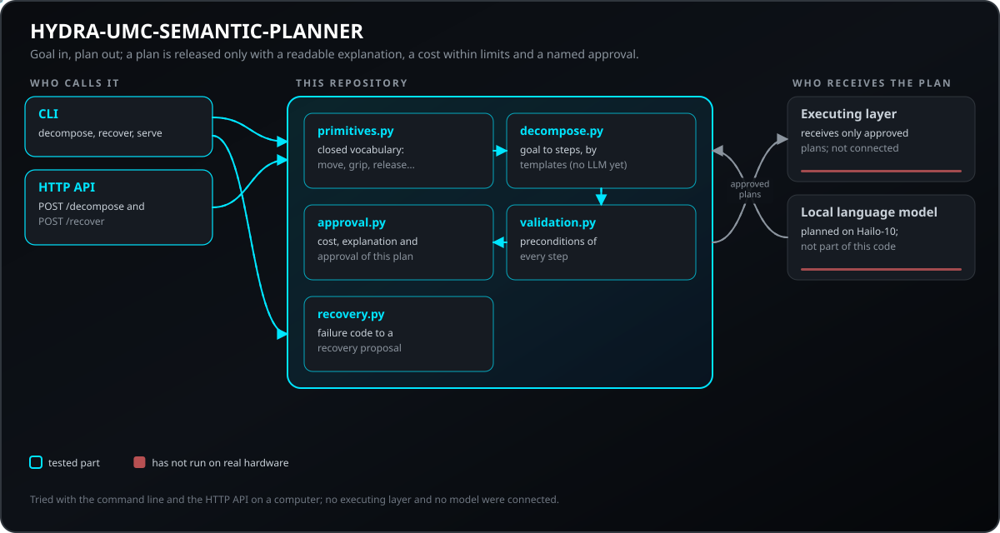
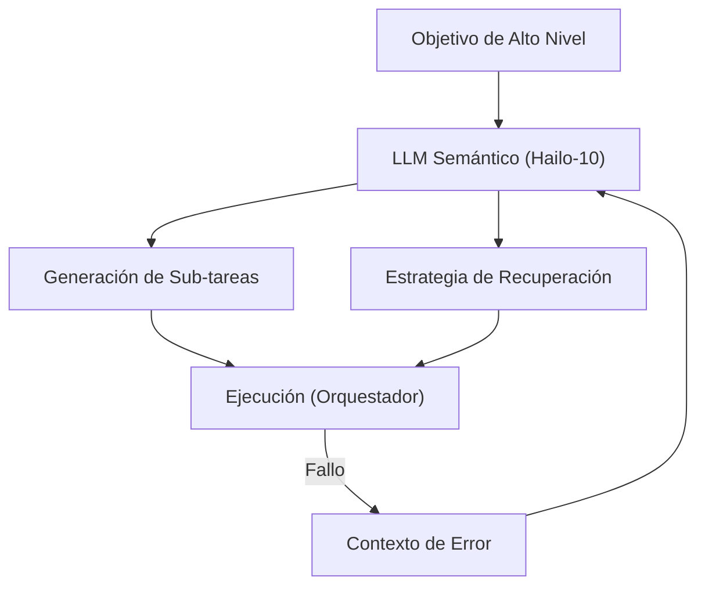
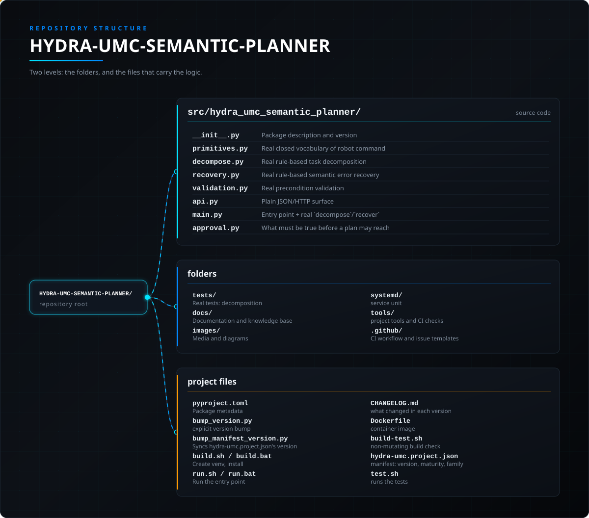

<!-- =============================================================================
HYDRA-UMC-SEMANTIC-PLANNER - Rule-based mission planner and semantic error recovery
Copyright (C) JuanenRac (Electro Hobby 3D) <electrohobby3d@gmail.com>
GPL-3.0-or-later - see LICENSE
============================================================================= -->

<p align="center">
  
</p>

# 🧭 HYDRA-UMC-SEMANTIC-PLANNER

<p align="center"><a href="README.md">🇺🇸 English</a> | 🇪🇸 <b>Español</b> | <a href="README_fra.md">🇫🇷 Français</a> | <a href="README_ita.md">🇮🇹 Italiano</a> | <a href="README_deu.md">🇩🇪 Deutsch</a> | <a href="README_zho.md">🇨🇳 简体中文</a> | <a href="README_jpn.md">🇯🇵 日本語</a> | <a href="README_por.md">🇵🇹 Português</a></p>

### 🧠 Planificador de Misiones Basado en Reglas y Sistema de Recuperación Lógica (LLM previsto)

<p align="center">
  
  
  
  
</p>

---

**Verificación de honestidad - qué funciona de verdad hoy:** el vocabulario cerrado de primitivas (`primitives.py`), la descomposición de tareas basada en reglas (`decompose.py`), la recuperación semántica de errores basada en reglas sobre una tabla fija de códigos de error de MCU (`recovery.py`), el validador de precondiciones que rechaza un plan mal formado en vez de dejarlo pasar (`validation.py`), y la superficie JSON/HTTP con `http.server` de la stdlib sobre esa misma lógica (`api.py`: `POST /decompose`, `POST /recover`, `GET /stats`) son reales y están probados (119 tests, `pytest`), incluyendo un test de fuzzing que ejecuta `decompose_goal()` contra cientos de objetivos aleatorios/inválidos con una semilla fija y comprueba que nunca falla ni devuelve un plan mal formado. Lo que todavía NO es real: no hay ningún LLM local en todo este código - `decompose.py` es coincidencia de patrones/plantillas regex sobre un vocabulario de objetivos pequeño y fijo (ensamblar/pick-and-place/inspeccionar), no comprensión del lenguaje, y nunca se ha ejecutado contra un módulo Hailo-10 real (este entorno no tiene ninguno). Las viñetas "Agentic Workflow" y "Hailo-10 Optimized" más abajo están marcadas explícitamente como `(planned)` en este mismo README - describen el reemplazo eventual del núcleo actual basado en reglas de `decompose_goal()`, no algo que exista hoy. Ver `CHANGELOG.md` para lo que ya se ha entregado exactamente, y la HOJA DE RUTA más abajo para lo que sigue abierto.

**Límites conocidos del planificador por reglas:** un objetivo negado o cancelado («no ...», «nunca ...»), que encaja en más de una plantilla, sin objeto o de más de 512 caracteres no produce plan. El objeto se lee de las palabras que siguen al verbo, no del final de la frase. Una descomposición es una propuesta, no una orden: `POST /decompose` responde `executable: false` con una huella, el coste estimado y una explicación legible, y `POST /release` (o `release_for_execution()`) recalcula el coste y la explicación a partir del plan y comprueba la huella de la aprobación antes de poder ejecutar nada. La aprobación aún no está firmada: nombra a una persona pero no es una credencial. `FailureContext.attempt` hace que las recuperaciones de `TIMEOUT` y `GRIP_LOST_SEAL` escalen a un operador tras 1 y 3 intentos automáticos.

---

> **Estado de seguridad física y de ciberseguridad:** este ecosistema no es un sistema de seguridad certificado. Todavía no existe una ruta de E-STOP por hardware, ni límites ni enclavamientos aplicados por el firmware, ni un comando de movimiento verificado; las imágenes de firmware se comprueban con CRC-32 y una firma Ed25519, y una compilación de versión rechaza las claves de desarrollo publicadas (los cabezales de herramienta y las placas de expansión detrás del relé siguen con cargadores de URTC, que usan un HMAC-SHA256 de clave compartida en lugar de una firma); TLS y TLS mutuo son opcionales y están desactivados por defecto; aún no se ha poblado ni probado ninguna placa propia. Lee la [línea base de seguridad](https://github.com/JuanenRac/HYDRA-UMC-DOCS/blob/main/docs/SECURITY_BASELINE.md) y el [modelo de amenazas](https://github.com/JuanenRac/HYDRA-UMC-DOCS/blob/main/docs/THREAT_MODEL.md) antes de fiarte de cualquier afirmación de aquí para la seguridad de una persona.

---

## 📋 De un vistazo

| | |
|---|---|
| Versión | `0.1.5` |
| Madurez | Funcional |
| Tests | 119 (`python -m pytest -q tests`) |
| Tecnología | Python / local LLM (Llama-3 class) |
| Destino | La Raspberry Pi CM5 de una celda HYDRA-UMC |
| En hardware real | Todavía no: no consta ninguna ejecución en hardware real para esta versión |

**Ir a:** [Resumen](#-resumen) · [Arquitectura](#-arquitectura) · [Seguridad y protección](#-seguridad-y-protección) · [Inicio rápido](#-inicio-rápido) · [Pruebas](#-pruebas) · [Estructura del repositorio](#-estructura-del-repositorio) · [Proyectos relacionados](#-proyectos-relacionados)

## 🚦 Estado del proyecto

Cada línea es una parte de este repositorio y la luz dice hasta dónde llega hoy. Se escribe con lo que el repositorio puede demostrar (pruebas, compilaciones, ejecuciones), no con lo previsto.

🟢 Hecho y verificado · 🟡 Funciona, con límites conocidos · 🟠 Hecho a medias o sin verificar · 🔴 Sin hacer o sin funcionar

| Área | Estado | Qué significa aquí |
|---|---|---|
| Software | 🟡 | Funciona para su propósito principal; la comprobación de honestidad de arriba lista lo que aún falta |
| Pruebas | 🟢 | 119 pruebas automáticas, ejecutadas en cada cambio |
| Hardware real | 🔴 | Todavía no: no consta ninguna ejecución en hardware real para esta versión |
| Documentación | 🟢 | README en ocho idiomas, comprobado contra el manifiesto en cada cambio |

## 🎯 Resumen

**HYDRA-UMC-SEMANTIC-PLANNER** es el "Orquestador de Lógica" del Nodo Cognitive AI. Utiliza LLMs locales (Large Language Models) para descomponer objetivos complejos en primitivas robóticas accionables.

Maneja la ambigüedad de alto nivel y proporciona recuperación semántica de errores: si una tarea falla (ej. "el gripper de vacío perdió el sello"), el planificador razona sobre la causa y decide si aumentar la presión, intentarlo de nuevo o cambiar a una herramienta mecánica.

### Características Clave:
* 🧩 **Descomposición de Tareas (v0):** División real basada en reglas de un pequeño vocabulario de objetivos conocidos (ej. "ensamblar PCB") en comandos secuenciales de robot. *(implementado como reglas de plantilla reales, todavía no un LLM - ver BUILD Y EJECUCIÓN abajo)*
* 🛡️ **Recuperación Semántica (v0):** Búsqueda real basada en reglas desde códigos de error estructurados del MCU a una acción de recuperación. *(implementado como una tabla explícita real sobre un vocabulario de códigos conocido; los códigos desconocidos siempre escalan a un humano)*
* ✅ **Validación de Precondiciones:** Cada plan descompuesto se valida contra lo que cada primitiva real realmente necesita antes de entregarlo - un plan que falla es rechazado, nunca se pasa silenciosamente como listo para ejecutar. Un catálogo opcional y real de capacidades declaradas para el robot/celda objetivo (`capabilities` en `validate_plan()`/`POST /decompose`) también detecta un paso bien formado para una primitiva que ese robot nunca declaró soportar. *(implementado)*
* ✅ **Estado de la pinza a lo largo del plan:** el plan se recorre con una pinza simbólica (vacía al inicio): un GRIP cuando ya sujeta algo, y un RELEASE sin nada sujeto o de algo distinto de lo que se sujeta, son errores del plan en su paso, encontrados antes de que nada se mueva. Un plan puede terminar sujetando su objetivo. Los parámetros de un paso son de solo lectura y con hash (`Params`), así que un plan no puede cambiarse después de proponerlo. *(implementado)*
* 🌐 **API JSON/HTTP (v0.0.8):** el subcomando `serve` expone la misma lógica exacta de `decompose`/`recover` sobre un `http.server` de la stdlib (`POST /decompose`, `POST /recover`, `GET /stats`) para clientes que no son la CLI - solo loopback por defecto, igual que la unidad `systemd/hydra-umc-semantic-planner.service`. Ver [`docs/CLI_REFERENCE.md`](docs/CLI_REFERENCE.md) para cada comando, flag y código de salida real, y [`docs/RECOVERY_CONTRACT.md`](docs/RECOVERY_CONTRACT.md) para el vocabulario público completo de códigos de error.
* 🎲 **Determinista y Testeado por Propiedades:** `decompose_goal()` está probado como determinista (mismo objetivo, mismo plan, siempre) y testeado mediante fuzzing contra cientos de objetivos aleatorios/inválidos - nunca falla, nunca devuelve un plan mal formado. *(implementado)*
* 🤖 **Flujo Agéntico:** Funciona como un agente local capaz de consultar el estado del sistema y herramientas. *(planeado)*
* ⚡ **Optimizado para Hailo-10:** Aprovecha 40 TOPS para un razonamiento multi-paso rápido. *(planeado - necesita el LLM local real)*
* 👨‍👩‍👧 **Hijo del Cognitive AI Node:** Corre como uno de los cuatro
  servicios hermanos bajo [HYDRA-UMC-COGNITIVE-NODE](https://github.com/JuanenRac/HYDRA-UMC-COGNITIVE-NODE)
  (junto a VLA-Engine, Voice-UI y Docs-QA), compartiendo la imagen
  HydraOS y los pesos de modelos de su padre en vez de mantener copias
  propias.
* 📦 **Versionado Cuentakilómetros:** La versión de `pyproject.toml` solo la sube el comando `bump` explícito (`python tools/hydra_project_tool.py bump`, que ejecuta `bump_version.py`) - compilar nunca la cambia.

## 🧩 Papel en HYDRA-UMC

**HYDRA-UMC-SEMANTIC-PLANNER** convierte un objetivo de alto nivel en un plan hecho con un vocabulario cerrado de primitivas del robot y propone una recuperación cuando falla un paso. Hoy se basa en reglas, no en un modelo de lenguaje; un plan es solo una propuesta hasta que una persona con nombre aprueba ese plan exacto.

## 🏛️ Arquitectura

<p align="center">
  
</p>

<details>
<summary>Versión en texto del diagrama (Mermaid)</summary>



</details>

### ARQUITECTURA Y DECISIONES DE DISEÑO

Este repositorio es un **hijo** de la familia Cognitive AI Node - su
padre, [HYDRA-UMC-COGNITIVE-NODE](https://github.com/JuanenRac/HYDRA-UMC-COGNITIVE-NODE),
posee la imagen HydraOS compartida y los pesos de modelos cuantizados, y
conecta este servicio en su `docker-compose.yml` junto a sus tres
hermanos (VLA-Engine, Voice-UI, Docs-QA):

* **Por qué este hijo no tiene hardware/firmware/`os/`/`models/`
  propios.** Corre por completo sobre el módulo CM5 + Hailo-10 M.2 que ya
  posee el padre - centralizar los pesos de modelos y la imagen HydraOS
  en un solo lugar evita cuatro copias divergentes de varios gigabytes
  dentro de la familia.
* **Por qué una estructura `src/`.** Mantiene el paquete instalable
  (`hydra_umc_semantic_planner`) separado del tooling en la raíz del
  repo (`bump_version.py`), igual que el resto de proyectos Python del
  ecosistema.
* **Por qué el punto de entrada empezó imprimiendo solo identidad/versión/rol.**
  La etapa de andamiaje demostró que el paquete se instala, compila e
  importa correctamente - en la versión real de Python objetivo - antes
  de añadir ninguna lógica real de planificación y recuperación basada en
  LLM, manteniendo ese trabajo posterior aislado de los problemas de
  empaquetado. Desde entonces `main.py` ha crecido con subcomandos reales
  `decompose`/`recover`/`serve` (ver Compilación y publicación más abajo) -
  que `run.sh` sin argumentos siga imprimiendo solo identidad/versión/rol
  es intencional (una comprobación rápida de "¿se instaló bien el
  paquete?"), no una señal de que la CLI en sí siga siendo un esqueleto.
* **Cómo encaja en el resto del ecosistema.** Este planificador es el
  núcleo de decisión del Cognitive AI Node: consume la intención de su
  hermano HYDRA-UMC-VOICE-UI y los tokens de acción de su hermano
  HYDRA-UMC-VLA-ENGINE, y envía las decisiones de misión resultantes
  aguas abajo a HYDRA-UMC-ORCHESTRATOR para su ejecución física.
* **Por qué `decompose.py` son reglas regex reales, no un LLM local.**
  Un vocabulario de objetivos pequeño y real (ensamblar/pick-and-place/
  inspeccionar) queda cubierto por completo y de forma honesta con
  reglas hoy - el mismo razonamiento que el índice TF-IDF real del
  hermano HYDRA-UMC-DOCS-QA en vez de un modelo de embeddings: un núcleo
  real y testeable ahora que un futuro planificador basado en LLM puede
  sustituir detrás del mismo contrato `decompose_goal()`.
* **Por qué los códigos de error de `recovery.py` coinciden con el contrato
  público de recuperación.** `INVALID_STATE`/`OUT_OF_RANGE`/`ESTOP_ACTIVE`/
  `TOOL_INCOMPATIBLE`/`TIMEOUT`/`UNSUPPORTED` son los errores
  estructurados reales que ese adaptador está diseñado para devolver -
  una lógica de recuperación construida hoy contra ese vocabulario real
  sigue siendo válida cuando el propio adaptador exista, en vez de
  inventar una taxonomía de errores paralela que habría que reconciliar
  después.
* **Por qué `ESTOP_ACTIVE`/`UNSUPPORTED`/códigos desconocidos siempre
  escalan a un humano.** Coincide con la regla de seguridad de todo el
  ecosistema de que las capas de IA, UI y nube nunca anulan una
  condición de seguridad física - este planificador propone una acción
  de recuperación, nunca despeja un E-STOP ni adivina ante un error que
  no reconoce.
* **Por qué existe `validation.py` aunque las plantillas reales de
  `decompose.py` nunca produzcan realmente un plan inválido.** Una
  plantilla fija puede garantizar parámetros bien formados por
  construcción - un futuro planificador basado en LLM no puede.
  `validate_plan()` es el contrato real y explícito que ese
  planificador tendría que cumplir, comprobado aquí y ahora contra el
  único planificador que existe hoy, de modo que el propio contrato
  quede probado como correcto antes de que algo más difícil tenga que
  cumplirlo.
* **Por qué `decompose_goal()` se testea mediante fuzzing con una
  semilla aleatoria fija en lugar de `hypothesis`.** Este proyecto
  (como el resto del ecosistema) se mantiene solo con la librería
  estándar - un bucle reproducible y con semilla de `random.Random`
  sobre cientos de objetivos sintéticos obtiene la misma propiedad
  real (nunca falla, nunca devuelve un plan mal formado) sin añadir
  una nueva dependencia.

**Un plan como Operation.** `POST /decompose` responde además con `operation`: la propuesta expresada como la Operation común del SDK (`kind` `execute_plan`, `status` `received`, el `target` y la `priority` de la petición, los pasos, el objetivo y la huella en `params`; el mismo plan es el mismo `operation_id`). Es la forma que el orquestador y el despachador de trabajos toman como misión o como trabajo. No libera nada: `executable` sigue en `false` hasta `POST /release`.

## 🔒 Seguridad y protección

Las aprobaciones pueden firmarse (apagado por defecto): `serve --approval-key-file FICHERO --robot-id ROBOT` hace que `POST /release` exija `robot_id`, `issued_at_ms`, `expires_at_ms` y una `signature` HMAC-SHA256 sobre la huella del plan, el aprobador, el robot y una ventana de tiempo de una hora como máximo, de modo que una aprobación sin firma, alterada, caducada o de otro robot no libera nada; `sign-approval` produce los campos. La clave (al menos 16 bytes) vive en un fichero de la instalación, nunca en el repositorio.

## 🚀 Inicio rápido

Requiere Python 3.10 o superior.

```bash
./build.sh  # Linux, macOS (build.bat on Windows)
./run.sh decompose "assemble the pcb"
./run.sh recover --component gripper --error-code TIMEOUT
./run.sh serve --port 8110
```

## 🧪 Pruebas

119 pruebas automáticas se ejecutan con `python -m pytest -q tests`. No necesitan hardware ni nada fuera de esta máquina.

El CI ejecuta `HYDRA_UMC_CI=1 python tools/ci_validate.py`, que comprueba el manifiesto, los documentos, los ocho README y las imágenes.

## 🏗️ Compilación y publicación

Requiere Python >= 3.10.

```bash
# Linux / macOS / Git Bash
./build.sh   # crea .venv, instala el paquete (editable), verifica la importación
./run.sh     # ejecuta el punto de entrada

# Windows (cmd)
build.bat
run.bat
```

`build.sh`/`build.bat` nunca cambian la versión (solo `python tools/hydra_project_tool.py bump` la sube), y corren la suite de tests
real (`pytest tests/`). Salida esperada de un `run.sh` sin argumentos:

```text
HYDRA-UMC-SEMANTIC-PLANNER v0.1.5
Semantic Planner (Hailo-10) - decomposes high-level goals into robotic primitives and recovers from execution failures.
```

Los subcomandos reales descomponen un objetivo o proponen una recuperación:

```bash
./run.sh decompose "assemble the pcb"
./run.sh recover --component gripper --error-code GRIP_LOST_SEAL --detail "vacuum gripper lost seal"

# Windows
run.bat decompose "assemble the pcb"
run.bat recover --component gripper --error-code GRIP_LOST_SEAL --detail "vacuum gripper lost seal"
```

Cada plan real descompuesto se valida contra las precondiciones reales
de `validation.py` antes de imprimirse. Las propias plantillas de
`decompose.py` siempre pasan; un plan que fallara sería rechazado en
su lugar:

```text
Plan for: "broken" FAILED precondition validation:
  step 1 (GRIP): missing required param 'target'
```

La misma lógica de `decompose`/`recover` también es accesible por HTTP, para clientes que no son la CLI:

```bash
./run.sh serve --addr 127.0.0.1 --port 8109
# en otra terminal:
curl -s -X POST http://127.0.0.1:8109/decompose -d '{"goal": "assemble the pcb"}'
```

Ver [`docs/CLI_REFERENCE.md`](docs/CLI_REFERENCE.md) para la referencia completa de comandos, flags y códigos de salida, y [`docs/RECOVERY_CONTRACT.md`](docs/RECOVERY_CONTRACT.md) para el vocabulario público de códigos de error de recuperación.

### 🩺 Solución de problemas

* **`python: comando no encontrado` / el build falla en el paso 1.**
  Requiere Python >= 3.10 en el `PATH`. En Windows, instálalo desde
  [python.org](https://python.org) y marca "Add to PATH" durante la
  instalación; en Linux/macOS suele llamarse `python3`.
* **`build.sh` no consigue activar el venv.** `python3 -m venv .venv`
  coloca el script de activación en una ruta distinta según la
  plataforma: `.venv/bin/activate` en Linux/macOS, `.venv/Scripts/activate`
  en Windows (también con un venv de Python de Windows usado desde Git
  Bash). `build.sh` ya comprueba ambas rutas - si sigue fallando, borra
  `.venv/` y vuelve a ejecutar `./build.sh` para reconstruirlo desde cero.
* **`pip install -e .` falla.** Normalmente por un `.venv/` obsoleto.
  Borra la carpeta `.venv/` y vuelve a ejecutar `./build.sh`/`build.bat`
  para recrearla.
* **`import OK` nunca se imprime.** Significa que `python -c "import
  hydra_umc_semantic_planner"` falló - vuelve a ejecutarlo con el venv
  activo para ver el traceback real.

## 📂 Estructura del repositorio

<p align="center">
  
</p>

<details>
<summary>Versión en texto del árbol</summary>

```text
HYDRA-UMC-SEMANTIC-PLANNER/
├── src/hydra_umc_semantic_planner/   código fuente
│   ├── __init__.py                   Descripción y versión del paquete
│   ├── primitives.py                 Vocabulario cerrado real de primitivas de comando del robot
│   ├── decompose.py                  Descomposición real de tareas basada en reglas
│   ├── recovery.py                   Recuperación semántica real de errores basada en reglas
│   ├── validation.py                 Validación real de precondiciones sobre un Plan descompuesto
│   ├── api.py                        Superficie JSON/HTTP plana (http.server de stdlib) sobre decompose/recover
│   ├── main.py                       Punto de entrada + subcomandos reales `decompose`/`recover`
│   └── approval.py                   Lo que debe cumplirse antes de que un plan llegue a una capa que ejecuta
├── tests/                            Tests reales: descomposición, recuperación, validación, api, tests de propiedades, CLI end-to-end
├── docs/                             Documentación y base de conocimientos
├── images/                           Medios y diagramas
├── configs/                          configuración de la política de recuperación
├── systemd/                          unidad de servicio
├── tools/                            herramientas del proyecto y comprobaciones del CI
├── .github/                          flujo de CI y plantillas de incidencias
├── pyproject.toml                    Metadatos del paquete (versión con incremento cuentakilómetros)
├── bump_version.py                   Incremento de versión tipo cuentakilómetros (solo lo ejecuta el comando `bump` explícito)
├── bump_manifest_version.py          Sincroniza la versión de hydra-umc.project.json con la nativa (--sync)
├── build.sh / build.bat              Crea el venv, instala (con extras de dev), corre tests, verifica la importación
├── run.sh / run.bat                  Ejecuta el punto de entrada (reenvia argumentos, ej. `decompose`)
├── CHANGELOG.md                      qué cambió en cada versión
├── Dockerfile                        imagen de contenedor
├── build-test.sh                     comprobación de compilación sin cambios
├── hydra-umc.project.json            manifiesto: versión, madurez, familia
└── test.sh                           ejecuta las pruebas
```

</details>

## 🗺️ Hoja de ruta y límites conocidos

**Límites conocidos hoy**

* **Fase 1:** Despliegue del motor VLA y procesamiento de entrada multi-modal en Hailo-10.
* **Fase 2:** Integración del planificador semántico con modelos de comportamiento de enjambre y memoria a largo plazo.
* **Fase 3:** Ejecución local de baja latencia de Voice UI y cancelación de ruido industrial.
* **Fase 4:** Coordinación multi-agente para descomposición de objetivos compartidos y optimización de recuperación semántica.

## 🌍 Idiomas

Este README y los documentos del repositorio existen en ocho idiomas: inglés, español, alemán, francés, italiano, japonés, chino y portugués (Portugal). Se escriben a la vez y el CI comprueba que los ocho ficheros tengan las mismas secciones y los mismos enlaces. Este repositorio no tiene pantalla ni catálogo de mensajes propios, así que no hay cadenas de interfaz que traducir.

## 🔗 Proyectos relacionados

Este proyecto es parte del ecosistema de robótica HYDRA-UMC del mismo autor (JuanenRac / Electro Hobby 3D). Vale la pena conocerlo, ya que una petición podría en realidad ser sobre alguno de estos en vez de sobre este repositorio.

**Proyecto Padre**
- **[HYDRA-UMC-COGNITIVE-NODE](https://github.com/JuanenRac/HYDRA-UMC-COGNITIVE-NODE)** — nodo de integración para el pipeline cognitivo Hailo-10 (orquestación de LLM/VLA/voz); el padre del que este repositorio es una etapa o consumidor específico, dentro de su propio pipeline cognitivo.

**Proyectos Hermanos** — las demás etapas/consumidores del propio pipeline cognitivo Hailo-10 de HYDRA-UMC-COGNITIVE-NODE
- **[HYDRA-UMC-VOICE-UI](https://github.com/JuanenRac/HYDRA-UMC-VOICE-UI)** — front-end de voz real (VAD + analizador de intención) con un relé a Watch acotado y con confirmación.
- **[HYDRA-UMC-VLA-ENGINE](https://github.com/JuanenRac/HYDRA-UMC-VLA-ENGINE)** — codificación/decodificación real de tokens de acción y generación de trayectoria para un modelo Vision-Language-Action.
- **[HYDRA-UMC-DOCS-QA](https://github.com/JuanenRac/HYDRA-UMC-DOCS-QA)** — búsqueda real de documentos TF-IDF (solo librería estándar) sobre los propios documentos Markdown de este ecosistema.
- **[HYDRA-UMC-LOCAL-TECHNICIAN](https://github.com/JuanenRac/HYDRA-UMC-LOCAL-TECHNICIAN)** — técnico de mantenimiento con IA local y con puertas de política para el propio ecosistema - observa, diagnostica y propone arreglos; los dos niveles de riesgo más altos están deliberadamente sin implementar todavía.

**Directamente Relacionados**
- **[HYDRA-UMC-ORCHESTRATOR](https://github.com/JuanenRac/HYDRA-UMC-ORCHESTRATOR)** — nodo de integración con un contrato real de informe de salud gRPC/Protobuf y una máquina de estados de misión; recibe las propias decisiones de misión de este planificador.

**También Forma Parte del Ecosistema**

*Hardware y Plataforma Base*
- **[HYDRA-UMC](https://github.com/JuanenRac/HYDRA-UMC)** — el diseño de la placa madre del brazo robótico: host CM5 + coprocesador STM32H745 de doble núcleo, pensado para coordinar hasta 8 brazos herramienta por CAN-OTA/SPI-OTA (firmware en fase temprana; todavía no hay ninguna placa poblada).
- **[HYDRA-UMC-OS](https://github.com/JuanenRac/HYDRA-UMC-OS)** — capa de producto reproducible sobre Raspberry Pi OS para el CM5: agente de solo lectura, config/perfiles validados, aprovisionamiento WiFi de primer contacto.
- **[HYDRA-UMC-SDK](https://github.com/JuanenRac/HYDRA-UMC-SDK)** — el contrato JSON-Schema compartido y la barrera de software de puerta de trabajos contra la que cada bridge valida sus comandos (no es una función de seguridad certificada).
- **[HYDRA-UMC-CONNECTOR-HUB](https://github.com/JuanenRac/HYDRA-UMC-CONNECTOR-HUB)** — registro declarativo y validador de manifiestos de adaptador para conectores de máquinas externas; extiende la propia idea de contrato del SDK a máquinas externas sin sustituir a los proyectos de pasarela industrial.

*Backend Central y Clientes*
- **[HYDRA-UMC-SERVER](https://github.com/JuanenRac/HYDRA-UMC-SERVER)** — el backend headless real (REST/WebSocket) con el que habla de verdad cada cliente de control.
- **[HYDRA-UMC-STUDIO](https://github.com/JuanenRac/HYDRA-UMC-STUDIO)** — panel de control web con visualización 3D multi-robot en tiempo real.
- **[HYDRA-UMC-SUITE](https://github.com/JuanenRac/HYDRA-UMC-SUITE)** — centro de mando de enjambre de escritorio (PySide6) para varios servidores a la vez, empaquetado como ejecutable independiente.
- **[HYDRA-UMC-ANDROID-CONTROL](https://github.com/JuanenRac/HYDRA-UMC-ANDROID-CONTROL)** — app nativa de control para Android con inicio de sesión biométrico y un compañero Wear OS emparejado.
- **[HYDRA-UMC-IOS-CONTROL](https://github.com/JuanenRac/HYDRA-UMC-IOS-CONTROL)** — app de control para iOS/iPadOS (Flutter) con sincronización en tiempo real por WebSocket.
- **[HYDRA-UMC-DSI](https://github.com/JuanenRac/HYDRA-UMC-DSI)** — interfaz táctil nativa para la pantalla táctil DSI de 7" a bordo, embebida en el propio CM5.
- **[HYDRA-UMC-EDITOR-URDF](https://github.com/JuanenRac/HYDRA-UMC-EDITOR-URDF)** — creador/editor gráfico de URDF de escritorio que envía los modelos terminados al propio catálogo de STUDIO.
- **[HYDRA-UMC-EDITOR-STL](https://github.com/JuanenRac/HYDRA-UMC-EDITOR-STL)** — editor de escritorio de modelos STL, que transforma/reemplaza/quita/añade piezas reales en el mismo catálogo de modelos que también edita HYDRA-UMC-EDITOR-URDF.
- **[HYDRA-UMC-BRIDGE-AMR](https://github.com/JuanenRac/HYDRA-UMC-BRIDGE-AMR)** — barrera de coordinación para flotas AGV/AMR mediante un publicador MQTT VDA 5050 (probado solo contra una flota emulada).
- **[HYDRA-UMC-BRIDGE-CNC](https://github.com/JuanenRac/HYDRA-UMC-BRIDGE-CNC)** — coordinador de alto nivel para celdas CNC con acceso a estado/bytes de control GRBL (probado solo contra un emulador).
- **[HYDRA-UMC-BRIDGE-DROIDS](https://github.com/JuanenRac/HYDRA-UMC-BRIDGE-DROIDS)** — barrera de coordinación para droides con patas/humanoides, con un emisor de comandos para Boston Dynamics Spot (probado solo contra un emulador).
- **[HYDRA-UMC-BRIDGE-LASER](https://github.com/JuanenRac/HYDRA-UMC-BRIDGE-LASER)** — coordinador de celdas láser que lee 3 señales GPIO de llave/carcasa/enclavamiento (probado solo contra un chip simulado; no puede armar ni disparar un láser).
- **[HYDRA-UMC-BRIDGE-OPENPNP](https://github.com/JuanenRac/HYDRA-UMC-BRIDGE-OPENPNP)** — coordinador de alto nivel seguro para el flujo de placas de pick-and-place OpenPnP.
- **[HYDRA-UMC-BRIDGE-PRINTER3D](https://github.com/JuanenRac/HYDRA-UMC-BRIDGE-PRINTER3D)** — barrera de coordinación segura para impresoras 3D Moonraker/Klipper, con comandos de trabajo reales y controlados.
- **[HYDRA-UMC-BRIDGE-ROS2](https://github.com/JuanenRac/HYDRA-UMC-BRIDGE-ROS2)** — coordinador con un transporte ROS 2 rclpy importado de forma perezosa (todavía no ejecutado contra una instalación de ROS 2).
- **[HYDRA-UMC-BRIDGE-UAV](https://github.com/JuanenRac/HYDRA-UMC-BRIDGE-UAV)** — barrera de coordinación para UAV equipados con cámara, con un emisor de comandos MAVLink (probado solo contra un emulador).

*Plataforma de Herramientas URTC*
- **[URTC](https://github.com/JuanenRac/URTC)** — firmware para la placa física del Universal Robot Tool Controller, más de 25 perfiles de herramienta por bus CAN.
- **[URTC-FLASHER](https://github.com/JuanenRac/URTC-FLASHER)** — herramienta de escritorio con GUI para flashear placas URTC, CAN-OTA más SWD/JTAG de chip completo.
- **[URTC-TESTER](https://github.com/JuanenRac/URTC-TESTER)** — herramienta de escritorio de diagnóstico CAN-bus en vivo para placas URTC, un panel por perfil de herramienta.
- **[URTC-WEB-STUDIO](https://github.com/JuanenRac/URTC-WEB-STUDIO)** — alternativa basada en navegador a URTC-TESTER mediante la Web Serial API, sin instalación local.
- **[URTC-GATEWAY](https://github.com/JuanenRac/URTC-GATEWAY)** — pasarela delante del bus CAN de URTC: lista de identificadores permitidos, límite de tasa y clave de sesión; software probado en ordenador, aún no en un bus real.

*Nodo IA de Visión (Hailo-8)*
- **[HYDRA-UMC-VISION-NODE](https://github.com/JuanenRac/HYDRA-UMC-VISION-NODE)** — nodo de integración para el pipeline de visión Hailo-8, con una comprobación real de disponibilidad de hardware por etapa.
- **[HYDRA-UMC-DETECTION-HEF](https://github.com/JuanenRac/HYDRA-UMC-DETECTION-HEF)** — registro real de modelos compilados con verificación de carga segura por arquitectura Hailo/checksum.
- **[HYDRA-UMC-VISION-STREAMER](https://github.com/JuanenRac/HYDRA-UMC-VISION-STREAMER)** — generador real de pipeline GStreamer + config MediaMTX, con una frontera de integración HailoRT real.
- **[HYDRA-UMC-VISUAL-SERVOING-API](https://github.com/JuanenRac/HYDRA-UMC-VISUAL-SERVOING-API)** — ley de corrección Position-Based Visual Servoing con autorización condicionada al estado de zona; todavía sin estimación de pose por cámara.
- **[HYDRA-UMC-SAFETY-ZONES](https://github.com/JuanenRac/HYDRA-UMC-SAFETY-ZONES)** — lógica v0 de invasión de zona, vigencia de calibración y solicitud de E-STOP que toma las posiciones de los objetos de un fichero; ningún detector la alimenta y todavía no hay un E-STOP físico conectado.

*Orquestación y Enjambre*
- **[HYDRA-UMC-JOB-DISPATCHER](https://github.com/JuanenRac/HYDRA-UMC-JOB-DISPATCHER)** — cola de trabajos real basada en prioridad con deduplicación, sobre una API HTTP real.
- **[HYDRA-UMC-NODE-HEALING](https://github.com/JuanenRac/HYDRA-UMC-NODE-HEALING)** — watchdog de salud de flota real basado en gRPC, con reintento/backoff y detección de discrepancia de identidad.
- **[HYDRA-UMC-PATH-PLANNER-3D](https://github.com/JuanenRac/HYDRA-UMC-PATH-PLANNER-3D)** — planificador de rutas 3D real basado en RRT, con validación real de colisión de obstáculos/espacio de trabajo.
- **[HYDRA-UMC-SWARM-SYNC](https://github.com/JuanenRac/HYDRA-UMC-SWARM-SYNC)** — sincronización de estado real mediante CRDT LWW-Element-Map, con pruebas de propiedades para convergencia multi-celda.

*Gemelo Digital y Simulación*
- **[HYDRA-UMC-TWIN](https://github.com/JuanenRac/HYDRA-UMC-TWIN)** — nodo de integración para el motor de gemelo digital, con un contrato real de sincronización por compatibilidad de versión.
- **[HYDRA-UMC-HIL-BRIDGE](https://github.com/JuanenRac/HYDRA-UMC-HIL-BRIDGE)** — enrutador hardware-in-the-loop con un enclavamiento de software por colisión entre simulación y hardware real (probado sin hardware real).
- **[HYDRA-UMC-PHYSICS-REPLICA](https://github.com/JuanenRac/HYDRA-UMC-PHYSICS-REPLICA)** — cinemática directa real y validación de límites articulares sobre un subconjunto real de URDF.
- **[HYDRA-UMC-SYNTHETIC-DATA-GEN](https://github.com/JuanenRac/HYDRA-UMC-SYNTHETIC-DATA-GEN)** — generador real de escenas 2D procedurales con exportación de anotaciones YOLO/COCO.

*Datos y Analítica*
- **[HYDRA-UMC-DATALAKE](https://github.com/JuanenRac/HYDRA-UMC-DATALAKE)** — almacén de series temporales real respaldado por sqlite3, con una API HTTP real de ingesta/consulta.
- **[HYDRA-UMC-ANOMALY-DETECTOR](https://github.com/JuanenRac/HYDRA-UMC-ANOMALY-DETECTOR)** — detector de anomalías real basado en FFT + línea base estadística, con monitorización de deriva.
- **[HYDRA-UMC-PRODUCTION-REPORTS](https://github.com/JuanenRac/HYDRA-UMC-PRODUCTION-REPORTS)** — cálculo real de OEE/disponibilidad sobre el histórico de DATALAKE, con exportación CSV reproducible.
- **[HYDRA-UMC-TELEMETRY-COLLECTOR](https://github.com/JuanenRac/HYDRA-UMC-TELEMETRY-COLLECTOR)** — pipeline real de ingesta CAN/WebSocket hacia DATALAKE, con deduplicación por secuencia.

*Pasarela Industrial*
- **[HYDRA-UMC-GATEWAY-INDUSTRIAL](https://github.com/JuanenRac/HYDRA-UMC-GATEWAY-INDUSTRIAL)** — nodo de integración que retransmite a protocolos industriales, con una capa real de lista blanca de comandos/contrapresión.
- **[HYDRA-UMC-OPCUA-SERVER](https://github.com/JuanenRac/HYDRA-UMC-OPCUA-SERVER)** — espacio de direcciones OPC-UA real, verificado con una sesión de cliente real del protocolo binario.
- **[HYDRA-UMC-MQTT-BROKER](https://github.com/JuanenRac/HYDRA-UMC-MQTT-BROKER)** — broker MQTT real con autenticación por cliente opcional y ACL de tópicos.
- **[HYDRA-UMC-MTCONNECT-ADAPTER](https://github.com/JuanenRac/HYDRA-UMC-MTCONNECT-ADAPTER)** — endpoints XML reales `/probe` y `/current` de MTConnect, con salida en modo degradado.

*Herramientas Complementarias y Operaciones del Ecosistema*
- **[HYDRA-UMC-DASHBOARD-AI](https://github.com/JuanenRac/HYDRA-UMC-DASHBOARD-AI)** — paneles de Resúmenes Inteligentes y Resaltado de Anomalías sobre DATALAKE/ANOMALY-DETECTOR, con un respaldo estadístico honesto.
- **[HYDRA-UMC-TOOL-CLI](https://github.com/JuanenRac/HYDRA-UMC-TOOL-CLI)** — CLI de flota con un contrato real y estable de códigos de salida, cliente real y en vivo de la propia API de HYDRA-UMC-SERVER.
- **[HYDRA-UMC-WATCH](https://github.com/JuanenRac/HYDRA-UMC-WATCH)** — app compañera de WearOS con patrones de alerta háptica y un relé de voz al teléfono emparejado (todavía no ejecutada en un reloj físico).
- **[URTC-SMART-RACK](https://github.com/JuanenRac/URTC-SMART-RACK)** — firmware para un rack de montaje de placas con decodificación real de ID de herramienta y lógica de precalentamiento Smart Idle.
- **[URTC-VISION-TOOL](https://github.com/JuanenRac/URTC-VISION-TOOL)** — firmware más un compañero de visión real en Python para un cabezal de inspección térmica/RGB.
- **[HYDRA-UMC-UPDATER](https://github.com/JuanenRac/HYDRA-UMC-UPDATER)** — herramienta administrativa de escritorio que descubre, clona y actualiza cada repositorio de este ecosistema.
- **[HYDRA-UMC-OS-REBUILDER](https://github.com/JuanenRac/HYDRA-UMC-OS-REBUILDER)** — herramienta de escritorio Windows/Linux que construye una imagen de la CM5 lista para grabar, precargada con las versiones más actuales del ecosistema, con configuración de primer arranque de Wi-Fi/usuario/SSH al estilo de Raspberry Pi Imager.
- **[HYDRA-UMC-OPS-AGENT](https://github.com/JuanenRac/HYDRA-UMC-OPS-AGENT)** — coordinador de incidencias de mantenimiento: un rol edge de bajo privilegio recopila un snapshot de inventario/salud saneado, un rol control-plane lo renderiza de solo lectura y pide a un proveedor de IA que sugiera un diagnóstico - nunca aplica un parche ni despliega nada.
- **[HYDRA-UMC-DEV-SERVER](https://github.com/JuanenRac/HYDRA-UMC-DEV-SERVER)** — host de desarrollo reproducible (Raspberry Pi 5 / CM5) que almacena el código del ecosistema y ejecuta tareas acotadas de compilación/pruebas bajo una cola duradera; un rol de desarrollo dedicado, explícitamente distinto de un CM5 operativo.

## 📚 Documentación

Dónde leer más:

* [Base de seguridad del ecosistema](https://github.com/JuanenRac/HYDRA-UMC-DOCS/blob/main/docs/SECURITY_BASELINE.md)
* [Modelo de amenazas del ecosistema](https://github.com/JuanenRac/HYDRA-UMC-DOCS/blob/main/docs/THREAT_MODEL.md)
* [Historial de cambios de este repositorio](CHANGELOG.md)
* [Licencia de este repositorio](LICENSE.md)

## 🤝 Contribuir y comunidad

* Antes de un pull request ejecuta `HYDRA_UMC_CI=1 py -3 tools/ci_validate.py` (o `HYDRA_UMC_CI=1 python3 tools/ci_validate.py`): debe imprimir `CI_VALIDATION=PASS`. No ejecutes `build.sh` ni `build.bat` para esta comprobación; compilar no es comprobar.
* Los ocho README se escriben desde una sola fuente en HYDRA-UMC-DOCS; no los edites a mano. Cambia la fuente y vuelve a escribirlos con `tools/make_readmes.py`.
* No afirmes en un README lo que no se ha ejecutado: di «simulado» o «sin probar en hardware» cuando esa sea la verdad.
* Mira [CONTRIBUTING.md](CONTRIBUTING.md), el [código de conducta](CODE_OF_CONDUCT.md), [SECURITY.md](SECURITY.md) y [SUPPORT.md](SUPPORT.md).

## 👤 AUTOR

**JuanenRac (Electro Hobby 3D)** · electrohobby3d@gmail.com

## 📜 LICENCIA

GPL-3.0-or-later - [LICENSE](LICENSE).
